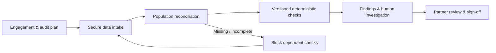

# Audit Intelligence System
### A Financial Audit Use Case & Solution Architecture Study

> **It imported successfully. But was the audit ready?**

An audit team receives financial records from a client. The files are valid, the import succeeds, and the checks find no major exceptions. Yet the source system lists **100,000 entries**, while the uploaded dataset contains only **98,600**. **What happened to the other 1,400?** This illustrative scenario is the starting point for **Audit Intelligence System**—a system-design case study exploring how financial audit teams could validate source completeness, identify review-worthy exceptions, document professional judgment, and preserve an accountable trail of evidence before an engagement is approved.

## The problem behind the use case

A technically successful upload does **not** establish that a financial dataset is complete. Similarly, **zero findings** does not prove that all relevant checks ran or that an auditor has sufficient evidence. The design asks how software can make these gaps visible without replacing the auditor's professional judgment.

## Proposed solution — from source to decision



The architecture is a **modular backend with asynchronous workers**, PostgreSQL for transactional state and evidence references, object storage for versioned source files, and a **transactional outbox** for dependable event delivery. The core design separates data parsing from population reconciliation, and rule outputs from human conclusions. Sign-off is **revision-aware and fail-closed**: stale results, missing evidence, and unresolved required work cannot silently pass as complete.

## Read the case study as a story

Instead of independent feature descriptions, the documentation follows one illustrative audit engagement across a working week:

| Chapter | The question it explores |
| --- | --- |
| [Monday — An Engagement Begins](docs/story/01-the-engagement.md) | Who owns the work, and what must be audited? |
| [Tuesday — The Missing Records](docs/story/02-the-missing-records.md) | How do we know the imported population is complete? |
| [Wednesday — A Finding Is a Question](docs/story/03-findings-not-verdicts.md) | How do we produce repeatable checks without automatic verdicts? |
| [Thursday — The Review Gate](docs/story/04-the-review-gate.md) | What should block an incomplete or stale sign-off? |
| [Friday — Proving What Happened](docs/story/05-trust-and-evidence.md) | Can every decision and source version be reconstructed? |
| [Design Reveal](docs/story/06-from-story-to-system.md) | How do those requirements shape the solution architecture? |

For the engineering details, see the [solution architecture](docs/architecture/solution-architecture.md), [domain model](docs/architecture/domain-model-v2.md), [sign-off contract](docs/architecture/signoff-contract.md), [architecture decisions](docs/architecture/decision-records.md), and [requirements traceability matrix](docs/reference/requirements-traceability.md).

## Project scope and current status

**This is a proposed use case and architecture study—not a deployed financial-audit product.** India is the first illustrative jurisdiction; additional jurisdictions would require independently reviewed rules and local requirements. ISO/IEC 27001 and SOC 2 inform future platform-security objectives; PCI DSS applicability depends on actual payment-card data flows. No certification, audit opinion, verified legal compliance, or production capability is claimed.

## I'd value your review

I'm sharing this work to strengthen my **business analysis, system design, and solution architecture** skills. Feedback from auditors, architects, security engineers, and other practitioners is welcome—especially on:

- **Business assumptions:** What part of the audit workflow or evidence requirements have I missed?
- **Architecture trade-offs:** Would you change the data model, service boundaries, or reliability strategy?
- **Failure scenarios:** What security, completeness, concurrency, or sign-off risks should be tested next?

If you see a weak assumption or a simpler design, please [open a GitHub issue](https://github.com/alokrathava/Audit-Intelligence-System-Usecase/issues) or start a discussion about the specific decision.

## View the documentation locally

```bash
npm ci
npm run build
npm run start
```

**Created by Alok Rathava — an independent learning and system-design exercise.**
