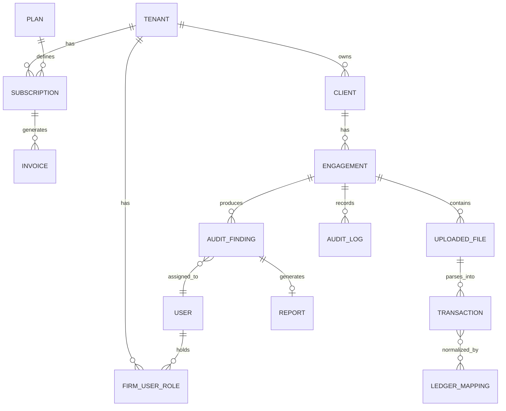

# Shared Data Model

## Global vs tenant-scoped entities

Two schemas exist per database cluster: one **global** schema shared by every tenant, and one
**tenant schema per firm**, created at provisioning time.

| Scope | Entities |
|---|---|
| Global | `tenant`, `plan`, `subscription`, `invoice`, `payment_method`, `user` (identity only), `api_key` |
| Per-tenant schema | `engagement`, `client`, `transaction`, `ledger_mapping`, `audit_finding`, `report`, `firm_user_role`, `audit_log` |

A user's login identity is global (one email, one password, one MFA enrollment); their
role/membership is tenant-scoped, since the same person can belong to multiple firms (e.g. a
contractor auditor working across firms) — see
[Auth & Identity](../modules/01-auth-identity) and [Multi-Tenancy](../modules/02-multi-tenancy).

## Entity relationship diagram

## Core entity reference

| Entity | Key fields | Notes |
|---|---|---|
| `tenant` | `id`, `firm_name`, `schema_name`, `status`, `created_at` | `status`: provisioning, active, suspended, offboarding |
| `user` | `id`, `email`, `password_hash`, `mfa_enabled`, `status` | Global identity, see [Auth](../modules/01-auth-identity) |
| `firm_user_role` | `tenant_id`, `user_id`, `role` | Composite key; a user row can exist under many tenants |
| `plan` | `id`, `name`, `seat_limit`, `engagement_limit`, `monthly_price` | See [Billing](../modules/03-subscriptions-billing) |
| `subscription` | `id`, `tenant_id`, `plan_id`, `status`, `current_period_end` | |
| `client` | `id`, `tenant_id`, `name`, `pan`, `industry` | |
| `engagement` | `id`, `client_id`, `financial_year`, `status`, `partner_id` | See [Engagements](../modules/04-engagements) |
| `uploaded_file` | `id`, `engagement_id`, `file_type`, `storage_path`, `status` | See [Ingestion](../modules/05-document-ingestion) |
| `transaction` | `id`, `engagement_id`, `voucher_id`, `ledger_name`, `standard_category`, `debit_amount`, `credit_amount`, `transaction_date` | Central fact table |
| `ledger_mapping` | `id`, `tenant_id`, `raw_name`, `standard_category`, `match_method` | See [Normalization](../modules/06-ledger-normalization) |
| `audit_finding` | `id`, `engagement_id`, `rule_id`, `severity`, `status`, `assignee_id`, `report_path` | See [Findings](../modules/08-findings-workflow) |
| `report` | `id`, `finding_id`, `file_path`, `generated_at` | |
| `audit_log` | `id`, `tenant_id`, `actor_id`, `action`, `entity_type`, `entity_id`, `occurred_at` | Append-only, see [Audit Trail](../modules/12-audit-trail-compliance) |

## Tenant isolation model

Every tenant-scoped query executes against `SET search_path = tenant_<schema_name>` resolved from
the authenticated request's `X-Tenant-ID`. No tenant-scoped table carries a `tenant_id` column as
its *only* isolation boundary — schema separation means a missing `WHERE tenant_id = ?` clause
fails closed (wrong schema has no matching table), not open. Full detail in
[Multi-Tenancy → DFD Level 3](../modules/02-multi-tenancy#dfd-level-3--request--tenant-resolution).
