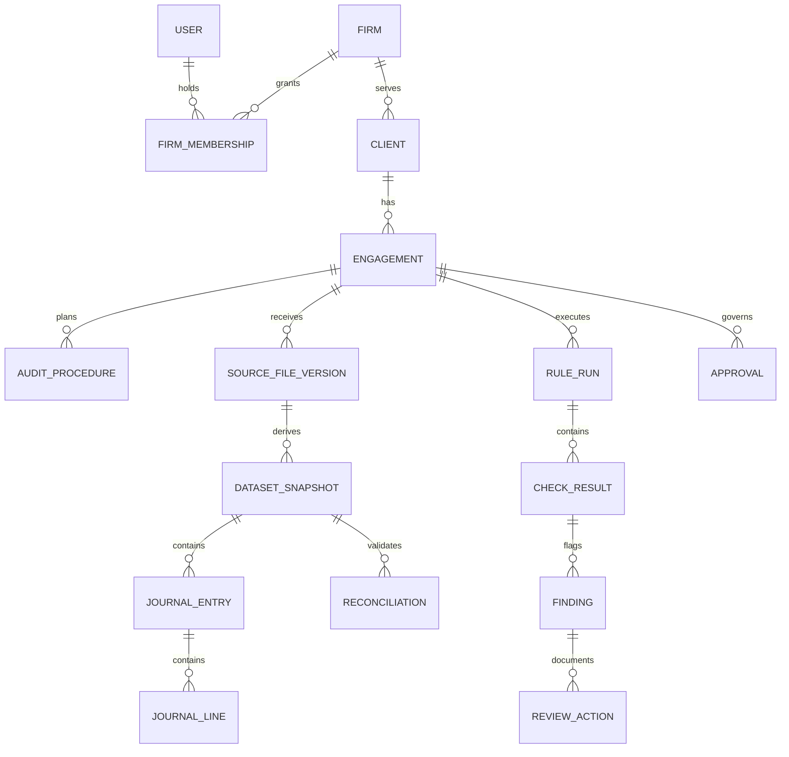

# Shared Data Model

This is the **selected conceptual model**. The detailed [domain model](./domain-model-v2.md) and [sign-off contract](./signoff-contract.md) define invariants; no physical SQL schema has been implemented.

## Global vs tenant-scoped entities

| Scope | Entities | Security model |
| --- | --- | --- |
| **Global control plane** | `user`, `firm`, `firm_membership`, `session`, proposed `plan`/`subscription` | Server-verified identity and membership |
| **Firm-private shared PostgreSQL tables** | `client`, `engagement`, `source_file_version`, `dataset_snapshot`, `journal_entry`, `journal_line`, `finding`, `workpaper`, `audit_event` | Explicit `firm_id`, application assignment checks **plus RLS** |
| **Versioned object storage** | Original uploads, reviewer evidence, generated reports and exports | Owner firm/engagement, versioned keys, hashes, short-lived authorized access |

The previous **schema-per-tenant** model is now a documented *alternative*, not the chosen pilot approach. See [ADR-004](./alternatives-and-tradeoffs.md).

## Entity relationship diagram

## Core entity reference

| Entity | Important fields |
| --- | --- |
| `engagement` | `id, firm_id, client_id, period_start, period_end, jurisdiction, framework, revision, status` |
| `source_file_version` | `id, firm_id, engagement_id, source_system, content_hash, object_version, supersedes_id` |
| `dataset_snapshot` | `id, firm_id, source_version_ids, parser_version, scope, accepted_count, rejected_count, reconciliation_status` |
| `journal_entry/line` | `entry_id, account_id, date, debit, credit, currency, source_ref` |
| `reconciliation` | `dataset_id, expected_totals, actual_totals, reviewer_id, decision, evidence_ids` |
| `rule_run/check_result` | `snapshot_id, pack_version, config_version, coverage_status, diagnostic, candidate_refs` |
| `finding/review_action` | `rule_result_id, original_severity, disposition, actor_id, evidence_ids` |
| `approval` | `engagement_revision, approver_id, evidence_manifest_id, decision, occurred_at` |
| `audit_event/outbox_event` | `event_id, firm_id, aggregate_ref, revision, actor_id, payload_ref, committed_at` |

## Tenant isolation model

For the **hypothetical pilot**, use shared PostgreSQL tables with firm keys, RLS policies, application engagement-membership checks and a per-transaction server-verified tenant context. Do not rely solely on RLS, on `X-Tenant-ID` headers, or on guess-resistant resource IDs. The application role must not bypass RLS, and policies must be tested against cross-tenant joins and background jobs.

The design is not a certification or proof that the controls operate. See [Security Design](./assurance-design.md) and [Isolation Trade-offs](./alternatives-and-tradeoffs.md).
