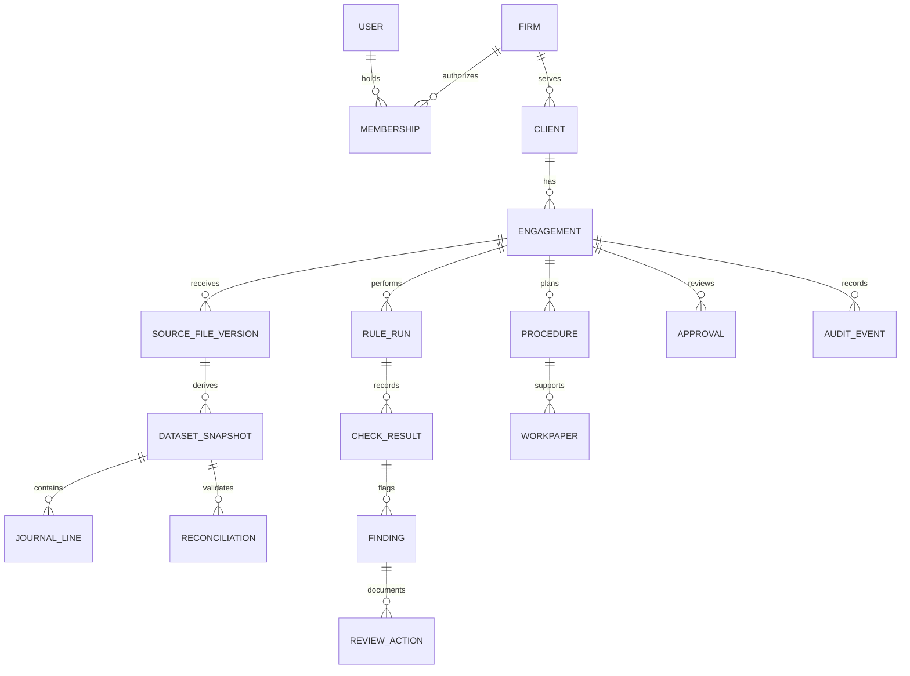

# Canonical Domain Model

> **V2 domain proposal.** Existing module tables in [Legacy Shared Data Model](./data-model.md) are illustrative and must be reconciled against this model before implementation.

## The key distinction

A voucher **line**, a general-ledger balance, a supplier **invoice**, and a tax-statement record may share dates and amounts, but they are **not the same entity**. Keeping them distinct avoids misleading reconciliation logic.

## Required entities and ownership

| Entity / aggregate | Primary fields or relationships | Owner |
| --- | --- | --- |
| `firm`, `user`, `membership` | Global user identity; firm ID, roles, membership status | Identity/tenancy |
| `client` | Firm ID, legal-entity name, jurisdictional identifiers | Engagement |
| `engagement` | Firm/client IDs, engagement type, period start/end, framework, jurisdiction, revision, status | Engagement |
| `procedure` / `risk_assessment` | Objective, assertion/risk, required source, preparer, reviewer, completion state | Planning |
| `source_file_version` | Firm/engagement, source system, hash, uploader, immutable object key, supersedes | Ingestion |
| `dataset_snapshot` | Source-version references, scope, parser version, counts and checksum | Ingestion |
| `journal_entry` and `journal_line` | Voucher ID, posting date, account, party (if known), debit/credit, source-row link | Accounting adapter |
| `account`, `trial_balance` | Raw name, taxonomy, balance period, currency and source scope | Normalization |
| `supplier_invoice`, `tax_statement_record` | Source IDs, invoice reference, counterparty, amount, taxes, amendments | Jurisdiction adapters |
| `reconciliation` | Control source, expected/actual counts and totals, reviewer, exceptions, status | Reconciliation |
| `jurisdiction_pack` | Jurisdiction, approved version, effective window, rules, hash | Governance |
| `rule_run`, `check_result` | Snapshot, pack/config/code version, applicability, coverage status, diagnostics | Rule execution |
| `finding` / `workpaper` | Original severity, source refs, investigation state, notes, supporting evidence | Checks/workpapers |
| `approval` / `audit_event` | Actor, revision, approval scope, immutable sequence and reason | Review/evidence |
| `outbox_event` | Event ID, aggregate ID, type/version, payload ref, commit timestamp, delivery state | Platform |

**Foreign-key and isolation rule:** every firm-private record must be associated unambiguously with a firm and engagement or with a trusted internal join. Test object access using both authenticated firm membership and engagement assignment.

## Precision and provenance

- Monetary amounts use **decimal fixed precision**, original currency and explicit rounding/conversion records; never binary floating point for statutory thresholds.
- Store full original row/voucher IDs and source hash; don't invent missing dates, parties, agreements or legal classifications.
- Track source dataset coverage separately from parser correctness.
- Client legal entities and reporting frameworks may span jurisdictions; don't infer applicability from the firm's billing country.
- Treat `finding` as a review candidate and `workpaper/procedure` as the auditor's documented work; do not infer audit completeness from finding counts.
- The snapshot and rule output are immutable; human dispositions are versioned and attributable.

## Required invariants

1. A rule cannot claim `COMPLETED` without its declared input prerequisites and applicability decision.
2. A source can be `PARSED` yet `INCOMPLETE` for the intended audit population.
3. Reuploads create a new source version and invalidate dependent assessments; the old evidence remains accessible.
4. A finding can recur after a rerun; older notes are preserved without silently approving the new result.
5. Sign-off refers to an immutable current engagement revision and required procedure coverage.
6. Audit events and outbox events are committed transactionally with each domain mutation.

The earlier `transaction` table remains a **candidate staging representation**, not a universal authoritative financial-record type.

See [Source Story](../story/02-the-missing-records.md), [System Architecture](./solution-architecture.md), and [Review Contract](./signoff-contract.md).
