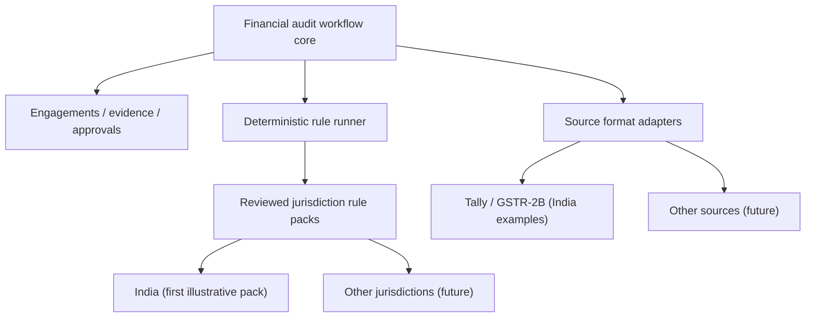

# Jurisdiction & Rule-Pack Design

> **Proposed architecture**, not working functionality.

## Scope decision

Keep the product focused on **financial and statutory audit workflows**, not a universal audit engine for every industry. Shared services manage engagements, upload/evidence lineage, deterministic processing, findings, reviewer approvals and exports. **Country-specific regulations are plug-in-style, versioned and professionally validated.**

India is the first **illustrative pack**. There are **no implemented or approved packs** for other countries.

## Shared platform vs country adapter

| Common platform | Pack-specific assumptions |
| --- | --- |
| Tenant access controls, engagement lifecycle, sign-off | Governing country and optional state/province |
| Source snapshots, immutable references and review history | Applicable law/standard, exemptions and materiality |
| Normalization and traceable computations | Tax identifiers, file formats and local taxonomy maps |
| Deterministic rule-run API and reproducible outputs | Reviewed rules with legal effective dates and version |
| Currency-safe numeric representation and explicit conversions | Reporting calendar, local currency and time zone |
| Retention/legal-hold engine and audit export | Verified retention and residency rules per engagement |

## Proposed pack record

`jurisdiction_code`, `pack_id`, `version`, `effective_from`, `effective_to`, `source_references`, `reviewer`, `approval_status`, `content_hash`, `required_source_types`, `supported_calendars`, `currency_policy`, `retention_policy_ref`.

A rule run must pin the jurisdiction, **approved** pack/version, effective law window, input snapshot, taxonomy/configuration versions, and reviewer authorization.

## Block unsafe assumptions

- **No approved applicable pack:** allow a manual evidence workflow, but **block statutory auto-checks** and display *not supported*.
- **Changed law:** create a new pack version, never rewrite historical findings or past sign-offs.
- **Cross-border audit:** select governing audit framework explicitly; do not infer it from firm address.
- **Unexpected format or currency:** reject or route for review; no silent conversion or reuse of an India rule.
- **No autonomous legal conclusion:** checks only flag review candidates and cannot substitute auditor judgment.

## Roadmap

1. **India pilot:** verify Tally/GSTR scenarios, rule exceptions, and statutory effective periods with qualified auditors.
2. **Global-ready architecture:** make fiscal calendar, locale, timezone, currency, rule-pack governance and retention explicit throughout the core.
3. **Second market:** validate a genuinely independent pack, data formats, professional rules and pilot users before claiming support.
4. **Separate product expansion:** management-system audits (ISO 19011:2026) require separate workflows; not automatically included.

**Do not confuse standards:** International Standards on Auditing (ISAs) address financial-statement audits, subject to national adoption. ISO 19011 concerns *management-system* auditing, not a financial audit opinion.

Read [UC-13](../use-cases/13-configure-jurisdiction.md), [India Rule Examples](../reference/statutory-rules.md), and [Framework Scope](../reference/assurance-frameworks.md).

Official references: [IAASB](https://www.iaasb.org/standards-pronouncements), [UK FRC](https://www.frc.org.uk/library/smes/support-material-for-smes/introduction-to-auditing-standards/), [ISO 19011:2026](https://www.iso.org/standard/19011).
