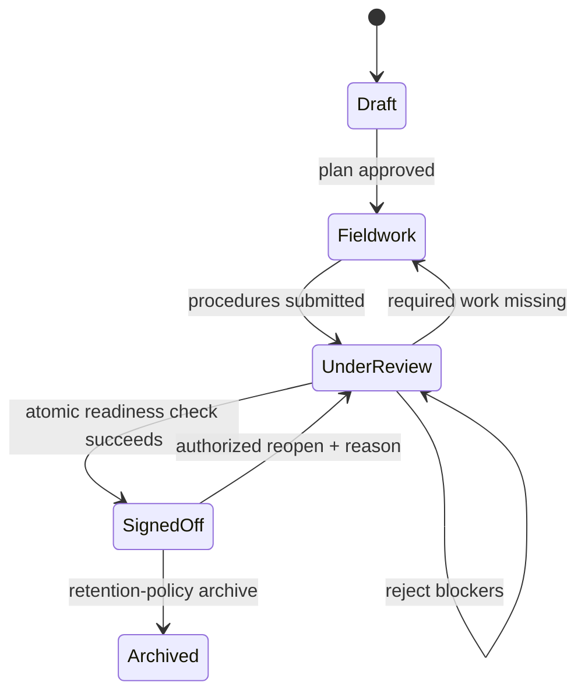

# Rule Coverage & Sign-off Contract

The core safety property is **no false assurance from absent or incomplete evidence**.

## Three different states, not one green badge

1. **File processing:** `UPLOADED`, `SCANNED`, `PARSED`, `REJECTED`.
2. **Population suitability:** `NOT_RECONCILED`, `INCOMPLETE`, `RECONCILED`, `LIMITED_WITH_APPROVAL`.
3. **Rule coverage:** `COMPLETED`, `INSUFFICIENT_DATA`, `FAILED`, `SKIPPED`, `NOT_APPLICABLE`.

A check's findings count is **orthogonal** to coverage: `0 findings + INSUFFICIENT_DATA` must never display as a pass.

## Sign-off preconditions

For an engagement revision `R`, the server must verify **atomically**:

- Reviewer has a valid firm membership, partner approval rights, appropriate independence/segregation and MFA/session assurance.
- Required planning/risk assessment and procedures have been identified under the firm's methodology.
- Each mandatory procedure has a documented **completed/reviewed** state, or an explicitly approved, attributable exception with an assessed limitation.
- Every required dataset has an accepted scope/reconciliation outcome for its dependent procedures.
- Every required automated check has an approved pack/version and a **current run** on data and mapping versions relevant to `R`; no silently ignored `FAILED`/`INSUFFICIENT_DATA` statuses.
- All blocking findings, unresolved critical issues and required review notes are dispositioned with evidence/justification and approvals.
- The approval persists `engagement_revision`, approver, time, procedure/result versions and frozen evidence manifest in the same durable decision boundary.

If any condition fails, **reject** with a structured list of blockers. Failure to load a prerequisite also blocks approval.

## Data-change invalidation

An upload, mapping change, source correction, rule-pack update or material finding amendment must increment the engagement revision and mark dependent results **STALE**. The system must require a rerun or scoped, recorded reviewer decision before sign-off.

## Failure scenarios to test

| Scenario | Correct outcome |
| --- | --- |
| 0 findings because GSTR-2B was never provided | `INSUFFICIENT_DATA`, not completed; gate blocks relevant required work |
| Valid CSV contains 98,600 lines but control report expects 100,000 | `INCOMPLETE`; reconcile before dependent testing |
| A recent source file supersedes an approved snapshot | Prior check marked `STALE`; gate blocks old approval |
| Async worker crashes after saving findings but before publishing | Durable outbox retries; no duplicate finding or missing audit record |
| Staff attempts partner approval | Deny and log |
| Partner waives a Critical item | Requires documented authorization, applicability, underlying severity and review; does not bypass other failed procedures |
| Another user edits engagement during sign-off | Optimistic revision conflict; fail rather than sign an old revision |

**Sign-off in this software means workflow review**, not an independently issued statutory financial-audit opinion.

See [Thursday Story](../story/04-the-review-gate.md) and [Acceptance Matrix](../reference/requirements-traceability.md).
