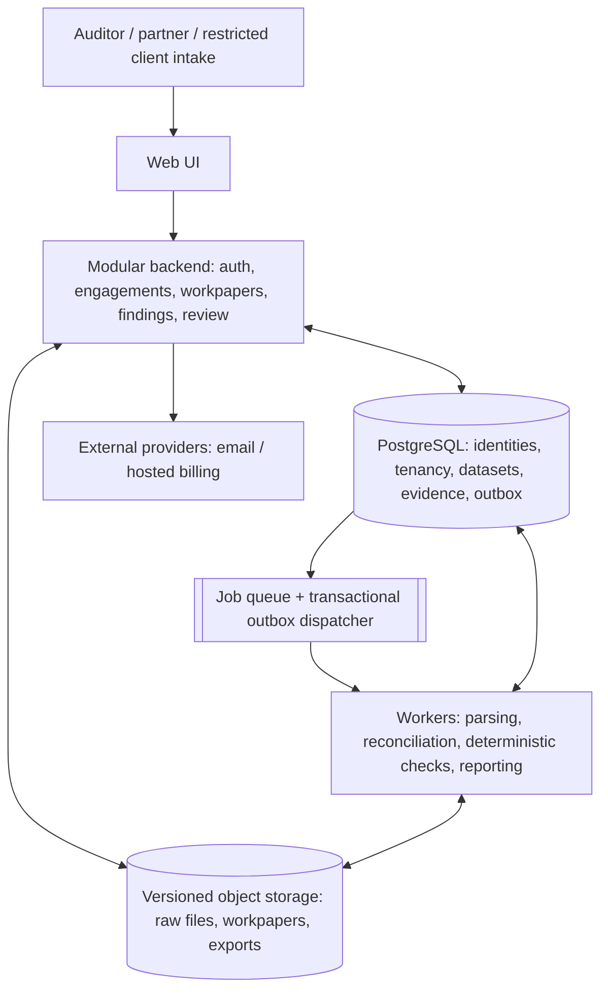
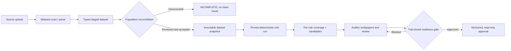

# Canonical Solution Architecture (proposed)

**Architecture status:** Selected hypothetical pilot architecture; no running backend is present. Components are logical modules within one backend, with separate workers. See [trade-offs](./alternatives-and-tradeoffs.md), [capacity assumptions](./capacity-model.md) and [system context](./system-context.md).

## Requirements driving the choice

- A trusted chain from source export → reconciliation → rule result → human investigation → approval.
- Fail-closed authorization and review; missing data is **not** a clean result.
- Fixed versions of every source, mapping, rule, applicability decision and sign-off.
- A realistic path to operate and test with a small team, without starting with a dozen distributed services.
- India-first rule validation while keeping the data types and workflow jurisdiction-neutral.

## Logical module boundaries

| Owner | Authoritative records | Emits after durable commit |
| --- | --- | --- |
| Identity/tenancy | User, membership, session, firm, authorization policy | Identity/tenant changed |
| Engagement/planning | Engagement revision, scope, procedures, responsibility matrix | Engagement or plan changed |
| Source ingestion | Upload versions, parsers, source metadata, staging, rejected rows | Dataset staged |
| Reconciliation | Source population assertions, control totals, reconciliations | Dataset accepted/rejected |
| Deterministic checks | Run snapshot, rule results, **finding candidates**, data-coverage statuses | Rule run completed/failed |
| Workpapers/findings | Notes, evidence, finding disposition, procedure review | Work reviewed |
| Sign-off | Readiness checks, review decision, immutable approved revision | Engagement signed off/reopened |
| Audit evidence | Append-only action record, integrity proof, export manifest | Audit-event delivery |

**Ownership rule:** the rule engine creates finding candidates in the same durable processing boundary as its run results. The findings module **does not recreate** them when it consumes an event.

## Data flow with trustworthy gates

A reviewer-authorized exception to population reconciliation must be explicitly scoped to the affected procedure and its resulting **limitation**, not globally re-label the dataset as complete.

## Transaction, replay and failure contracts

- **All business mutations:** transactionally write state + append-only audit record + outbox event in one Postgres transaction.
- **Workers:** at-least-once processing, stable idempotency IDs, bounded retry, dead-letter/recovery path; never bill or create duplicate findings on replay.
- **Source snapshots:** immutable version identifiers and checksums, no in-place overwrite.
- **Rule results:** pin immutable dataset, taxonomy, code and approved jurisdiction pack. Canonical outputs are comparable excluding execution metadata.
- **Concurrency:** optimistic engagement revision; sign-off checks latest revision within the same atomic decision boundary as approval. New uploads/mappings invalidate affected dependent results.
- **Exports:** record manifest, hash, source/version references, provenance and access; external checksum alone does not prove source history was never altered.
- **Data protection:** explicit tenant and engagement authorization, database permissions, encrypted object storage, safe short-lived URLs, backup restore tests.

## Security and governance

A firm is the tenant. Global user identity and **global firm-membership registry** authorize access; firm-private financial records are tenant-bound. For the illustrative pilot, **shared PostgreSQL tables with firm identifiers, RLS and application assignment checks** are selected. This requires tested policies, non-bypass roles, and scoped request context—not tenant headers alone. Alternatives are in the [tenant isolation ADR](./alternatives-and-tradeoffs.md).

If schema-per-tenant PostgreSQL is selected, set and reset `search_path` within a transaction and test pooled-connection isolation. Never derive access from `X-Tenant-ID` alone.

No platform support user impersonation of private client content in v1. External security certifications are out of scope; plan controls and evidence according to [assurance design](./assurance-design.md).

## Non-functional validation

Replace unmeasured absolute promises with benchmark scenarios: dataset size and format, machine resources, p95 latency, run duration, reconciliation accuracy, failure recovery, cross-tenant isolation, source traceability and restore tests. Performance targets from [NFRs](../reference/non-functional.md) are **aspirational until tested**.

See [Domain Model](./domain-model-v2.md), [Review Contract](./signoff-contract.md), [ADRs](./decision-records.md), and [the story](../story/06-from-story-to-system.md).
