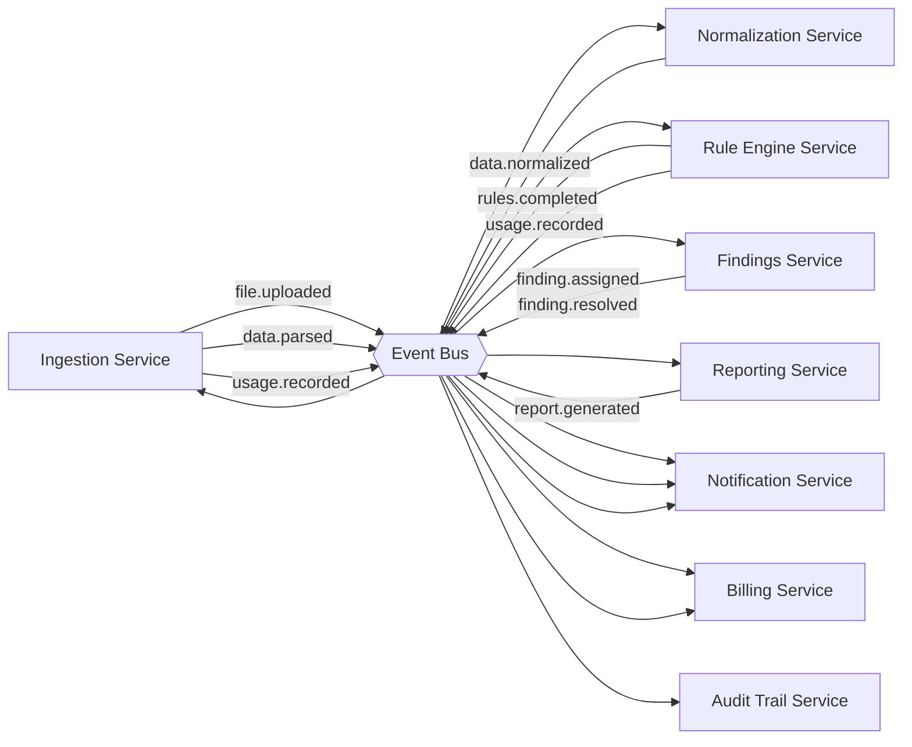

# System Context & Service Topology

## Service map

| Service | Owns | Talks to |
|---|---|---|
| API Gateway | Routing, JWT verification, rate limiting, tenant header injection | All services |
| Auth & Identity Service | Credentials, sessions, MFA, SSO | Tenant Service, Notification Service |
| Tenant Service | Tenant lifecycle, schema provisioning, tenant config | Billing Service |
| Billing Service | Plans, subscriptions, invoices, metering, payment gateway | Tenant Service, Notification Service |
| Engagement Service | Clients, financial years, engagement lifecycle | Tenant Service |
| Ingestion Service | Upload, virus scan, file parsing | Engagement Service, Event Bus |
| Normalization Service | Ledger-to-taxonomy mapping | Event Bus |
| Rule Engine Service | Statutory rule execution | Event Bus |
| Findings Service | Finding lifecycle, assignment, evidence | Event Bus, Notification Service |
| Reporting Service | Query letter and export generation | Event Bus |
| Notification Service | Email + in-app delivery | Event Bus, external email provider |
| Audit Trail Service | Immutable event log, retention | Event Bus (subscribes to everything) |

## Event catalogue

| Event | Producer | Consumers | Payload (key fields) |
|---|---|---|---|
| `tenant.provisioned` | Tenant Service | Billing, Notification | `tenant_id`, `plan_id` |
| `subscription.updated` | Billing Service | Tenant, Notification | `tenant_id`, `plan_id`, `status` |
| `user.invited` | Auth Service | Notification | `tenant_id`, `email`, `role` |
| `file.uploaded` | Ingestion Service | Ingestion (self-dispatch) | `engagement_id`, `file_type`, `storage_path` |
| `data.parsed` | Ingestion Service | Normalization Service | `engagement_id`, `row_count`, `rejected_count` |
| `data.normalized` | Normalization Service | Rule Engine Service | `engagement_id`, `unmapped_count` |
| `rules.completed` | Rule Engine Service | Findings, Reporting, Notification | `engagement_id`, `critical_findings`, `high_findings` |
| `finding.assigned` | Findings Service | Notification | `finding_id`, `assignee_id` |
| `finding.resolved` | Findings Service | Audit Trail | `finding_id`, `resolved_by` |
| `report.generated` | Reporting Service | Notification | `finding_id`, `report_path` |
| `usage.recorded` | Ingestion / Rule Engine | Billing Service | `tenant_id`, `metric`, `quantity` |
| `intake.link_created` | Ingestion Service | Notification | `engagement_id`, `intake_link_id`, `created_by` |
| `intake.uploaded` | Ingestion Service | Notification, Ingestion (self-dispatch) | `engagement_id`, `intake_link_id`, `file_type` |

Every event is consumed by the Audit Trail Service, which is the implicit subscriber to the whole
bus (omitted from each row above for brevity) — see
[Module 12 — Audit Trail & Compliance](../modules/12-audit-trail-compliance).

## DFD Level 2 — Cross-Service Event Flow

## Deployment shape

- Stateless services behind the API Gateway, horizontally scalable independently.
- One Postgres cluster, **schema-per-tenant** — see
  [Multi-Tenancy → Data Model](../modules/02-multi-tenancy#data-model) for the isolation model.
- Event bus (broker + worker pool) decouples ingestion → normalization → rule engine → downstream
  consumers, so a slow rule run never blocks the upload response.
- Object storage for uploaded source files and generated reports.

## Related pages

- [Data Model](./data-model)
- [Cross-Cutting Concerns](./cross-cutting)
- [Glossary](./glossary)
