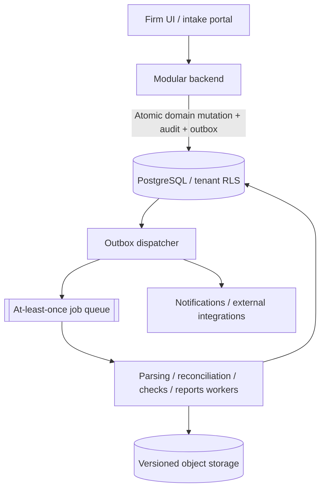

# System Context & Logical Components

This is the **selected proposal** for the case study. Components are logical modules **inside one backend**, not twelve independently deployed services. Asynchronous ingestion and rules workers share versioned evidence contracts and a transactional database. See [ADR-002](./decision-records.md).

## Service map

| Logical component | Owns | Communication boundary |
| --- | --- | --- |
| Identity and tenancy | User, firm membership, scoped authorization | Verified API request and DB policy |
| Engagement/planning | Client scope, risk/procedure plan, engagement revision | Same application transaction |
| Source ingestion | Source version, scan, parser status and staging | Enqueue jobs only after durable commit |
| Reconciliation | Source counts/totals, population suitability, reviewer acceptance | Dataset snapshot contract |
| Normalization | Mapping to explicit, versioned account taxonomy | Dataset/mapping revision |
| Deterministic checks | Check result, data coverage and candidate findings | Dataset + approved pack versions |
| Findings/workpapers | Assignment, note, evidence attachment, human disposition | Authorization + version check |
| Review | Atomic approval of a revision and a manifest | State transition, no stale results |
| Reporting | Query letters, exports and integrity manifest | Background job and object store |
| Notifications | Delivery preferences, messages, retry status | Outbox dispatched events |
| Platform evidence | Domain audit record, outbox delivery and integrity checks | Transactional journal and verification |
| Billing (future) | Subscription, invoices, versioned entitlements | Hosted billing provider and idempotent usage |

## Event catalogue

| Event | Producer | Result / contract |
| --- | --- | --- |
| `engagement.plan_changed` | Engagement | Bump revision; invalidate dependent work |
| `source.uploaded` | Intake | Source version persisted; queue scanning |
| `dataset.parsed` | Worker | Typed staging available; **not** complete by implication |
| `dataset.reconciled` | Reconciliation | Reviewed source scope and evidence references |
| `mapping.updated` | Auditor / normalization | Bump revision; invalidate dependent checks |
| `checks.finished` | Rule worker | Run and candidates **already durably committed**, explicit coverage statuses |
| `finding.reviewed` | Workpapers | Review action committed; event only notifies/projection |
| `engagement.approved` | Review | Frozen revision/manifest and reviewer ID committed |
| `usage.recorded` | Metering (future) | Idempotency key prevents billing duplicates |

Events are **effects of committed state changes**, not the only source of audit truth. All carry stable event IDs, aggregate revisions, actor context and schema version.

## DFD Level 2 — Cross-Service Event Flow

## Deployment shape

One backend deployable, PostgreSQL with firm-scoped RLS policies and separate privileged migration roles, versioned object storage, queue/worker processes and observability. Worker scaling is independently configurable even when core domain modules share a process.

A request selects a firm only after global identity/membership and engagement authorization; `tenant_id` and PostgreSQL RLS are **defense in depth**, not authorization inferred from a client header. RLS requires dedicated negative security tests and careful DB ownership/role configuration.

## Related pages

[Canonical Solution Architecture](./solution-architecture.md) · [Data Model](./data-model.md) · [Architecture Trade-offs](./alternatives-and-tradeoffs.md) · [Security Design](./assurance-design.md) · [Story](../story/06-from-story-to-system.md)
