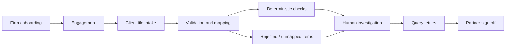

# Audit Intelligence System

**Use-case study · Proposed global-ready financial audit SaaS · India-first reference jurisdiction**

:::note Project status
This repository defines proposed user workflows and design assumptions. The audit platform, rule engine, integrations, and customer results have **not** been demonstrated by this repository.
:::

## Problem statement

A financial audit firm must review client records, handle inconsistent ledgers, reconcile exports, and document why exceptions were accepted or questioned. Jurisdictions differ in fiscal calendars, laws, retention and local audit standards. The question is:

> How can an audit team collect digital books, identify reproducible review candidates, preserve evidence, and hand the engagement to a partner for a defensible review?

## Proposed system outcome

The firm creates **one engagement per client and reporting period**, with a configured jurisdiction and applicable rule-pack version. India is the first reference use case, not the platform's permanent boundary. The system supports digital intake, validation, ledger normalization, reproducible checks, finding investigation, client query letters, partner review, and traceable activity. It **supports**, but cannot replace, auditor judgment or an audit opinion.

## Actors

| Actor | Responsibility | Example scenarios |
| --- | --- | --- |
| Firm Admin | Set up tenant, staff, plan, settings | [UC-01](./use-cases/01-firm-onboarding.md), [UC-11](./use-cases/11-firm-administration.md) |
| Engagement Partner | Supervise engagement and sign-off | [UC-02](./use-cases/02-create-engagement.md), [UC-09](./use-cases/09-partner-sign-off.md) |
| Audit Staff | Collect, analyze, investigate, document | [UC-04](./use-cases/04-validate-records.md), [UC-07](./use-cases/07-investigate-findings.md) |
| Client Representative | Submit documents through a restricted link | [UC-03](./use-cases/03-client-intake.md) |
| Platform Operator | Operate infrastructure without reading audit content | [UC-12](./use-cases/12-evidence-and-audit-history.md) |

## Example end-to-end scenario

In the India-first example, a CA firm audits a client for FY 2025–26. The partner creates the engagement and assigns staff. The client uploads Tally, spreadsheet and GSTR-2B exports. The platform validates files and displays rejected records; staff confirm ambiguous ledger mappings. The firm runs a recorded set of deterministic checks. An auditor inspects flagged transactions, asks the client for an explanation, records the outcome, and prepares a query letter. The partner reviews unresolved critical issues and explicitly signs off once the applicable gates are satisfied.

This is a **hypothetical India-specific scenario**, not a description of working software. Other jurisdictions require independently verified rules and local professional review.

## Global scope and platform assurance

**Approach:** reuse the engagement/evidence/review engine globally; isolate Indian rules, import formats, fiscal calendar, currency defaults and legal assumptions in a [jurisdiction pack](./architecture/jurisdiction-model.md). The product focuses on **financial audit**, not every type of audit. See [UC-13](./use-cases/13-configure-jurisdiction.md).

**Security:** propose controls informed by ISO/IEC 27001/27002 and SOC 2 Trust Services Criteria, plus a conditional PCI DSS assessment for payment-account data. **No ISO certification, SOC 2 report or PCI DSS validation is claimed.** See [assurance design](./architecture/assurance-design.md), [framework comparison](./reference/assurance-frameworks.md), and [UC-14](./use-cases/14-control-evidence-review.md).

## Core boundaries

- **Deterministic detection, human decisions:** rule outputs flag possible exceptions. They do not automatically establish fraud, non-compliance, or audit conclusions.
- **Source and decision traceability:** link each candidate finding to a source snapshot, rule/configuration version and review history.
- **Firm and engagement access control:** a user may only view records permitted by their tenant and engagement assignment; client upload links grant upload-only access.
- **Proposed v1 exclusions:** OCR, bookkeeping, automated audit opinions, live Tally synchronization, predictive scoring, and unrestricted client dashboards.

## Measurable acceptance targets—not achieved results

| Criterion | Future validation |
| --- | --- |
| Repeatable findings | Compare canonical outputs for identical input and rule configuration |
| No silent data loss | Verify rejected rows are counted and reported |
| Human approval | Ensure unresolved Critical items block partner sign-off |
| Tenant isolation | Prove forged tenant and engagement requests cannot leak content |
| Evidence chain | Resolve a finding to source rows, rules and decisions |
| Jurisdiction check | Reject unapproved, unsupported, or out-of-effective-period statutory rule packs |
| Platform assurance | Produce scoped access/change/incident evidence, with independent verification of controls before assurance claims |
| Payment boundary | Record PCI DSS scoping and third-party payment responsibilities; flag unexpected card data in uploads |

## Navigate

Start with the **[use-case catalogue](./use-cases/index.md)**. The [module specifications](./modules/04-engagements.md) and [proposed architecture](./architecture/system-context.md) remain supporting implementation options. The [statutory rule catalogue](./reference/statutory-rules.md) requires professional/legal validation before real-world use.
