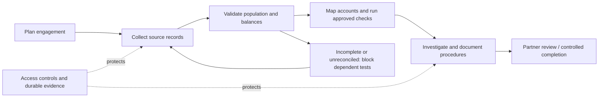

# It imported successfully. That wasn't enough.

*An illustrative financial audit case study and solution architecture.*

> **Fictional case:** Northstar Audit, a fictional mid-sized audit firm, is reviewing Aster Components, a fictional manufacturing client. Names, data and events are illustrative. Nothing described here is a deployed product, a completed audit or a compliance certification.

It's Monday morning. An audit manager receives a new engagement and a familiar collection of documents: accounting exports, spreadsheets and tax data. The firm's staff know how to examine them, but the steps vary between clients, evidence lives in scattered folders, and reviewers struggle to retrace every decision.

A platform can make the arithmetic faster. **But who proves the source files were complete?** Who explains why a suspicious entry was dismissed? What stops an incomplete test from being presented as a clean result? And when a partner signs off, **what exactly are they approving?**

That is the problem this design attempts to solve.

## Follow the week

| Day | What happens | Question it forces | Design response |
| --- | --- | --- | --- |
| **Monday** | A new engagement is opened | Who may work on it, and what audit work is planned? | [Engagement and audit plan](./story/01-the-engagement.md) |
| **Tuesday** | Every imported row looks valid, but the export is incomplete | Is the accounting population trustworthy? | [Dataset validation and reconciliation](./story/02-the-missing-records.md) |
| **Wednesday** | A deterministic check flags an unusual entry | How do we avoid treating a flag as a legal conclusion? | [Rules, evidence and investigation](./story/03-findings-not-verdicts.md) |
| **Thursday** | A partner reviews the work | Can an unfinished or stale run pass sign-off? | [Fail-closed review gate](./story/04-the-review-gate.md) |
| **Friday** | Someone asks for a complete record of what happened | Can the firm reconstruct every meaningful decision? | [Security, evidence and event integrity](./story/05-trust-and-evidence.md) |

**[Begin the story →](./story/01-the-engagement.md)**

## The proposed solution

The **core innovation is not a checklist of compliance buzzwords**. It is a coherent evidence chain from source material to a human-reviewed conclusion, with visible gaps and failures.

This platform **supports** audit work. It does not determine that financial statements are fairly presented, replace qualified auditors, or issue audit opinions.

## Explore the engineering

Read [the architecture walkthrough](./story/06-from-story-to-system.md), [the logical solution architecture](./architecture/solution-architecture.md), [the canonical data model](./architecture/domain-model-v2.md), [the review contract](./architecture/signoff-contract.md), and [the architectural decisions](./architecture/decision-records.md).

Existing [use cases](./use-cases/index.md) and [detailed module sketches](./modules/04-engagements.md) serve as supporting requirements. Where older India-first examples disagree with the canonical architecture and contracts, the canonical documents take precedence until the module details are reconciled.

## Scope, geography and assurance

- **Audience:** Financial audit teams and partners. For the initial pilot, validate with practicing Indian CAs.
- **Launch reference:** India's reporting conventions and examples; future markets require independently approved jurisdiction rules and source adapters.
- **V1 product:** Engagement planning, digital source intake, population reconciliation, deterministic review candidates, workpapers, findings and partner review.
- **Not v1:** Automated audit opinions, general ISO management-system auditing, enterprise SSO, full public API, automatic legal conclusions or a compliance certification.
- **Security:** Design for access control, tenant isolation, source integrity, incident response and evidence. ISO/IEC 27001, SOC 2 and PCI DSS are considered only according to their applicable scope; no assurance claim is made.

## What would prove the concept?

One qualified audit team can demonstrate, on representative test records, that the platform can detect **incomplete source populations**, reproduce its check outputs, track all reviewer decisions, prevent improper sign-off, and provide an independently inspectable evidence package. Details and negative tests are in the [requirements traceability matrix](./reference/requirements-traceability.md).
