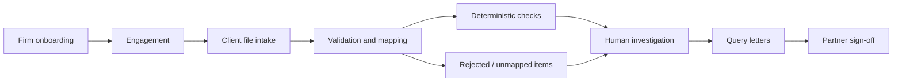

# Audit Intelligence System

**Use-case study · Proposed SaaS concept · Indian statutory audit firms**

:::note Project status
This repository defines proposed user workflows and design assumptions. The audit platform, rule engine, integrations, and customer results have **not** been demonstrated by this repository.
:::

## Problem statement

A statutory audit firm must review large volumes of client records, handle inconsistent ledger descriptions, reconcile different exports, and document why an exception was accepted or questioned. The question is:

> How can an audit team collect digital books, identify reproducible review candidates, preserve evidence, and hand the engagement to a partner for a defensible review?

## Proposed system outcome

The firm creates **one engagement per client per Indian financial year**. The system supports digital intake, validation, ledger normalization, reproducible checks, finding investigation, client query letters, partner review, and traceable activity. It **supports**, but cannot replace, auditor judgment or an audit opinion.

## Actors

| Actor | Responsibility | Example scenarios |
| --- | --- | --- |
| Firm Admin | Set up tenant, staff, plan, settings | [UC-01](./use-cases/01-firm-onboarding.md), [UC-11](./use-cases/11-firm-administration.md) |
| Engagement Partner | Supervise engagement and sign-off | [UC-02](./use-cases/02-create-engagement.md), [UC-09](./use-cases/09-partner-sign-off.md) |
| Audit Staff | Collect, analyze, investigate, document | [UC-04](./use-cases/04-validate-records.md), [UC-07](./use-cases/07-investigate-findings.md) |
| Client Representative | Submit documents through a restricted link | [UC-03](./use-cases/03-client-intake.md) |
| Platform Operator | Operate infrastructure without reading audit content | [UC-12](./use-cases/12-evidence-and-audit-history.md) |

## Example end-to-end scenario

A CA firm audits a client for FY 2025–26. The partner creates the engagement and assigns staff. The client uploads Tally, spreadsheet and GSTR-2B exports. The platform validates files and displays rejected records; staff confirm ambiguous ledger mappings. The firm runs a recorded set of deterministic checks. An auditor inspects flagged transactions, asks the client for an explanation, records the outcome, and prepares a query letter. The partner reviews unresolved critical issues and explicitly signs off once the applicable gates are satisfied.

This is a **hypothetical user journey**, not a description of working software.

## Core boundaries

- **Deterministic detection, human decisions:** rule outputs flag possible exceptions. They do not automatically establish fraud, non-compliance, or audit conclusions.
- **Source and decision traceability:** link each candidate finding to a source snapshot, rule/configuration version and review history.
- **Firm and engagement access control:** a user may only view records permitted by their tenant and engagement assignment; client upload links grant upload-only access.
- **Proposed v1 exclusions:** OCR, bookkeeping, automated audit opinions, live Tally synchronization, predictive scoring, and unrestricted client dashboards.

## Measurable acceptance targets—not achieved results

| Criterion | Future validation |
| --- | --- |
| Repeatable findings | Compare canonical outputs for identical input and rule configuration |
| No silent data loss | Verify rejected rows are counted and reported |
| Human approval | Ensure unresolved Critical items block partner sign-off |
| Tenant isolation | Prove forged tenant and engagement requests cannot leak content |
| Evidence chain | Resolve a finding to source rows, rules and decisions |

## Navigate

Start with the **[use-case catalogue](./use-cases/index.md)**. The [module specifications](./modules/04-engagements.md) and [proposed architecture](./architecture/system-context.md) remain supporting implementation options. The [statutory rule catalogue](./reference/statutory-rules.md) requires professional/legal validation before real-world use.
