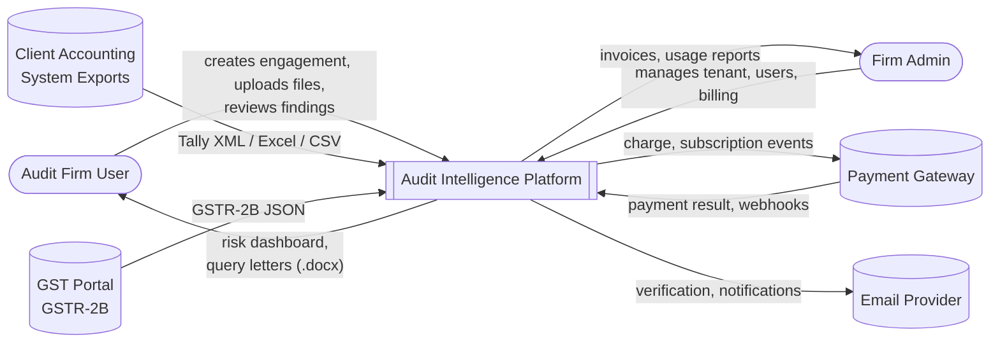
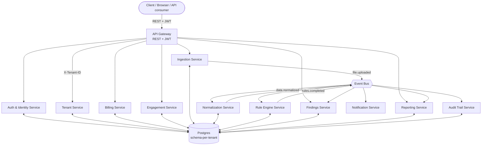

# Audit Intelligence Platform

## What this product is

The Audit Intelligence Platform is a multi-tenant SaaS product for statutory audit firms in
India. A firm signs up, subscribes to a plan, invites its audit staff, and creates one
**engagement** per client per financial year. For each engagement, the firm uploads the client's
books — Tally XML exports, Excel/CSV ledger dumps, GSTR-2B JSON filings — and the platform:

1. **Ingests** the files and parses them into a normalized transaction table.
2. **Normalizes** every ledger name onto a fixed standard chart of accounts.
3. **Runs** a deterministic statutory rule engine across the full transaction set — no LLM, no
   model variance, the same input always produces the same finding.
4. **Surfaces findings** the audit team reviews, assigns, and resolves.
5. **Generates** ready-to-send query letters and a risk dashboard the engagement partner signs
   off on.

Every number a partner signs is reproducible from the same inputs, every time. The rule engine is
arithmetic against fixed statutory thresholds (Sec 40A(3), Sec 43B(h), SA 240, CGST Sec 16(2)(aa))
— there is no judgment call for a model to make, so none is delegated to one.

Around that audit-specific core sits the machinery every SaaS product needs: accounts, tenants,
subscriptions, notifications, an audit trail, and a public API. This site documents both halves in
equal depth, because a contractor pricing this build needs both to scope accurately.

## How this documentation is organized

- **[Architecture](./architecture/system-context)** — the system as a whole: service topology,
  the shared data model, cross-cutting concerns (security, observability, error handling), and a
  glossary of statutory and domain terms used throughout.
- **Modules** — one page per product module. Each follows the same template: purpose, actors and
  permissions, a functional feature table with acceptance criteria, business rules, data model,
  API surface, DFD Level 0 through Level 3, edge cases, and what's explicitly out of scope.
- **Reference** — the full statutory rule catalogue, the role/permission matrix, and non-functional
  requirements (performance, retention, availability) that apply across every module.

## Module index

| # | Module | Owns |
|---|---|---|
| 01 | [Auth & Identity](./modules/01-auth-identity) | Login, MFA, sessions, SSO, invitations, password reset |
| 02 | [Multi-Tenancy](./modules/02-multi-tenancy) | Firm/tenant lifecycle, schema isolation, provisioning |
| 03 | [Subscriptions & Billing](./modules/03-subscriptions-billing) | Plans, trials, proration, invoices, metering |
| 04 | [Engagements](./modules/04-engagements) | Clients, financial years, engagement lifecycle, team assignment |
| 05 | [Document Ingestion](./modules/05-document-ingestion) | Upload, virus scan, parsing (Tally/Excel/GSTR-2B) |
| 06 | [Ledger Normalization](./modules/06-ledger-normalization) | Standard taxonomy mapping, fuzzy match, review queue |
| 07 | [Rule Engine](./modules/07-rule-engine) | Statutory rule registry, orchestration, thresholds |
| 08 | [Findings Workflow](./modules/08-findings-workflow) | Finding lifecycle, assignment, evidence, sign-off |
| 09 | [Reporting & Query Letters](./modules/09-reporting-query-letters) | .docx generation, branding, export bundles |
| 10 | [Dashboard & Analytics](./modules/10-dashboard-analytics) | Risk dashboard, trends, usage widgets |
| 11 | [Notifications](./modules/11-notifications) | Email/in-app events, preferences, digests |
| 12 | [Audit Trail & Compliance](./modules/12-audit-trail-compliance) | Immutable activity log, retention, regulator export |
| 13 | [Admin & Settings](./modules/13-admin-settings) | Firm profile, users, roles, rule config, API keys |
| 14 | [Integrations & Public API](./modules/14-integrations-api) | Tally connector, GST portal, REST API, webhooks |
| 15 | [Client Intake Portal](./modules/15-client-intake) | Tokenized client upload links, canonical template |

## DFD Level 0 — Context Diagram

## DFD Level 1 — Platform Service Topology

See [Architecture → System Context](./architecture/system-context) for the full event catalogue
and Level 2 breakdown of this diagram.
