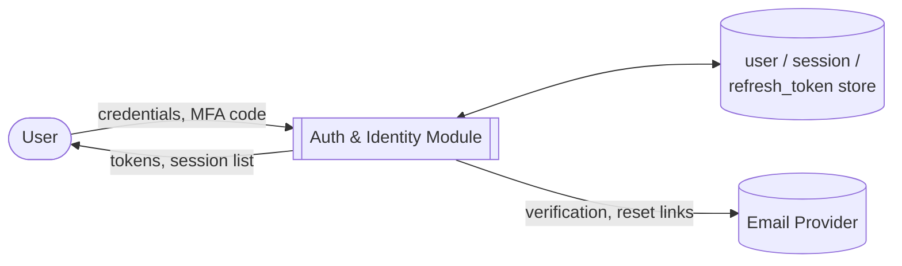
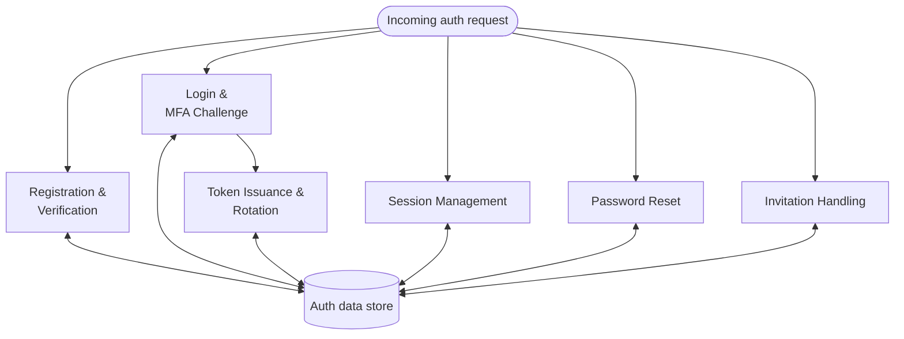
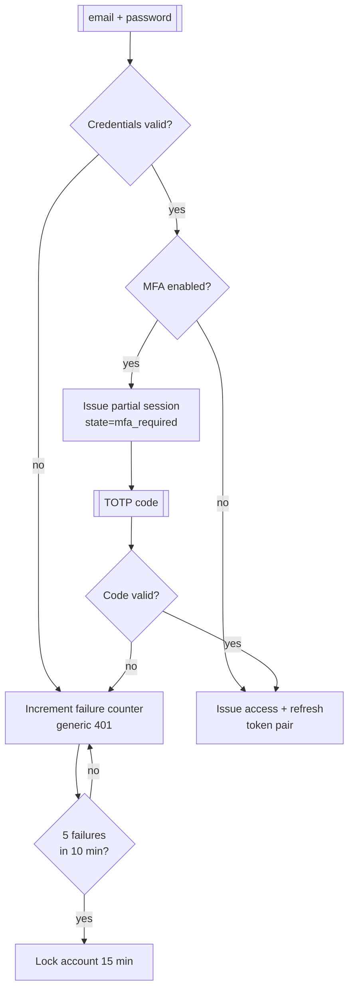
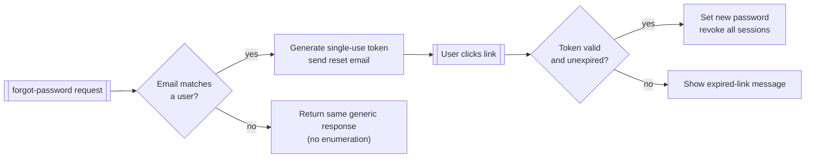
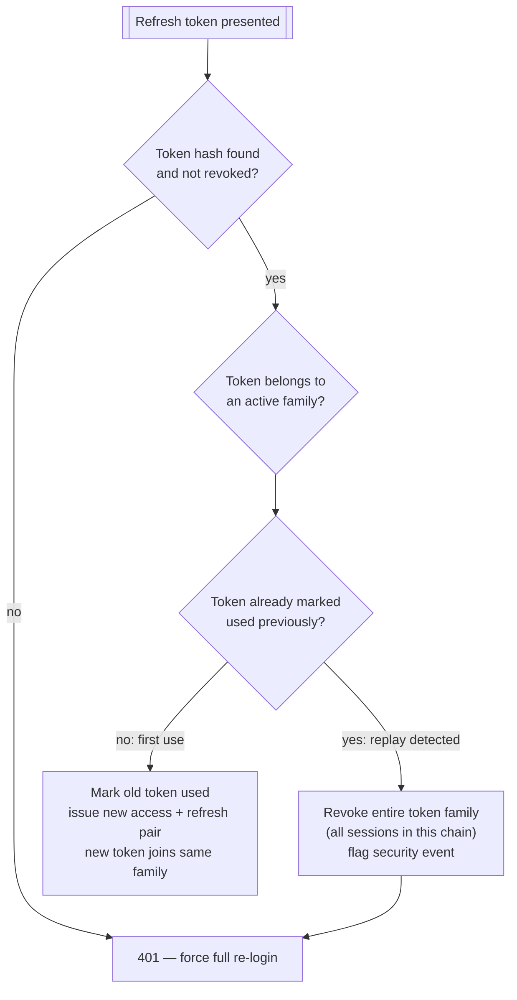

# Auth & Identity

## Purpose

Owns user identity, authentication, session lifecycle, and account security across the entire
platform. This module issues and validates every credential the rest of the system trusts;
authorization (what a role is *allowed* to do) is granted by [Multi-Tenancy](./02-multi-tenancy)'s
`firm_user_role` mapping, but *who the user is* and *whether their session is valid* is decided
here alone.

## Actors & permissions

| Actor | Interacts with this module as |
|---|---|
| Any platform user | Registers, logs in, manages own MFA/sessions, resets password |
| Firm Admin | Invites users, revokes user sessions, views firm's user list |
| Platform Support (impersonation) | Assumes a user's session for troubleshooting, under audit log |

## Functional features

| ID | Feature | Description | Acceptance criteria |
|---|---|---|---|
| FEAT-AUTH-001 | Email/password registration | User signs up with email + password | Account created in `pending_verification` state; verification email sent |
| FEAT-AUTH-002 | Email verification | User confirms email via time-limited link | Link expires after 24h; expired link offers resend; account moves to `active` on success |
| FEAT-AUTH-003 | Password policy enforcement | Minimum length, complexity, breach-list check | Passwords under 12 chars or found in a known-breach list are rejected at signup and reset |
| FEAT-AUTH-004 | Login | Email + password authentication | Valid credentials issue access + refresh token pair; invalid credentials return generic 401 (no user-enumeration) |
| FEAT-AUTH-005 | MFA enrollment (TOTP) | User enrolls an authenticator app | QR + manual seed shown once; enrollment requires one valid code before activation |
| FEAT-AUTH-006 | MFA challenge at login | Second factor required when enabled | Login halts at a `mfa_required` state until a valid TOTP code is submitted |
| FEAT-AUTH-007 | MFA recovery codes | One-time backup codes issued at enrollment | 10 single-use codes generated; each use invalidates that code only |
| FEAT-AUTH-008 | Access/refresh token issuance | Short-lived access token, longer-lived refresh token | Access token TTL 15 min; refresh token TTL 30 days, rotated on every use |
| FEAT-AUTH-009 | Refresh token rotation & replay detection | Reused refresh token revokes the whole session family | See [DFD Level 3](#dfd-level-3--refresh-token-rotation--replay-detection) |
| FEAT-AUTH-010 | Session listing | User views all active sessions (device, IP, last-seen) | Current session flagged distinctly from others |
| FEAT-AUTH-011 | Session revocation | User or admin revokes one or all sessions | Revoked session's refresh token rejected on next use within 1s of revocation |
| FEAT-AUTH-012 | Password reset | Forgot-password flow via emailed link | Link single-use, expires in 1h; all existing sessions revoked on successful reset |
| FEAT-AUTH-013 | Password change (authenticated) | User changes password while logged in | Requires current password; all *other* sessions revoked, current session kept |
| FEAT-AUTH-014 | Brute-force lockout | Repeated failed logins throttle the account | 5 failures in 10 min triggers a 15-min lockout with exponential backoff on repeat |
| FEAT-AUTH-015 | User invitation | Firm Admin invites a user by email to a tenant | Invitation token single-use, expires in 7 days; pre-assigns role on acceptance |
| FEAT-AUTH-016 | SSO / SAML login | Firm-level SSO for enterprise tenants | SAML assertion maps to existing user by verified email; JIT provisioning optional per tenant config |
| FEAT-AUTH-017 | Cross-tenant identity | One user account can belong to multiple tenants | Login is tenant-agnostic; tenant selection happens post-authentication if user has 2+ memberships |
| FEAT-AUTH-018 | Support impersonation | Support staff temporarily assumes a user's view | Requires explicit reason logged; impersonated session visibly banner-marked; full audit trail entry |
| FEAT-AUTH-019 | Account deactivation | Admin deactivates a user | All sessions revoked immediately; login attempts return 403 with no further detail |
| FEAT-AUTH-020 | API key issuance (service accounts) | Non-interactive credential for [Integrations](./14-integrations-api) | Key shown once at creation; stored hashed; scoped to specific permissions |

## Business rules & constraints

- **BR-AUTH-01**: Passwords are never stored or logged in plaintext; hashed with a memory-hard
  algorithm (bcrypt/argon2).
- **BR-AUTH-02**: Access tokens are never persisted server-side; they are stateless JWTs verified
  by signature. Refresh tokens are persisted and revocable.
- **BR-AUTH-03**: A refresh token is valid for exactly one use; the response to using it includes
  a new refresh token, and the old one is immediately invalidated.
- **BR-AUTH-04**: Login responses never distinguish "wrong password" from "no such user."
- **BR-AUTH-05**: MFA, once enabled, cannot be disabled without re-authenticating with a valid
  second factor or a recovery code.
- **BR-AUTH-06**: Impersonation sessions cannot perform destructive actions (delete data, change
  billing) — read and support-relevant write actions only.

## Data model

| Entity | Key fields | Scope |
|---|---|---|
| `user` | `id`, `email` (unique, global), `password_hash`, `mfa_enabled`, `mfa_secret`, `status` | Global |
| `refresh_token` | `id`, `user_id`, `token_hash`, `family_id`, `revoked_at`, `expires_at` | Global |
| `session` | `id`, `user_id`, `device_info`, `ip`, `last_seen_at` | Global |
| `invitation` | `id`, `tenant_id`, `email`, `role`, `token_hash`, `expires_at`, `accepted_at` | Global |
| `mfa_recovery_code` | `id`, `user_id`, `code_hash`, `used_at` | Global |
| `api_key` | `id`, `tenant_id`, `key_hash`, `scopes`, `created_by` | Global, tenant-scoped by field |

Full ERD: [Architecture → Data Model](../architecture/data-model).

## API surface

| Method | Path | Purpose | Auth scope |
|---|---|---|---|
| POST | `/auth/register` | Create account | None |
| POST | `/auth/verify-email` | Confirm email | None (token in body) |
| POST | `/auth/login` | Authenticate | None |
| POST | `/auth/mfa/verify` | Complete MFA challenge | Partial session (post-password) |
| POST | `/auth/refresh` | Rotate token pair | Refresh token |
| POST | `/auth/logout` | Revoke current session | Access token |
| GET | `/auth/sessions` | List active sessions | Access token |
| DELETE | `/auth/sessions/{id}` | Revoke a session | Access token |
| POST | `/auth/password/forgot` | Request reset link | None |
| POST | `/auth/password/reset` | Complete reset | Reset token |
| POST | `/auth/password/change` | Change password | Access token |
| POST | `/auth/mfa/enroll` | Start TOTP enrollment | Access token |
| POST | `/auth/mfa/disable` | Disable MFA | Access token + MFA/recovery code |
| POST | `/invitations/{token}/accept` | Accept firm invitation | None (token) |
| POST | `/admin/users/{id}/impersonate` | Start impersonation session | Support role |
| POST | `/admin/api-keys` | Issue an API key | Admin role |

## DFD Level 0

## DFD Level 1

## DFD Level 2 — Login & MFA Challenge

## DFD Level 2 — Password Reset

## DFD Level 3 — Refresh Token Rotation & Replay Detection

A refresh token is single-use. If a token that was already rotated is presented again — the
signature of a stolen token being replayed after the legitimate client already rotated past it —
the entire family (every token descended from the same original login) is revoked, forcing
re-authentication on all derived sessions rather than just rejecting the one request.

## Edge cases & failure modes

| Condition | System behavior |
|---|---|
| User has no MFA, tries to log in from a new device | Login succeeds; no device-trust step exists in v1 |
| Refresh token replay detected | Full session family revoked; user must log in again on every device |
| Invitation accepted after tenant is suspended | Acceptance succeeds, but resulting membership is inert until tenant reactivates |
| Password reset requested for an unverified account | Reset proceeds; successful reset also verifies the email |
| Impersonation started, target user logs out elsewhere | Impersonation session is unaffected (separate session record) |
| SSO assertion email doesn't match any existing user, JIT disabled | Login rejected with an admin-contact message |

## Out of scope

- Biometric authentication (fingerprint/face) — device-native, not a platform concern.
- Passwordless/magic-link login — not requested for v1; password + optional MFA only.
- OAuth "log in with Google/Microsoft" for individual users — SSO/SAML covers the enterprise case;
  consumer social login is not a fit for a B2B audit tool.
