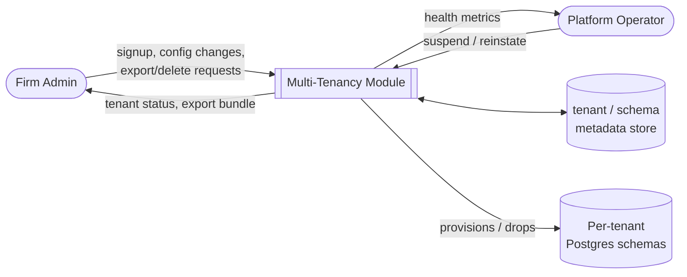
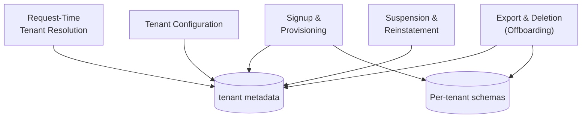
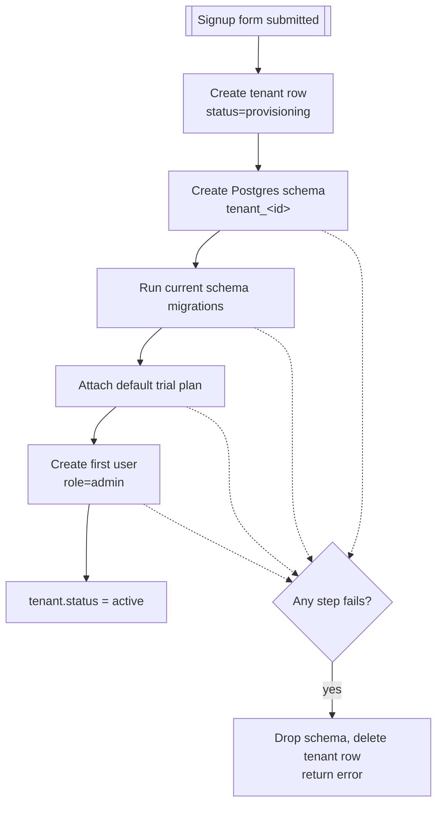
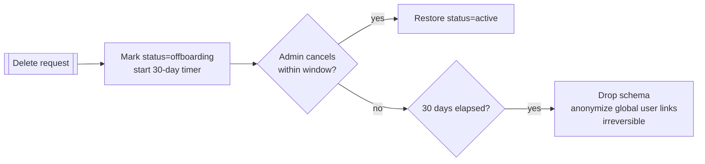
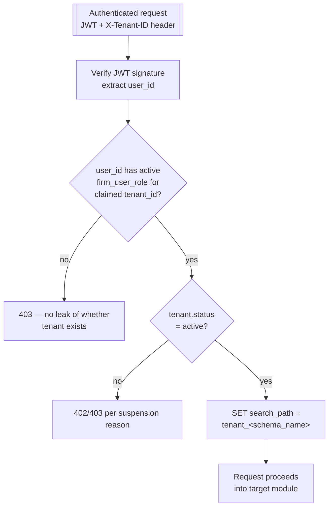

# Multi-Tenancy

## Purpose

Owns the tenant (audit firm) as the root of isolation for every other module. Every request that
touches client data is resolved to exactly one tenant schema before any other module's logic
runs; this module owns that resolution, plus the lifecycle of a tenant from signup through
offboarding.

## Actors & permissions

| Actor | Interacts with this module as |
|---|---|
| New firm (self-serve signup) | Triggers tenant provisioning |
| Firm Admin | Views/edits tenant config, requests data export or deletion |
| Platform Operator | Suspends/reinstates tenants, monitors tenant health |

## Functional features

| ID | Feature | Description | Acceptance criteria |
|---|---|---|---|
| FEAT-MT-001 | Self-serve tenant signup | New firm registers and gets a provisioned tenant | Tenant + schema created within 30s of signup completion |
| FEAT-MT-002 | Schema-per-tenant provisioning | New Postgres schema created and migrated on tenant creation | Schema contains full current table set; failure rolls back tenant creation atomically |
| FEAT-MT-003 | Tenant resolution per request | Every authenticated request resolves to exactly one tenant | See [DFD Level 3](#dfd-level-3--request--tenant-resolution) |
| FEAT-MT-004 | Tenant configuration | Firm-level settings (name, branding, locale, retention) | Changes take effect on next request, no restart required |
| FEAT-MT-005 | Cross-tenant guardrail | Structural prevention of one tenant's query touching another's data | Automated test: forged tenant header against another tenant's resource returns 404, not data |
| FEAT-MT-006 | Tenant suspension | Platform operator suspends a tenant (e.g. non-payment) | All API calls from that tenant return 402/403; data retained, not deleted |
| FEAT-MT-007 | Tenant reinstatement | Suspended tenant restored to active | Access restored within 1 request cycle of reinstatement |
| FEAT-MT-008 | Data export (offboarding) | Firm requests full export of its data before leaving | Export bundle contains all engagements, findings, reports in a documented format |
| FEAT-MT-009 | Tenant deletion | Firm's schema and all data permanently removed | Requires two-step confirmation + 30-day grace hold before irreversible delete |
| FEAT-MT-010 | Storage quota enforcement | Uploads blocked once a tenant's plan storage limit is hit | Upload attempt over quota returns 402 with upgrade prompt, not a silent failure |
| FEAT-MT-011 | Tenant health visibility | Operator dashboard shows per-tenant schema size, activity, error rate | Refreshes at least hourly |
| FEAT-MT-012 | Multi-membership support | One user can hold roles in multiple tenants | User's tenant switcher lists all active memberships |

## Business rules & constraints

- **BR-MT-01**: A tenant schema is never shared or partially provisioned — creation is atomic;
  a partially-failed provisioning leaves no orphan schema.
- **BR-MT-02**: Tenant deletion is a two-step, time-delayed operation (request → 30-day hold →
  irreversible purge) to prevent accidental data loss.
- **BR-MT-03**: Suspension never deletes data — a suspended tenant's data is fully intact on
  reinstatement.
- **BR-MT-04**: The tenant identifier used for schema resolution is derived from the verified JWT
  claim, never from a client-supplied header alone (see [Auth & Identity](./01-auth-identity)).

## Data model

| Entity | Key fields | Scope |
|---|---|---|
| `tenant` | `id`, `firm_name`, `schema_name`, `status`, `plan_id`, `created_at` | Global |
| `tenant_config` | `tenant_id`, `branding`, `locale`, `retention_days` | Global |
| `firm_user_role` | `tenant_id`, `user_id`, `role` | Global (join table) |
| `tenant_export` | `id`, `tenant_id`, `status`, `file_path`, `requested_by` | Global |

## API surface

| Method | Path | Purpose | Auth scope |
|---|---|---|---|
| POST | `/tenants` | Self-serve signup | None (creates first admin user + tenant) |
| GET | `/tenants/current` | Fetch active tenant's config | Any authenticated user |
| PATCH | `/tenants/current` | Update tenant config | Admin role |
| POST | `/tenants/current/export` | Request data export | Admin role |
| GET | `/tenants/current/export/{id}` | Download export bundle | Admin role |
| POST | `/tenants/current/delete-request` | Start deletion hold | Admin role |
| POST | `/tenants/current/delete-cancel` | Cancel pending deletion | Admin role |
| POST | `/admin/tenants/{id}/suspend` | Suspend tenant | Platform Operator |
| POST | `/admin/tenants/{id}/reinstate` | Reinstate tenant | Platform Operator |
| GET | `/admin/tenants/{id}/health` | Tenant health metrics | Platform Operator |

## DFD Level 0

## DFD Level 1

## DFD Level 2 — Tenant Provisioning

## DFD Level 2 — Offboarding

## DFD Level 3 — Request → Tenant Resolution

This is the check every other module implicitly relies on: by the time a request reaches
[Engagements](./04-engagements), [Ingestion](./05-document-ingestion), or any tenant-scoped
service, the schema binding has already happened and every subsequent query is structurally
confined to one tenant's schema.

## Edge cases & failure modes

| Condition | System behavior |
|---|---|
| JWT valid but `X-Tenant-ID` doesn't match any of the user's memberships | 403, generic message |
| Tenant suspended mid-session | Next request after suspension takes effect is rejected; already-issued access token is not proactively revoked but expires within its 15-min TTL |
| Export requested while a large upload is in progress | Export includes a consistent snapshot; in-flight upload is captured only if committed before export starts |
| Deletion hold cancelled after schema was already partially archived | Cancellation restores full access; archival step is idempotent and safe to reverse within the hold window |

## Out of scope

- Cross-tenant data sharing or benchmarking features (e.g. "compare your findings to industry
  average") — would require an anonymization layer not built for v1.
- Tenant-configurable custom domains — all tenants use the platform's shared domain in v1.
