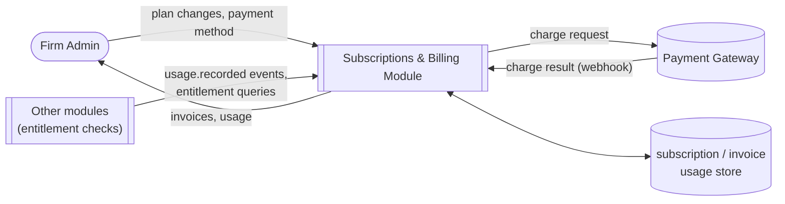
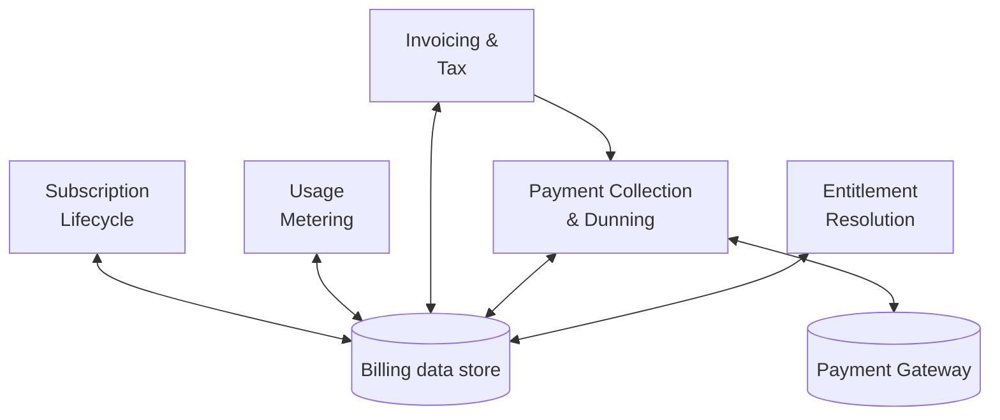
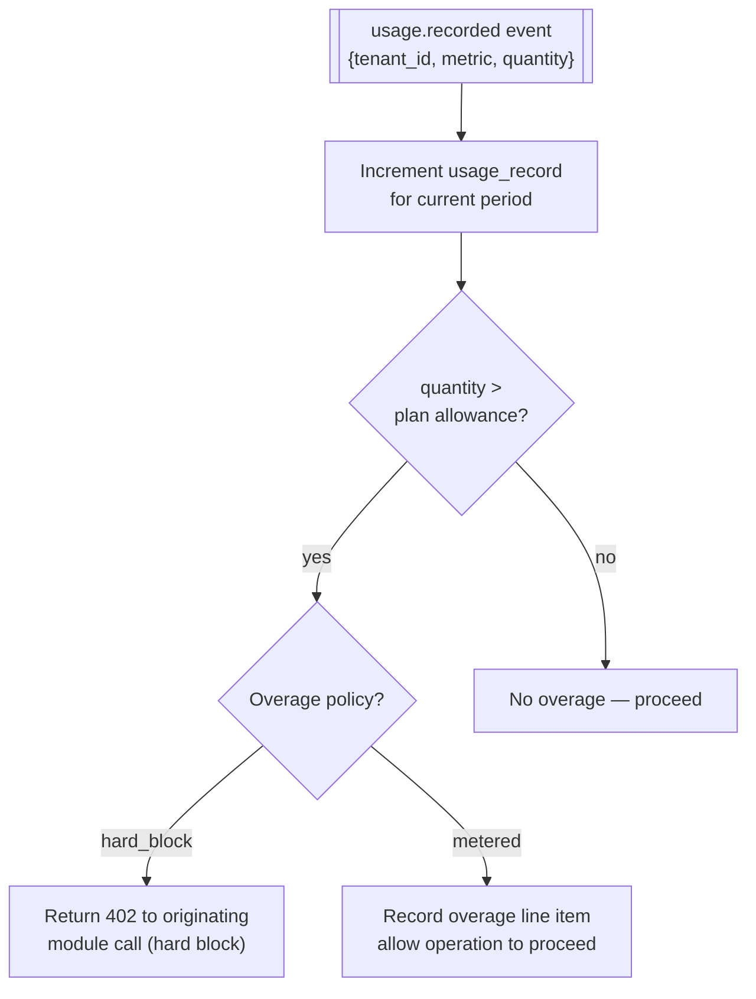
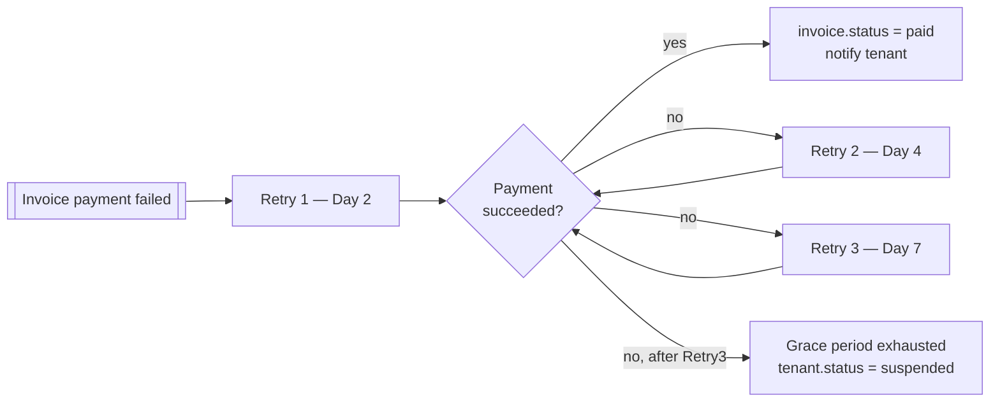
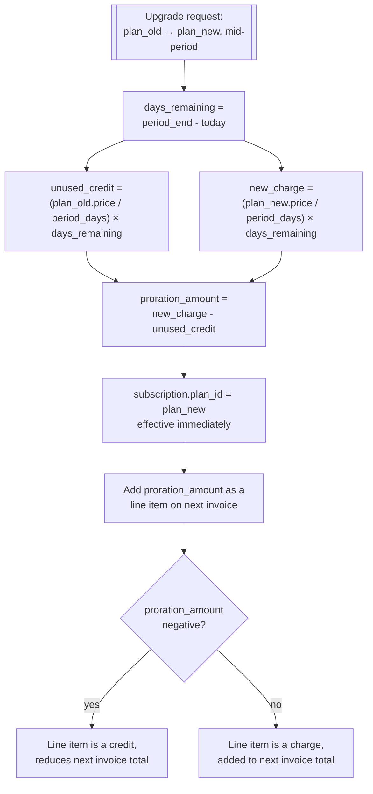

# Subscriptions & Billing

## Purpose

Owns the commercial relationship with each tenant: plan catalogue, trials, upgrades/downgrades,
usage metering, invoicing, and payment collection. This module is the source of truth for what a
tenant is entitled to use; every other module checks entitlements here rather than hard-coding
limits.

## Actors & permissions

| Actor | Interacts with this module as |
|---|---|
| Firm Admin | Chooses/changes plan, manages payment method, views invoices |
| Platform Operator | Manages plan catalogue, handles billing disputes, applies credits |
| Payment Gateway | External system, sends webhook events for charge results |

## Functional features

| ID | Feature | Description | Acceptance criteria |
|---|---|---|---|
| FEAT-BILL-001 | Plan catalogue | Tiered plans by seats, engagement count, document volume | Each plan defines seat_limit, engagement_limit, monthly_document_pages, price |
| FEAT-BILL-002 | Free trial | New tenant starts on a time-boxed trial plan | Trial auto-expires after 14 days; expiry blocks new engagement creation, not existing data access |
| FEAT-BILL-003 | Plan upgrade | Tenant moves to a higher tier mid-cycle | Takes effect immediately; proration charged on next invoice — see [DFD Level 3](#dfd-level-3--mid-cycle-plan-change-proration) |
| FEAT-BILL-004 | Plan downgrade | Tenant moves to a lower tier | Takes effect at the end of the current billing period, not immediately, to avoid mid-cycle feature loss |
| FEAT-BILL-005 | Seat-based metering | Active user count tracked against plan seat limit | Inviting a user beyond the seat limit is blocked with an upgrade prompt |
| FEAT-BILL-006 | Usage metering | Document pages parsed and rule runs counted per billing period | Usage counters reset at period boundary; visible to tenant in near real time |
| FEAT-BILL-007 | Overage handling | Usage beyond plan allowance | Configurable per plan: hard-block or metered overage billing |
| FEAT-BILL-008 | Invoice generation | Monthly invoice reflecting plan + overages | Generated within 24h of period close; itemized line per charge type |
| FEAT-BILL-009 | GST on subscription | Indian GST applied to the SaaS invoice itself | Invoice shows CGST/SGST or IGST per tenant's registered state |
| FEAT-BILL-010 | Payment method management | Tenant adds/updates a card or bank mandate | Card details never touch platform servers — tokenized via payment gateway |
| FEAT-BILL-011 | Automatic charge | Invoice auto-charged to the default payment method | Retried per dunning schedule on failure |
| FEAT-BILL-012 | Dunning & grace period | Failed payment triggers retry schedule before suspension | 3 retries over 7 days; tenant suspended only after grace period exhausted |
| FEAT-BILL-013 | Feature gating by entitlement | Plan determines which features are available | Entitlement check is a single lookup other modules call, not duplicated logic |
| FEAT-BILL-014 | Billing history | Tenant views past invoices and payments | Downloadable as PDF |
| FEAT-BILL-015 | Manual credit/adjustment | Operator applies a goodwill credit or correction | Requires reason logged; reflected on next invoice |
| FEAT-BILL-016 | Cancellation | Tenant cancels subscription | Access continues until current period end, then tenant moves to suspended (not deleted) |

## Business rules & constraints

- **BR-BILL-01**: Downgrades never take effect mid-cycle — this prevents a tenant losing access
  to data or seats they've already paid for in the current period.
- **BR-BILL-02**: Upgrades take effect immediately; the price difference for the remainder of the
  current period is prorated on the next invoice, not charged as a separate immediate transaction.
- **BR-BILL-03**: No card data is stored on platform infrastructure — payment method storage is
  fully delegated to the payment gateway (PCI scope reduction).
- **BR-BILL-04**: A tenant is never data-deleted for non-payment — only suspended. Deletion
  requires the explicit offboarding flow in [Multi-Tenancy](./02-multi-tenancy).
- **BR-BILL-05**: Usage counters are the same numbers [Ingestion](./05-document-ingestion) and
  [Rule Engine](./07-rule-engine) emit as `usage.recorded` events — billing never re-derives usage
  independently, to avoid drift between what's metered and what's charged.

## Data model

| Entity | Key fields | Scope |
|---|---|---|
| `plan` | `id`, `name`, `seat_limit`, `engagement_limit`, `monthly_pages`, `price`, `overage_policy` | Global |
| `subscription` | `id`, `tenant_id`, `plan_id`, `status`, `current_period_start/end`, `trial_end` | Global |
| `usage_record` | `id`, `tenant_id`, `metric`, `quantity`, `period` | Global |
| `invoice` | `id`, `tenant_id`, `subscription_id`, `amount`, `tax_amount`, `status`, `issued_at` | Global |
| `invoice_line_item` | `id`, `invoice_id`, `description`, `amount` | Global |
| `payment_method` | `id`, `tenant_id`, `gateway_token`, `type`, `is_default` | Global |
| `payment_attempt` | `id`, `invoice_id`, `status`, `attempted_at`, `gateway_reference` | Global |

## API surface

| Method | Path | Purpose | Auth scope |
|---|---|---|---|
| GET | `/billing/plans` | List available plans | Any authenticated user |
| GET | `/billing/subscription` | Current tenant's subscription | Admin role |
| POST | `/billing/subscription/change-plan` | Upgrade/downgrade | Admin role |
| POST | `/billing/subscription/cancel` | Cancel subscription | Admin role |
| GET | `/billing/usage` | Current-period usage | Admin role |
| GET | `/billing/invoices` | Invoice history | Admin role |
| GET | `/billing/invoices/{id}` | Single invoice detail/PDF | Admin role |
| POST | `/billing/payment-methods` | Add payment method | Admin role |
| DELETE | `/billing/payment-methods/{id}` | Remove payment method | Admin role |
| POST | `/billing/webhooks/gateway` | Payment gateway callback | Gateway signature verification |
| POST | `/admin/billing/{tenant_id}/credit` | Apply manual credit | Platform Operator |

## DFD Level 0

## DFD Level 1

## DFD Level 2 — Usage Metering & Overage

## DFD Level 2 — Dunning

## DFD Level 3 — Mid-Cycle Plan Change Proration

Downgrades skip this entirely — per BR-BILL-01, they queue for the *next* period boundary instead
of prorating, so there is no mid-cycle downgrade credit calculation to reconcile.

## Edge cases & failure modes

| Condition | System behavior |
|---|---|
| Trial expires with an in-progress engagement | Existing engagement stays read-accessible; new engagement creation blocked until a paid plan is chosen |
| Payment gateway webhook arrives twice for the same charge | Idempotency key on the webhook payload prevents double-processing |
| Tenant cancels then re-subscribes within the same period | Original period end is honored; no double-charge for the same period |
| Seat limit hit while an invitation is already pending | Pending invitation still counts against the seat limit at send time, not just at acceptance |
| Usage event arrives for a tenant with no active subscription | Recorded but excluded from billing; surfaced as an anomaly for operator review |

## Out of scope

- Multi-currency billing — INR only for v1, matching the target market.
- Reseller/partner billing hierarchies — every tenant bills directly.
- Usage-based (pure pay-as-you-go, no base plan) pricing — all plans have a fixed base + metered
  overage, not fully consumption-based pricing.
