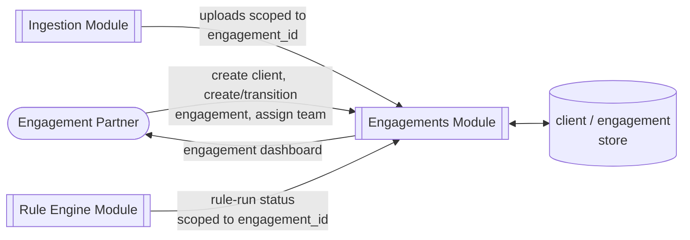
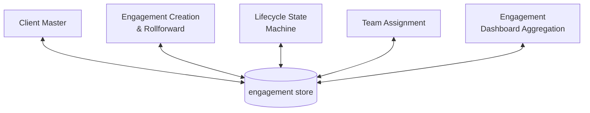
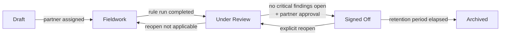
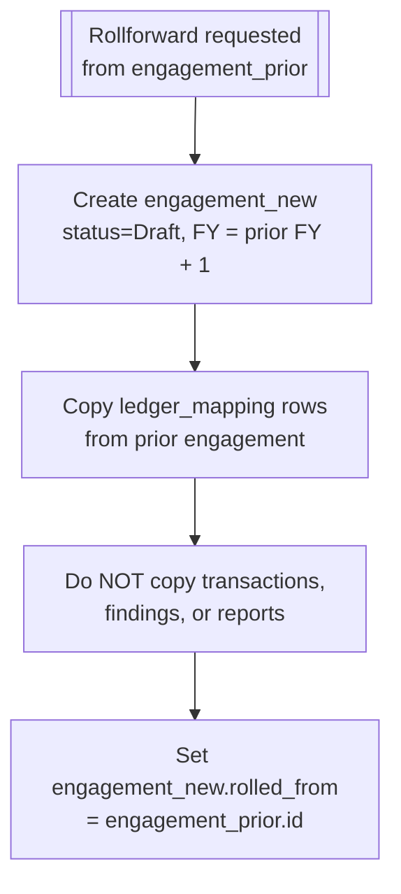
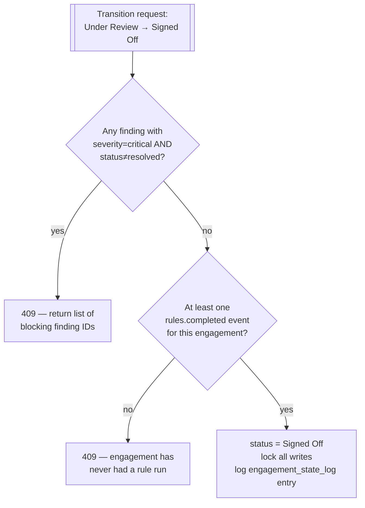

# Engagements

## Purpose

Owns the client master and the audit engagement lifecycle — the organizing unit that every
uploaded file, transaction, and finding hangs off. An engagement is one client audited for one
financial year; this module governs its states from creation through sign-off and archival.

## Actors & permissions

| Actor | Interacts with this module as |
|---|---|
| Engagement Partner | Creates engagements, assigns team, approves sign-off |
| Audit Staff | Works within assigned engagements |
| Firm Admin | Manages client master, views all engagements firm-wide |

## Functional features

| ID | Feature | Description | Acceptance criteria |
|---|---|---|---|
| FEAT-ENG-001 | Client master | Create/edit client records (name, PAN, industry) | PAN format validated; duplicate PAN within a tenant flagged, not silently allowed |
| FEAT-ENG-002 | Engagement creation | Create an engagement for a client + financial year | Blocked if an engagement for the same client+FY already exists, unless explicitly re-opened |
| FEAT-ENG-003 | Engagement lifecycle states | Draft → Fieldwork → Under Review → Signed Off → Archived | Each transition is a distinct API action, not a free-text status field |
| FEAT-ENG-004 | Team assignment | Assign staff and a reviewing partner to an engagement | At least one partner required before moving out of Draft |
| FEAT-ENG-005 | Rollforward from prior year | New engagement pre-populated from prior year's ledger mappings | Ledger mapping table copied; transactions and findings are not carried over |
| FEAT-ENG-006 | Sign-off lock | Signed-off engagement becomes read-only | Any write attempt (upload, finding edit) after sign-off returns 409 |
| FEAT-ENG-007 | Re-open after sign-off | Partner explicitly re-opens a signed-off engagement | Requires reason logged; reverts to Under Review state |
| FEAT-ENG-008 | Archival | Old engagements archived after a retention period | Archived engagements are read-only and excluded from default list views |
| FEAT-ENG-009 | Engagement dashboard | Per-engagement summary of upload/finding status | Reflects live state, no manual refresh needed |
| FEAT-ENG-010 | Cross-engagement search | Firm-wide search across clients and engagements | Scoped to tenant; respects staff's assigned-engagement visibility |

## Business rules & constraints

- **BR-ENG-01**: An engagement cannot move to Under Review until at least one rule run has
  completed (see [Rule Engine](./07-rule-engine)).
- **BR-ENG-02**: An engagement cannot move to Signed Off while any Critical-severity finding is
  unresolved.
- **BR-ENG-03**: Financial year is stored as its start date (e.g. `2025-04-01`); the platform
  always assumes the Indian FY convention (1 April–31 March).
- **BR-ENG-04**: Staff without an explicit assignment to an engagement cannot view it, even within
  the same tenant, unless they hold the Firm Admin role.

## Data model

| Entity | Key fields | Scope |
|---|---|---|
| `client` | `id`, `tenant_id`, `name`, `pan`, `industry` | Tenant |
| `engagement` | `id`, `client_id`, `financial_year_start`, `status`, `partner_id` | Tenant |
| `engagement_team` | `engagement_id`, `user_id`, `role_on_engagement` | Tenant |
| `engagement_state_log` | `id`, `engagement_id`, `from_state`, `to_state`, `actor_id`, `occurred_at` | Tenant |

## API surface

| Method | Path | Purpose | Auth scope |
|---|---|---|---|
| POST | `/clients` | Create client | Admin / Partner |
| GET | `/clients` | List clients | Any assigned user |
| POST | `/engagements` | Create engagement | Admin / Partner |
| GET | `/engagements/{id}` | Engagement detail + dashboard | Assigned user |
| POST | `/engagements/{id}/transition` | Move to next lifecycle state | Assigned user (state-dependent) |
| POST | `/engagements/{id}/team` | Assign/remove team members | Partner |
| POST | `/engagements/{id}/rollforward` | Create next-year engagement from this one | Partner |
| POST | `/engagements/{id}/reopen` | Re-open a signed-off engagement | Partner |

## DFD Level 0

## DFD Level 1

## DFD Level 2 — Lifecycle State Machine

## DFD Level 2 — Rollforward

## DFD Level 3 — Sign-Off Gate Check

## Edge cases & failure modes

| Condition | System behavior |
|---|---|
| Upload attempted on a Signed Off engagement | 409, with message directing to reopen |
| Rollforward requested from a Draft (never-run) engagement | Allowed, but the copied `ledger_mapping` table is empty — no error |
| Two partners transition the same engagement simultaneously | Optimistic concurrency check on `engagement.status`; second request gets 409 |
| Client PAN changed after engagements exist | Allowed with a warning; historical engagements keep the client link, not a PAN snapshot |

## Out of scope

- Multi-entity consolidated engagements (group audits spanning several clients as one engagement)
  — each engagement is single-client for v1.
- Engagement budgeting/time-tracking — that's practice-management territory, not this platform's
  scope.
