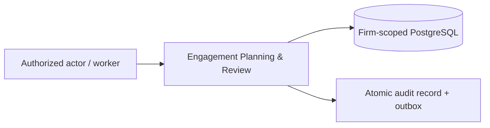

# Engagements

> **Case-study contract.** This is the selected proposed *logical module* of one modular backend, not a deployed service. Source-specific laws and unverified performance assumptions are not implementation claims.

## Purpose

Define client scope, reporting period, planned audit procedures, owners and evidence requirements.

## Actors & permissions

Actors are the responsible firm user, engagement reviewer, authorized client uploader, or scoped background worker as applicable. Every firm-private operation requires verified membership and engagement authorization. See [Roles & Permissions](../reference/roles-permissions.md).

## Functional features

| Requirement | Selected case-study behavior |
| --- | --- |
| Ownership | Engagement revision; required procedures; reviewer independence; source dependencies; immutable approval manifest. |
| Workflow | Review gate checks current approved evidence, procedure coverage and blocking issues atomically. |
| Boundary | One completed rule run or absence of Critical findings is never sufficient for sign-off. |

## Business rules & constraints

- Preserve immutable evidence and document every material human decision.
- Reject unauthorized access, stale revisions and missing prerequisites rather than silently defaulting to success.
- Current design is described in [Solution Architecture](../architecture/solution-architecture.md), [Domain Model](../architecture/domain-model-v2.md) and [Sign-off Contract](../architecture/signoff-contract.md).

## Data model

Authoritative concepts and entity ownership are documented in the [canonical domain model](../architecture/domain-model-v2.md) and [shared-data design](../architecture/data-model.md). This module does not introduce a contradictory independent schema.

## API surface

Any future API must require verified firm/engagement authorization, typed versioned requests, idempotent mutations and explicit error codes. Exact endpoints are **not implemented** or finalized by this use-case study.

## DFD Level 0

## Edge cases & failure modes

- **Unauthorized actor:** deny without exposing firm-private metadata.
- **Missing required input or stale version:** return a reviewable incomplete/error status; do not claim completion.
- **Worker retry:** logical idempotency ensures no duplicate evidence, findings or usage charges.

## Out of scope

One completed rule run or absence of Critical findings is never sufficient for sign-off.

## Cross references

[The end-to-end case](../reference/worked-example.md) · [Architecture alternatives](../architecture/alternatives-and-tradeoffs.md) · [Domain assumptions](../reference/domain-validation-register.md)

### DFD Level 0

The earlier detailed diagram is archived conceptually in the [architecture alternatives](../architecture/alternatives-and-tradeoffs.md). The selected DFD Level 0 and canonical documents govern this case study.

### DFD Level 1

The earlier detailed diagram is archived conceptually in the [architecture alternatives](../architecture/alternatives-and-tradeoffs.md). The selected DFD Level 0 and canonical documents govern this case study.

### DFD Level 2 — Lifecycle State Machine

The earlier detailed diagram is archived conceptually in the [architecture alternatives](../architecture/alternatives-and-tradeoffs.md). The selected DFD Level 0 and canonical documents govern this case study.

### DFD Level 2 — Rollforward

The earlier detailed diagram is archived conceptually in the [architecture alternatives](../architecture/alternatives-and-tradeoffs.md). The selected DFD Level 0 and canonical documents govern this case study.

### DFD Level 3 — Sign-Off Gate Check

The earlier detailed diagram is archived conceptually in the [architecture alternatives](../architecture/alternatives-and-tradeoffs.md). The selected DFD Level 0 and canonical documents govern this case study.
