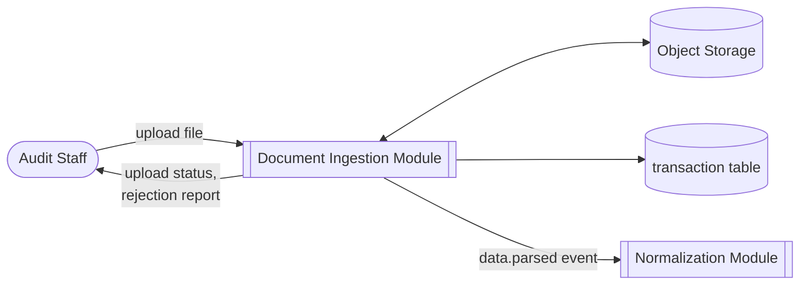
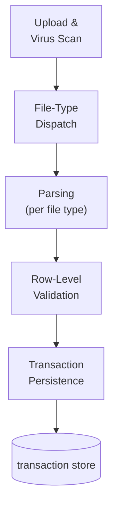
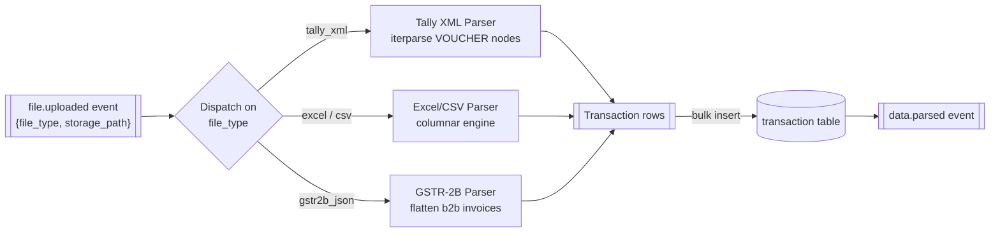
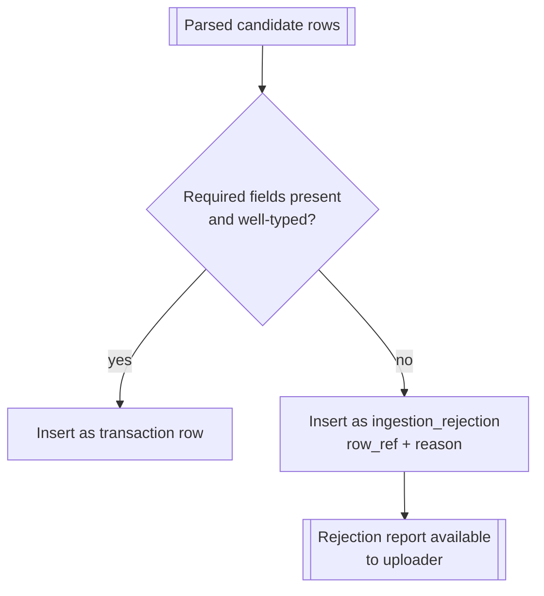
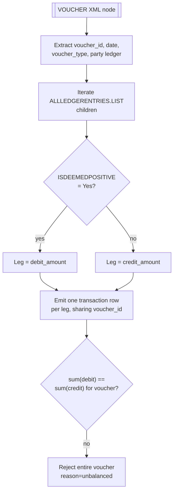

# Document Ingestion

## Purpose

Owns getting a client's raw books into the platform as clean transaction rows. Accepts Tally XML
exports, Excel/CSV ledger dumps, and GSTR-2B JSON filings; validates, scans, and parses each into
the common `transaction` schema that [Normalization](./06-ledger-normalization) and the
[Rule Engine](./07-rule-engine) consume.

## Actors & permissions

| Actor | Interacts with this module as |
|---|---|
| Audit Staff | Uploads files to an engagement, reviews rejected rows |
| Client (via intake link) | Uploads files without a platform account — see [Client Intake Portal](./15-client-intake) |

## Functional features

| ID | Feature | Description | Acceptance criteria |
|---|---|---|---|
| FEAT-ING-001 | File upload | Upload a source file to an engagement | Accepts .xml, .xlsx, .csv, .json up to a configured size limit |
| FEAT-ING-002 | Virus/malware scan | Scan uploaded file before processing | Infected file rejected before parsing; upload marked `rejected_scan` |
| FEAT-ING-003 | File-type dispatch | Route to the correct parser by declared type | Mismatched type/content (e.g. .xml with non-Tally structure) rejected with a clear error |
| FEAT-ING-004 | Tally XML parsing | Parse VOUCHER nodes into transaction rows | 3-voucher fixture parses to 6 transaction rows with correct debit/credit legs |
| FEAT-ING-005 | Excel/CSV parsing | Parse client ledger dumps via a columnar engine | Column-alias table resolves common header variants |
| FEAT-ING-006 | GSTR-2B JSON parsing | Parse GST portal export | Supplier invoices flattened to rows joinable against the purchase register |
| FEAT-ING-007 | Row-level validation | Reject malformed rows individually, not the whole file | Malformed rows are rejected and reported, never silently dropped |
| FEAT-ING-008 | Rejection report | Per-upload report of rejected rows with reasons | Downloadable; references original row/line number |
| FEAT-ING-009 | Re-upload / versioning | Replace a previously uploaded file | Prior version's transactions are superseded, not duplicated, on re-upload |
| FEAT-ING-010 | Duplicate detection | Flag if an identical file is uploaded twice | Hash-based detection; second upload is rejected with a pointer to the original |
| FEAT-ING-011 | Upload status tracking | Per-file status: uploaded, scanning, parsing, parsed, failed | Visible on the engagement dashboard in real time |
| FEAT-ING-012 | Large-file handling | Files up to plan-tier size limits process without timeout | Streamed/chunked parsing, not full in-memory load for large Excel files |

## Business rules & constraints

- **BR-ING-01**: A file is never partially committed — either the full parse succeeds (with
  individually rejected rows reported) or the whole upload fails and no transaction rows are
  written.
- **BR-ING-02**: Re-upload of a file for the same source supersedes the prior transaction set for
  that file; it does not merge or duplicate.
- **BR-ING-03**: Parsing emits a `usage.recorded` event (document pages/rows) consumed by
  [Billing](./03-subscriptions-billing) for metering.
- **BR-ING-04**: No LLM or fuzzy inference is used at the parsing stage — parsing is structural
  (XML schema, column headers, JSON keys), not content interpretation.

## Data model

| Entity | Key fields | Scope |
|---|---|---|
| `uploaded_file` | `id`, `engagement_id`, `file_type`, `storage_path`, `file_hash`, `status` | Tenant |
| `transaction` | `id`, `engagement_id`, `uploaded_file_id`, `voucher_id`, `ledger_name`, `debit_amount`, `credit_amount`, `transaction_date` | Tenant |
| `ingestion_rejection` | `id`, `uploaded_file_id`, `row_ref`, `reason` | Tenant |

## API surface

| Method | Path | Purpose | Auth scope |
|---|---|---|---|
| POST | `/engagements/{id}/uploads` | Upload a file | Assigned user |
| GET | `/engagements/{id}/uploads` | List uploads + status | Assigned user |
| GET | `/uploads/{id}/rejections` | Download rejection report | Assigned user |
| DELETE | `/uploads/{id}` | Remove an upload (supersede) | Assigned user |

## DFD Level 0

## DFD Level 1

## DFD Level 2 — Parsing Subsystem

## DFD Level 2 — Row-Level Validation & Rejection

## DFD Level 3 — Tally VOUCHER → Transaction Legs

A single voucher can produce more than two legs (split entries); the balance check runs after all
legs for a voucher are collected, not per-leg, since an individual leg is neither balanced nor
unbalanced on its own.

## Edge cases & failure modes

| Condition | System behavior |
|---|---|
| Excel file with merged header cells | Column-alias resolution fails for that column; rows still parse with that field null and flagged rejected |
| Tally voucher with debit ≠ credit | Whole voucher rejected (BR-ING-01 applies at voucher granularity for Tally, not whole-file) |
| GSTR-2B JSON missing the `docdata.b2b` key | File rejected at dispatch with a clear "not a GSTR-2B export" error |
| Upload exceeds plan's page/row quota mid-parse | Parsing completes for the file; quota breach is handled by Billing as an overage, not a parse failure |
| Duplicate file uploaded to a *different* engagement | Allowed — duplicate detection is scoped per engagement, not tenant-wide |

## Out of scope

- OCR of scanned paper vouchers — source files must be digital exports.
- Direct live API pull from Tally (real-time sync) — see [Integrations & Public API](./14-integrations-api)
  for the connector roadmap; v1 ingestion is file-upload only.
- Client-authenticated upload — a client submits files via a tokenized, unauthenticated link, not
  a platform login; see [Client Intake Portal](./15-client-intake).
