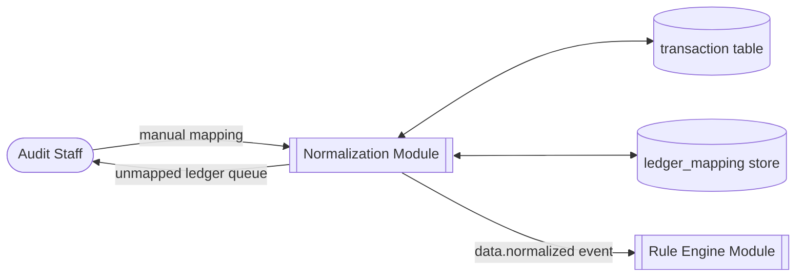
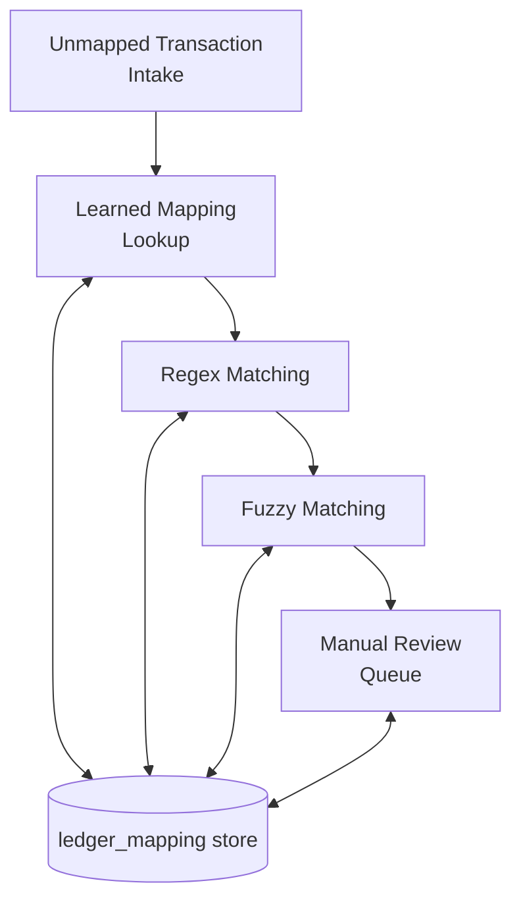
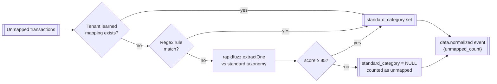
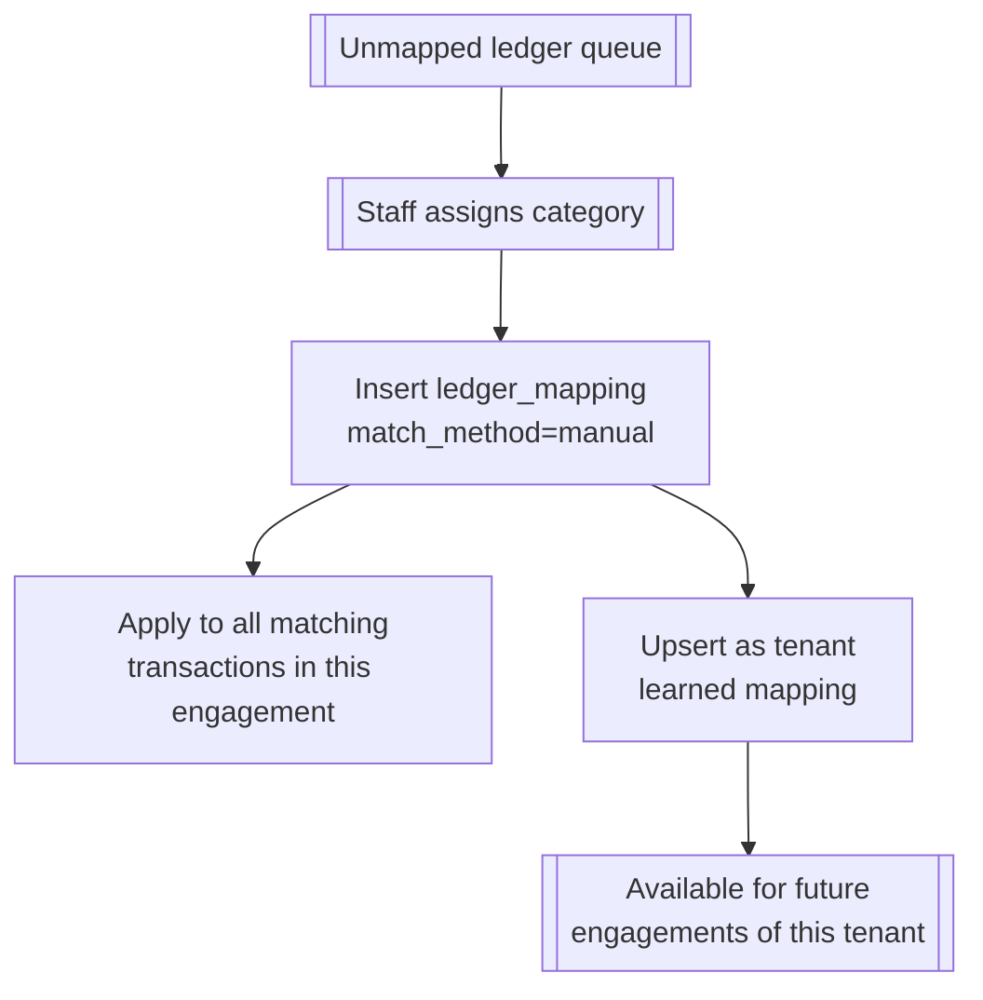
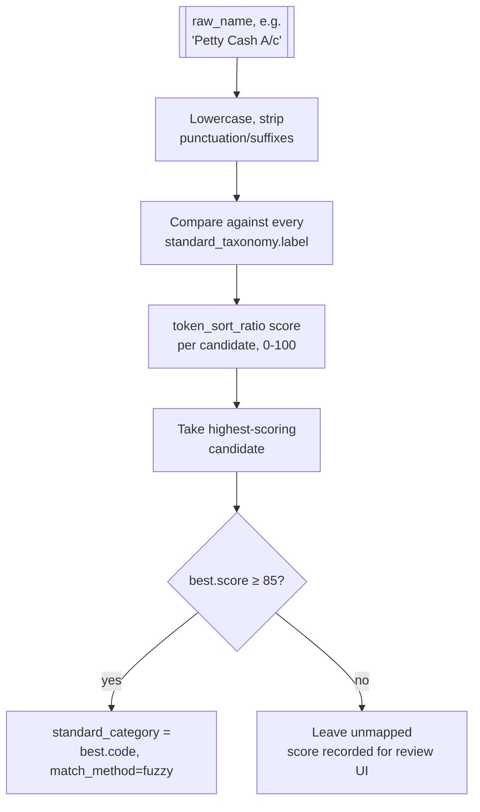

# Ledger Normalization

## Purpose

Maps arbitrary client ledger names onto a fixed standard taxonomy, so the
[Rule Engine](./07-rule-engine) can be written once against `Assets.Current.Cash` instead of every
client's spelling of "Cash A/c" / "Cash-in-Hand" / "Petty Cash". This module is what makes the
rule engine client-agnostic.

## Actors & permissions

| Actor | Interacts with this module as |
|---|---|
| Audit Staff | Reviews and confirms unmapped ledgers |
| Firm Admin | Manages the tenant's learned-mapping overrides |

## Functional features

| ID | Feature | Description | Acceptance criteria |
|---|---|---|---|
| FEAT-NORM-001 | Standard taxonomy | Fixed, versioned chart of accounts every ledger maps onto | Taxonomy is platform-global, not editable per tenant |
| FEAT-NORM-002 | Regex mapping table | Common Tally/Excel ledger name patterns matched first | Covers common naming variants out of the box |
| FEAT-NORM-003 | Fuzzy match fallback | `rapidfuzz`-style match against taxonomy labels when regex misses | Match applied only at score ≥ 85; below cutoff is left unmapped, never guessed |
| FEAT-NORM-004 | Unmapped ledger queue | Ledgers neither regex- nor fuzzy-matched surfaced for manual review | Queue is per-engagement, cleared explicitly by staff, not auto-dismissed |
| FEAT-NORM-005 | Manual mapping | Staff assigns a standard category to an unmapped ledger | Becomes a tenant-scoped learned mapping for future engagements |
| FEAT-NORM-006 | Learned mapping reuse | Tenant's manual mappings applied automatically on future uploads | Learned mappings checked before falling back to fuzzy match |
| FEAT-NORM-007 | Mapping override | Staff corrects an automatic (regex/fuzzy) mapping | Overriding a mapping does not retroactively change already-generated findings |
| FEAT-NORM-008 | Mapping confidence display | Each mapped transaction shows how it was matched | UI/API distinguishes regex, fuzzy (with score), learned, manual |
| FEAT-NORM-009 | Unmapped-count gate | Rule run blocked (or run with a warning) above an unmapped threshold | Engagement dashboard surfaces `unmapped_count` prominently |

## Business rules & constraints

- **BR-NORM-01**: An unmapped ledger is never guessed into a category below the 85 fuzzy-score
  cutoff — it stays `standard_category = NULL` and is counted, not silently assigned.
- **BR-NORM-02**: The standard taxonomy itself is platform-global and versioned; tenants cannot
  add arbitrary new categories, only map their ledgers onto the existing set.
- **BR-NORM-03**: Regex mapping always takes priority over fuzzy match — fuzzy match only runs
  when no regex rule matches.
- **BR-NORM-04**: A manual mapping made in one engagement becomes a tenant-level learned mapping,
  applied automatically in future engagements for that tenant (not shared cross-tenant).

## Data model

| Entity | Key fields | Scope |
|---|---|---|
| `standard_taxonomy` | `code` (e.g. `Assets.Current.Cash`), `label`, `category_group` | Global |
| `regex_mapping_rule` | `id`, `pattern`, `standard_category` | Global |
| `ledger_mapping` | `id`, `tenant_id`, `raw_name`, `standard_category`, `match_method`, `score` | Tenant |
| `unmapped_ledger` | `id`, `engagement_id`, `raw_name`, `transaction_count` | Tenant |

## API surface

| Method | Path | Purpose | Auth scope |
|---|---|---|---|
| GET | `/engagements/{id}/unmapped-ledgers` | List unmapped ledgers for review | Assigned user |
| POST | `/engagements/{id}/ledger-mappings` | Assign a mapping manually | Assigned user |
| PATCH | `/ledger-mappings/{id}` | Override an existing mapping | Assigned user |
| GET | `/taxonomy` | Fetch the standard taxonomy | Any authenticated user |

## DFD Level 0

## DFD Level 1

## DFD Level 2 — Mapping Resolution Pipeline

## DFD Level 2 — Manual Review & Learning

## DFD Level 3 — Fuzzy Match Scoring

## Edge cases & failure modes

| Condition | System behavior |
|---|---|
| Two ledgers with near-identical names map to different categories via fuzzy match | Both are individually scored; no cross-ledger consistency check forces them to agree — staff can override either |
| Tenant's learned mapping conflicts with an updated regex rule (platform taxonomy version bump) | Learned mapping still takes priority — tenant override is sticky across taxonomy updates |
| Same raw ledger name appears with different capitalization/whitespace across files | Normalized (case/whitespace-insensitive) before matching, so both resolve to the same mapping |
| Unmapped count is non-zero but staff proceeds to rule run anyway | Allowed — unmapped-count gate is a warning, not a hard block, since the auditor may judge remaining ledgers immaterial |

## Out of scope

- Automatic taxonomy expansion (learning entirely new standard categories) — the standard
  taxonomy is fixed and platform-curated, not machine-extended.
- Cross-tenant sharing of learned mappings — each firm's mapping corrections stay private to that
  firm, consistent with tenant data isolation.
