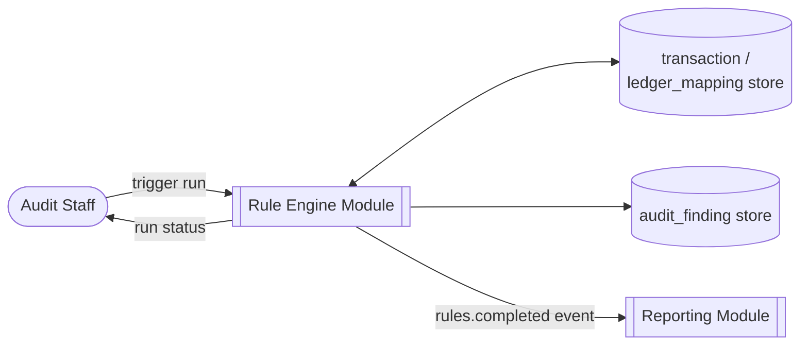
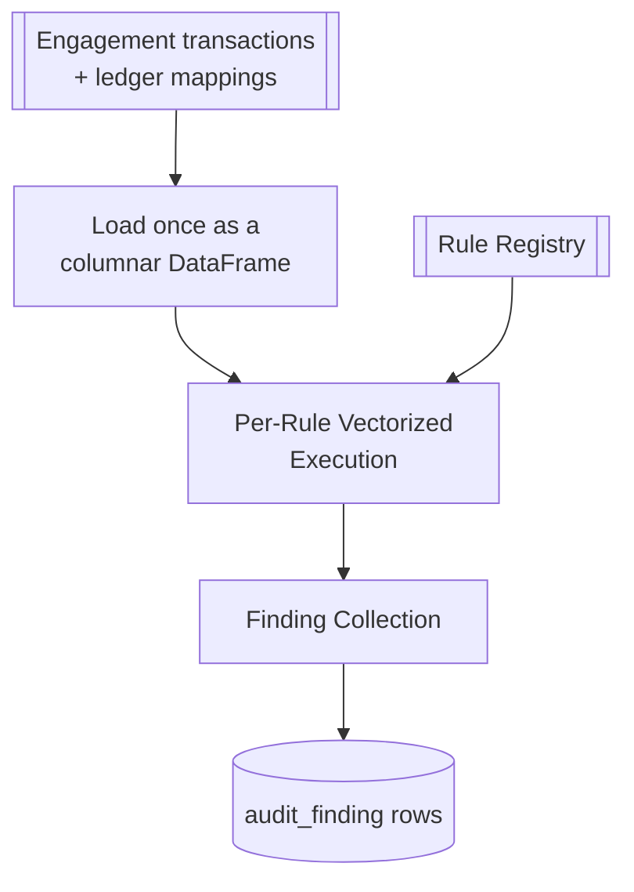
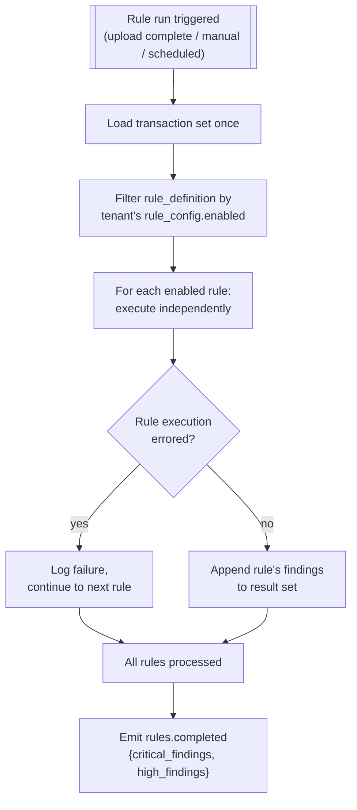
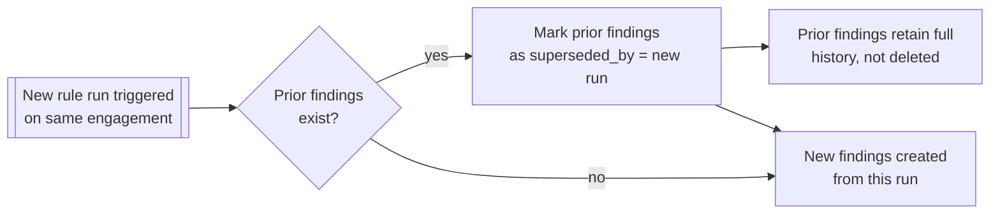
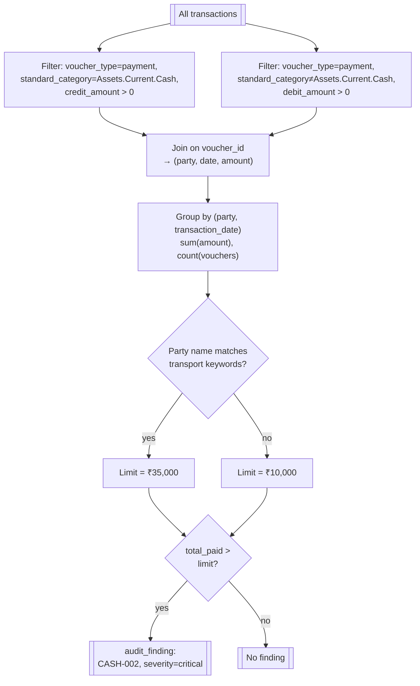

# Rule Engine

:::caution Earlier module sketch — reconcile before implementation
This page documents an earlier India-first design. The [canonical solution architecture](../architecture/solution-architecture.md), [domain model](../architecture/domain-model-v2.md), [review contract](../architecture/signoff-contract.md), and [decision records](../architecture/decision-records.md) override contradictory details in this module. It is a **reference use case**, not executable functionality.
:::

## Purpose

Runs approved deterministic checks against a **pinned and adequately reconciled dataset snapshot**, producing candidate findings and explicit per-rule coverage states. `0 findings` does not mean success if input is missing. The engine owns candidate creation; downstream human workflow owns disposition. See [Review Contract](../architecture/signoff-contract.md).

The earlier design described running every statutory check across an engagement's full transaction set and producing
findings. This is the platform's core value proposition: arithmetic against fixed statutory
thresholds, vectorized for speed, with zero model variance. The full rule catalogue lives in
[Reference → Statutory Rules](../reference/statutory-rules); this page covers the engine that runs
them.

## Actors & permissions

| Actor | Interacts with this module as |
|---|---|
| Audit Staff | Triggers rule runs, views results |
| Firm Admin | Configures per-tenant rule thresholds/overrides |

## Functional features

| ID | Feature | Description | Acceptance criteria |
|---|---|---|---|
| FEAT-RULE-001 | Rule registry | Central catalogue of all statutory rules | Each rule self-describes id, legal reference, severity, default thresholds |
| FEAT-RULE-002 | Run orchestration | Trigger a full run across an engagement's transactions | Loads transaction set once, runs all enabled rules against it |
| FEAT-RULE-003 | Vectorized execution | Rules run as columnar operations, not row-by-row loops | A 100,000-row trial balance completes in under 3 seconds |
| FEAT-RULE-004 | Per-rule enable/disable | Tenant can disable a rule not applicable to their engagement type | Disabled rule is skipped entirely, not run-and-hidden |
| FEAT-RULE-005 | Threshold overrides | Tenant can override a rule's default numeric threshold within a bounded range | Override is per-tenant, logged, and shown alongside any finding it affects |
| FEAT-RULE-006 | Determinism guarantee | Same inputs always produce the same findings | Automated regression test: re-running against unchanged data produces byte-identical findings |
| FEAT-RULE-007 | Re-run & result versioning | Re-running after new uploads produces a new result set | Prior findings are superseded, not deleted — see [Findings Workflow](./08-findings-workflow) |
| FEAT-RULE-008 | Run history | Every rule run recorded with timestamp and trigger reason | Visible on the engagement dashboard |
| FEAT-RULE-009 | Partial rule failure isolation | One rule erroring doesn't abort the others | Failed rule logged and surfaced; other rules' findings still produced |
| FEAT-RULE-010 | Performance budget alerting | Runs exceeding the performance budget are flagged to operators | Internal metric, not tenant-facing |

## Business rules & constraints

- **BR-RULE-01**: No rule in this engine's registry ever calls an LLM or any non-deterministic
  service — this is a structural guarantee, not a convention, enforced by architecture review of
  every new rule before it's added to the registry.
- **BR-RULE-02**: A rule run always loads the full current transaction set for the engagement —
  there is no incremental/delta rule execution that could diverge from a full run's result.
- **BR-RULE-03**: Threshold overrides are bounded per rule (e.g. cannot move the Sec 40A(3) limit
  below the statutory ₹10,000, only tighten it) so a tenant cannot configure away a genuine
  statutory violation.
- **BR-RULE-04**: A rule run is triggered explicitly (upload completion, manual trigger, or
  scheduled re-run) — never silently in the background without a `rules.completed` event a user
  can see.

## Data model

| Entity | Key fields | Scope |
|---|---|---|
| `rule_definition` | `id` (e.g. `CASH-002`), `legal_reference`, `default_severity`, `default_thresholds` | Global |
| `rule_config` | `tenant_id`, `rule_id`, `enabled`, `threshold_overrides` | Tenant |
| `rule_run` | `id`, `engagement_id`, `triggered_by`, `started_at`, `completed_at`, `status` | Tenant |
| `audit_finding` | `id`, `rule_run_id`, `rule_id`, `severity`, `transaction_refs`, `details` | Tenant |

## API surface

| Method | Path | Purpose | Auth scope |
|---|---|---|---|
| POST | `/engagements/{id}/rule-runs` | Trigger a rule run | Assigned user |
| GET | `/engagements/{id}/rule-runs` | Run history | Assigned user |
| GET | `/rule-runs/{id}` | Run detail + per-rule status | Assigned user |
| GET | `/rules` | List rule registry | Any authenticated user |
| PATCH | `/tenants/current/rule-config/{rule_id}` | Enable/disable/override threshold | Admin role |

## DFD Level 0

## DFD Level 1

## DFD Level 2 — Run Orchestration

## DFD Level 2 — Determinism & Re-run Handling

## DFD Level 3 — CASH-002 (Sec 40A(3)) Micro-Logic

This is one of five rules in the current registry. The other four (CASH-001, JOUR-001, MSME-001,
GST-ITC-001) follow the same shape — filter, group, threshold check, finding — and are detailed in
full in [Reference → Statutory Rules](../reference/statutory-rules).

## Edge cases & failure modes

| Condition | System behavior |
|---|---|
| Rule threshold override set outside the bounded range | API rejects with 422 at config time, not silently clamped |
| Rule run triggered while a prior run is still in progress | Second trigger queued, not run concurrently against the same transaction set |
| Transaction set has zero rows (empty upload) | Run completes with zero findings, not an error |
| Required source missing (e.g. GSTR-2B for an applicable India check) | Mark check `INSUFFICIENT_DATA`; **never report as clean/completed**. Dependent required procedures and sign-off remain blocked or require documented limitation approval |

## Out of scope

- Custom/tenant-authored rules — the rule catalogue is platform-curated; tenants configure
  thresholds within bounds but cannot add arbitrary new logic in v1.
- Judgment-based checks (going concern, related-party substance-over-form, revenue recognition
  estimates) — these require auditor judgment and are explicitly excluded from an engine built for
  determinism.
