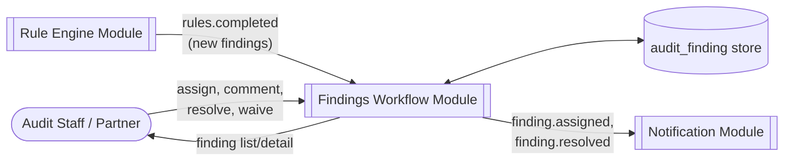
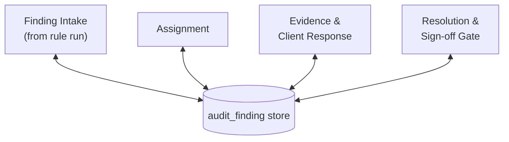
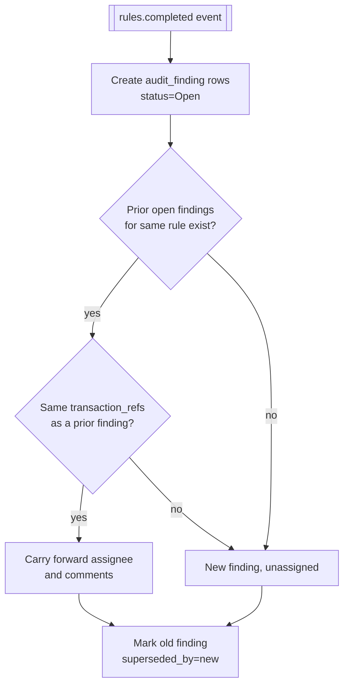
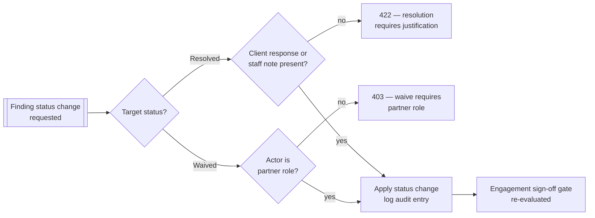
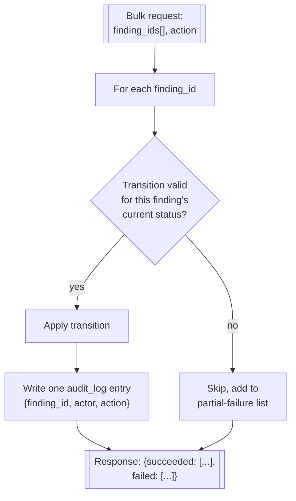

# Findings Workflow

## Purpose

Owns a finding's life after the [Rule Engine](./07-rule-engine) creates it: assignment, evidence
gathering, client response capture, resolution, and the gate that blocks engagement sign-off while
critical findings remain open.

## Actors & permissions

| Actor | Interacts with this module as |
|---|---|
| Audit Staff | Works findings assigned to them, attaches evidence, proposes resolution |
| Engagement Partner | Reassigns findings, approves resolution, overrides severity |

## Functional features

| ID | Feature | Description | Acceptance criteria |
|---|---|---|---|
| FEAT-FIND-001 | Finding list | Filterable/sortable list per engagement | Filters by severity, rule, status, assignee |
| FEAT-FIND-002 | Finding detail | Full transaction evidence behind a finding | Shows every transaction row the rule matched, not just a summary |
| FEAT-FIND-003 | Assignment | Assign a finding to a staff member | Assignee notified via [Notifications](./11-notifications) |
| FEAT-FIND-004 | Status lifecycle | Open → In Progress → Pending Client Response → Resolved → Waived | Waived requires a partner-entered justification |
| FEAT-FIND-005 | Comments/notes | Threaded notes on a finding | Visible to the engagement team, not client-facing |
| FEAT-FIND-006 | Evidence attachment | Attach supporting documents to a finding | Attachments stored per finding, included in audit trail |
| FEAT-FIND-007 | Client response capture | Record the client's explanation for a finding | Free text + optional attachment; timestamped |
| FEAT-FIND-008 | Severity override | Partner overrides a rule's default severity for one finding | Requires justification; original rule severity retained for reference |
| FEAT-FIND-009 | Bulk actions | Assign/resolve multiple findings at once | Bulk action logs one audit entry per affected finding, not one combined entry |
| FEAT-FIND-010 | Sign-off gate integration | Critical findings block engagement sign-off | Enforced by [Engagements](./04-engagements), read from this module's state |
| FEAT-FIND-011 | Superseded-finding handling | Findings from a prior rule run are superseded, not deleted, on re-run | Superseded findings remain viewable in run history |

## Business rules & constraints

- **BR-FIND-01**: A finding cannot be marked Resolved without either a client response or an
  explicit staff note explaining the resolution — no silent close.
- **BR-FIND-02**: Waiving a Critical finding requires partner-level role, never staff-level.
- **BR-FIND-03**: Severity override changes the *display* severity only; the underlying rule's
  original severity is preserved for audit and regulatory purposes.

## Data model

| Entity | Key fields | Scope |
|---|---|---|
| `audit_finding` | `id`, `engagement_id`, `rule_id`, `severity`, `status`, `assignee_id` | Tenant |
| `finding_comment` | `id`, `finding_id`, `author_id`, `body`, `created_at` | Tenant |
| `finding_evidence` | `id`, `finding_id`, `file_path`, `uploaded_by` | Tenant |
| `client_response` | `id`, `finding_id`, `body`, `recorded_by`, `recorded_at` | Tenant |

## API surface

| Method | Path | Purpose | Auth scope |
|---|---|---|---|
| GET | `/engagements/{id}/findings` | List findings | Assigned user |
| GET | `/findings/{id}` | Finding detail | Assigned user |
| PATCH | `/findings/{id}` | Update status/severity/assignee | Assigned user (role-dependent) |
| POST | `/findings/{id}/comments` | Add comment | Assigned user |
| POST | `/findings/{id}/evidence` | Attach evidence | Assigned user |
| POST | `/findings/{id}/client-response` | Record client response | Assigned user |
| POST | `/findings/bulk` | Bulk status/assignment update | Assigned user |

## DFD Level 0

## DFD Level 1

## DFD Level 2 — Finding Intake from Rule Run

## DFD Level 2 — Resolution & Sign-off Gate

## DFD Level 3 — Bulk Action Audit Fan-Out

A bulk action is not all-or-nothing: each finding is evaluated independently, so one finding in an
invalid state (e.g. already Resolved) doesn't block the rest of the batch.

## Edge cases & failure modes

| Condition | System behavior |
|---|---|
| Rule re-run produces a finding identical to a previously Resolved one | New finding created as Open, referencing the resolved prior one for context — resolution doesn't suppress recurrence |
| Assignee removed from the engagement team while findings still assigned to them | Findings remain assigned (historical record); reassignment prompted on next partner review |
| Client response recorded after finding already Resolved | Allowed as an addendum; does not reopen the finding |

## Out of scope

- Client-facing portal for direct client response submission — client responses are recorded by
  audit staff on the client's behalf in v1, not submitted by the client themselves.
- SLA/aging automation (auto-escalate findings open too long) — see
  [Notifications](./11-notifications) for what digest/reminder behavior does exist.
