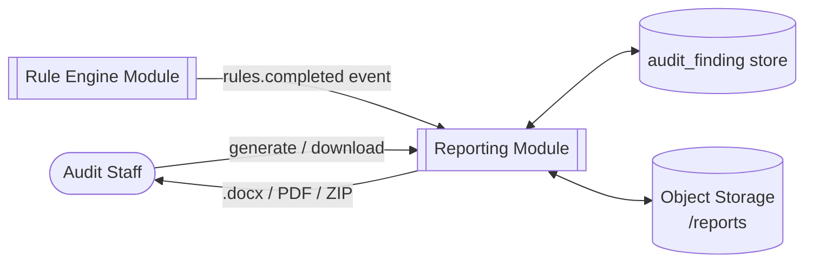
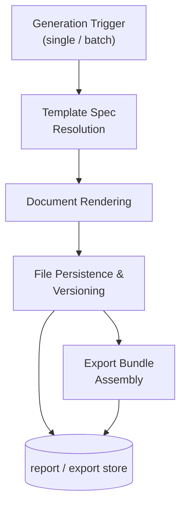
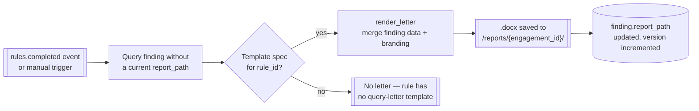
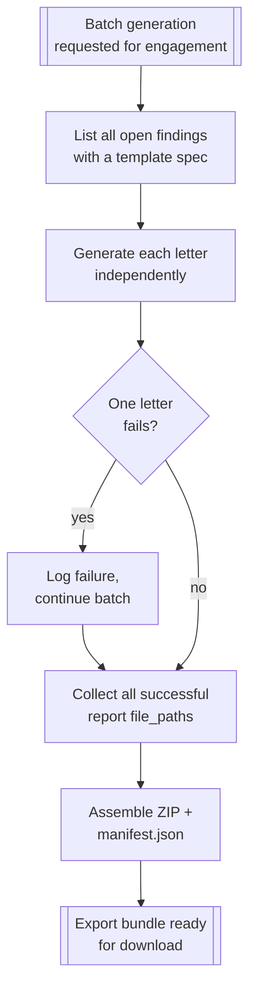
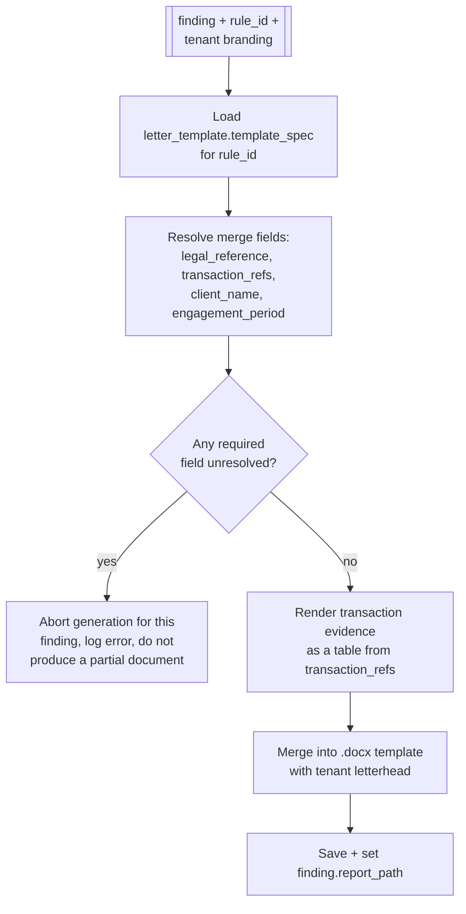

# Reporting & Query Letters

## Purpose

Turns each finding into a ready-to-send .docx query letter with the correct statutory reference
and supporting transaction detail pre-populated, and bundles engagement-level exports for
handover or archival.

## Actors & permissions

| Actor | Interacts with this module as |
|---|---|
| Audit Staff | Generates and downloads letters/exports |
| Firm Admin | Manages letterhead/branding templates |

## Functional features

| ID | Feature | Description | Acceptance criteria |
|---|---|---|---|
| FEAT-REP-001 | Per-rule letter template | Each rule maps to a template spec | Template covers statutory reference, finding detail table, response instructions |
| FEAT-REP-002 | Letter generation | Render a .docx for a single finding | Output opens cleanly in Word; no template placeholder left unfilled |
| FEAT-REP-003 | Firm letterhead/branding | Firm's logo and letterhead applied to generated letters | Configurable per tenant in [Admin & Settings](./13-admin-settings) |
| FEAT-REP-004 | Batch generation | Generate letters for all open findings in an engagement at once | Partial failure (one bad template) doesn't block the rest of the batch |
| FEAT-REP-005 | Export bundle | ZIP of all letters + a summary index for an engagement | Includes a manifest listing every included file and its finding reference |
| FEAT-REP-006 | Risk summary report | Partner-facing PDF summarizing findings by severity | Generated on demand, reflects current finding state |
| FEAT-REP-007 | Regeneration on data change | Letter regenerated if the underlying finding is superseded | Prior letter retained in history, not overwritten |

## Business rules & constraints

- **BR-REP-01**: A letter is only generated for a finding whose rule has a template spec — rules
  without one produce no letter, by design, not by omission.
- **BR-REP-02**: Generated letters are immutable once created; a data change produces a new letter
  version, not an in-place edit, preserving what was actually sent historically.
- **BR-REP-03**: All generated files are stored per-tenant and never cross-referenced across
  tenants, consistent with [Multi-Tenancy](./02-multi-tenancy) isolation.

## Data model

| Entity | Key fields | Scope |
|---|---|---|
| `letter_template` | `id`, `rule_id`, `template_spec` | Global |
| `report` | `id`, `finding_id`, `file_path`, `version`, `generated_at` | Tenant |
| `export_bundle` | `id`, `engagement_id`, `file_path`, `manifest` | Tenant |
| `firm_branding` | `tenant_id`, `logo_path`, `letterhead_config` | Tenant |

## API surface

| Method | Path | Purpose | Auth scope |
|---|---|---|---|
| POST | `/findings/{id}/report` | Generate letter for one finding | Assigned user |
| GET | `/findings/{id}/report` | Download latest letter | Assigned user |
| POST | `/engagements/{id}/reports/batch` | Batch-generate letters | Assigned user |
| GET | `/engagements/{id}/export` | Generate/download export bundle | Assigned user |
| GET | `/engagements/{id}/risk-summary` | Generate risk summary PDF | Assigned user |
| PATCH | `/tenants/current/branding` | Update letterhead/branding | Admin role |

## DFD Level 0

## DFD Level 1

## DFD Level 2 — Single-Letter Generation

## DFD Level 2 — Batch Generation & Export Bundle

## DFD Level 3 — Template Merge Field Resolution

## Edge cases & failure modes

| Condition | System behavior |
|---|---|
| Finding waived before a letter was ever generated | No letter generated — waived findings are excluded from batch generation |
| Firm changes branding after letters already sent | Existing letters unaffected; only new generations use updated branding |
| Export bundle requested for an engagement with zero findings | Bundle generated with an empty manifest and a note, not an error |
| Template spec references a merge field the finding doesn't have | Generation aborts for that finding per BR-REP-01/L3 above, surfaced in the batch failure list |

## Out of scope

- Direct email delivery of query letters to the client from within the platform — letters are
  generated for the auditor to send through their own channel; see
  [Notifications](./11-notifications) for what *is* emailed automatically (platform events only).
- Multi-language letter templates — English only, per
  [Cross-Cutting Concerns → Internationalization](../architecture/cross-cutting#internationalization).
