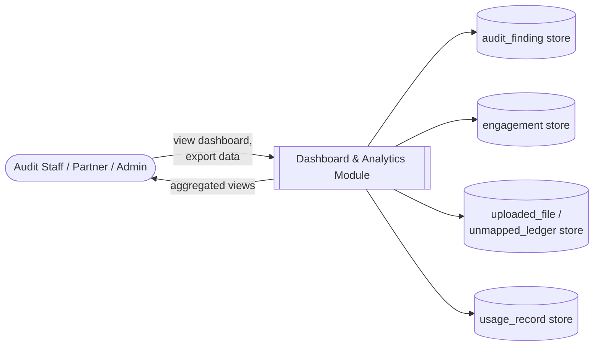
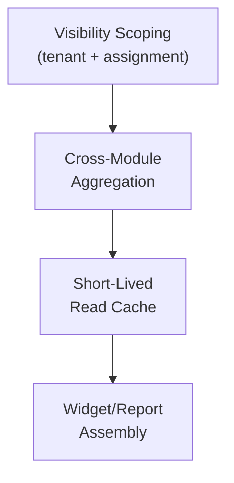
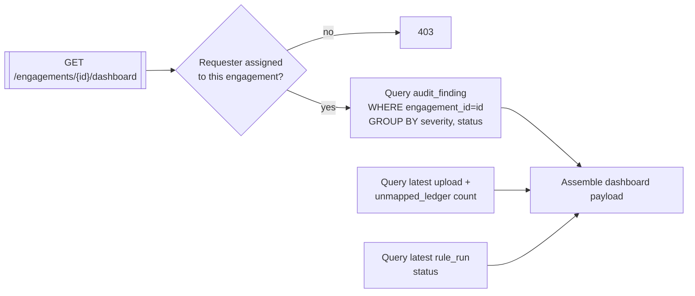
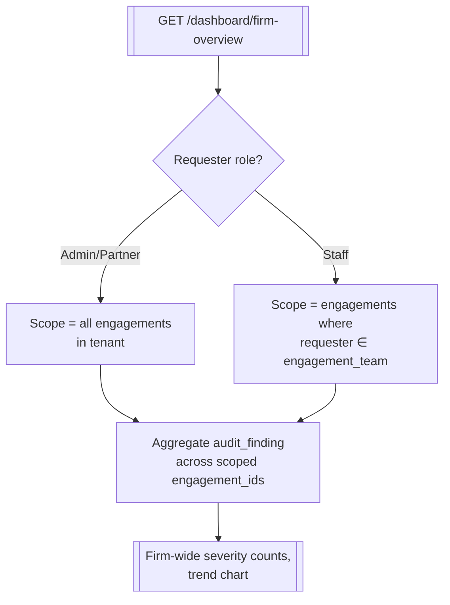
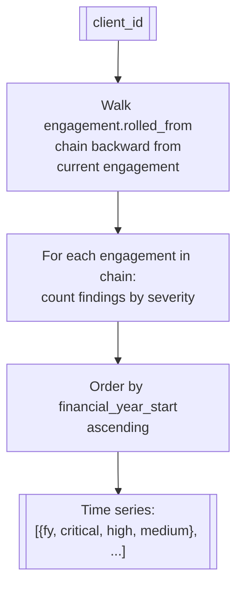

# Dashboard & Analytics

## Purpose

Aggregates live state from every other module into the views a partner or admin actually looks
at: engagement risk posture, firm-wide trends, ingestion health, and plan usage. This module reads
other modules' data; it owns no primary business state itself.

## Actors & permissions

| Actor | Interacts with this module as |
|---|---|
| Audit Staff / Partner | Views engagement and firm-wide dashboards |
| Firm Admin | Views usage/billing widgets alongside audit metrics |

## Functional features

| ID | Feature | Description | Acceptance criteria |
|---|---|---|---|
| FEAT-DASH-001 | Engagement risk dashboard | Finding counts by severity for one engagement | Reflects live `audit_finding` state, updates after each rule run |
| FEAT-DASH-002 | Firm-wide risk overview | Aggregated finding counts across all engagements | Respects staff's assigned-engagement visibility (no cross-visibility leak) |
| FEAT-DASH-003 | Trend over time | Finding counts across engagement history for a client | Chart spans multiple financial years where rollforward data exists |
| FEAT-DASH-004 | Rule hit-rate analytics | Which rules fire most often, firm-wide | Helps a firm see which statutory areas need most attention |
| FEAT-DASH-005 | Ingestion health widget | Upload success/failure rate, unmapped-ledger counts | Surfaces engagements stuck on data-quality issues |
| FEAT-DASH-006 | Usage/plan widget | Seats used, storage used, document volume vs plan limits | Sourced directly from [Billing](./03-subscriptions-billing) usage records |
| FEAT-DASH-007 | Export dashboard data | CSV export of any dashboard table | Export matches exactly what's on screen, same filters applied |

## Business rules & constraints

- **BR-DASH-01**: Dashboards are read-only aggregations — no dashboard action writes to another
  module's state directly; any action (e.g. "resolve finding") deep-links to the owning module.
- **BR-DASH-02**: All dashboard queries are tenant-scoped and further filtered by the viewer's
  assigned engagements, identical to the access rules enforced by the owning modules.
- **BR-DASH-03**: Aggregation is computed on read (or via a short-lived cache), never a
  separately-maintained denormalized copy that could drift from the source tables.

## Data model

This module owns no primary entities; it queries across:

| Source entity | Owning module |
|---|---|
| `audit_finding` | [Rule Engine](./07-rule-engine) / [Findings Workflow](./08-findings-workflow) |
| `engagement` | [Engagements](./04-engagements) |
| `uploaded_file`, `unmapped_ledger` | [Ingestion](./05-document-ingestion) / [Normalization](./06-ledger-normalization) |
| `usage_record` | [Billing](./03-subscriptions-billing) |

## API surface

| Method | Path | Purpose | Auth scope |
|---|---|---|---|
| GET | `/engagements/{id}/dashboard` | Engagement risk dashboard | Assigned user |
| GET | `/dashboard/firm-overview` | Firm-wide risk overview | Any authenticated user (scoped) |
| GET | `/dashboard/trends` | Trend data for a client | Assigned user |
| GET | `/dashboard/rule-hit-rates` | Rule hit-rate analytics | Any authenticated user (scoped) |
| GET | `/dashboard/ingestion-health` | Ingestion health widget | Any authenticated user (scoped) |
| GET | `/dashboard/usage` | Plan usage widget | Admin role |
| GET | `/dashboard/export` | CSV export of a dashboard table | Any authenticated user (scoped) |

## DFD Level 0

## DFD Level 1

## DFD Level 2 — Engagement Risk Dashboard

## DFD Level 2 — Firm-Wide Overview with Scoping

## DFD Level 3 — Trend Aggregation Across Rollforward Chain

Trend charts only span engagements linked via [Engagements → Rollforward](./04-engagements#dfd-level-2--rollforward);
a client audited for the first time (no rolled-from chain) shows a single data point.

## Edge cases & failure modes

| Condition | System behavior |
|---|---|
| Staff views firm-wide overview with zero assigned engagements | Dashboard renders with an empty-state message, not an error |
| Underlying rule run is still in progress when dashboard is loaded | Dashboard shows the prior completed run's data plus a "run in progress" indicator |
| Export requested for a dataset larger than a single-response threshold | Export streams/paginates rather than timing out |

## Out of scope

- Predictive/ML-based risk scoring — this module aggregates deterministic finding counts only,
  consistent with the platform's zero-LLM guarantee for anything a partner relies on.
- Custom dashboard builder (drag-and-drop widgets) — the widget set is fixed for v1.
