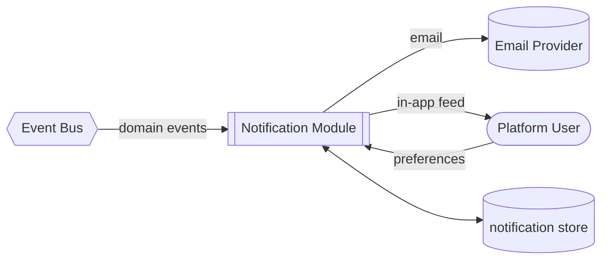
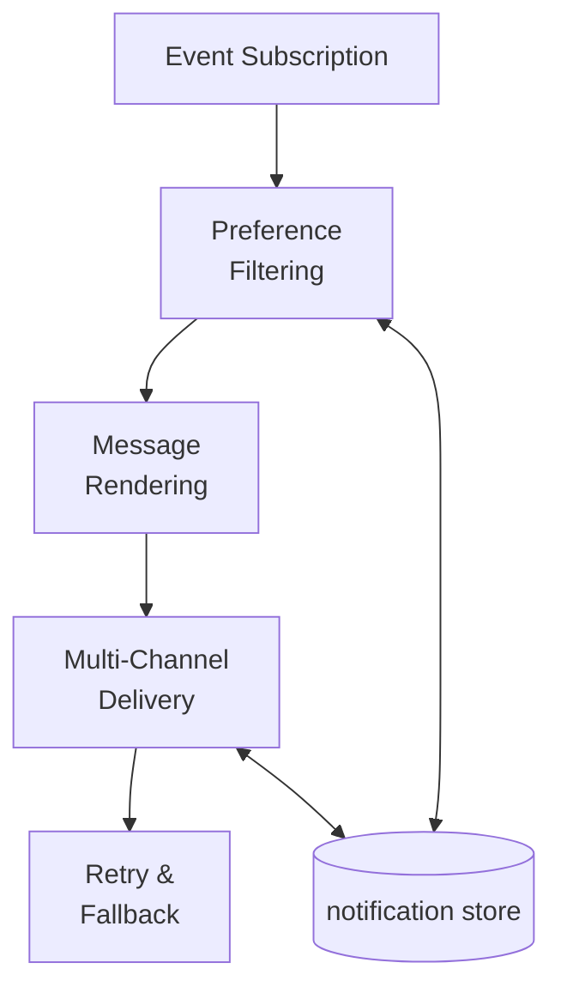
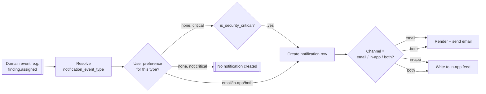
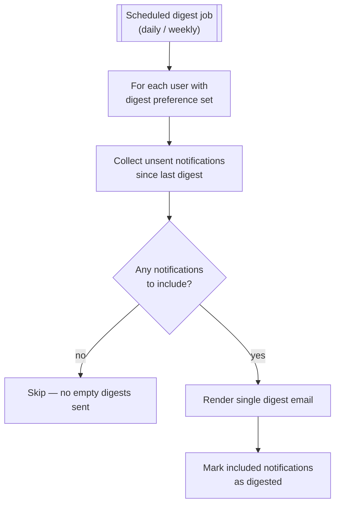
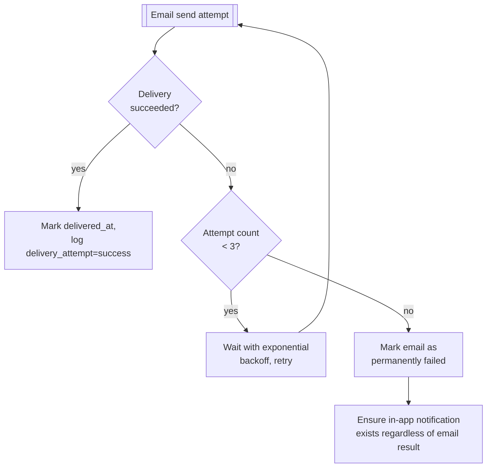

# Notifications

## Purpose

Delivers platform events to the right person through the right channel — email and in-app — and
lets each user control what they receive. Every other module emits events onto the bus; this
module is the only one that turns an event into something a human sees.

## Actors & permissions

| Actor | Interacts with this module as |
|---|---|
| Any platform user | Receives notifications, manages own preferences |
| Firm Admin | Configures firm-level notification defaults |

## Functional features

| ID | Feature | Description | Acceptance criteria |
|---|---|---|---|
| FEAT-NOTIF-001 | Event catalogue subscription | Module subscribes to the platform event bus | New event types require a registry entry, not code scattered across producers — e.g. `intake.uploaded` from [Client Intake Portal](./15-client-intake) notifies the CA without polling |
| FEAT-NOTIF-002 | Email delivery | Transactional email for key events | Delivered within 1 minute of the triggering event under normal load |
| FEAT-NOTIF-003 | In-app notifications | Bell-icon feed within the product | Read/unread state tracked per user |
| FEAT-NOTIF-004 | Per-user preferences | User chooses which event types trigger email vs in-app-only vs none | Security-critical events (e.g. new login, password change) cannot be fully disabled |
| FEAT-NOTIF-005 | Digest mode | Daily/weekly rollup instead of per-event email | Digest respects the same preference filtering as immediate delivery |
| FEAT-NOTIF-006 | Firm-level defaults | Admin sets default preferences for new users | New user inherits firm defaults, can override individually |
| FEAT-NOTIF-007 | Delivery retry | Failed email delivery retried with backoff | 3 retries; permanent failure logged and surfaced to the user's in-app feed as a fallback |
| FEAT-NOTIF-008 | Unsubscribe compliance | One-click unsubscribe link on marketing-adjacent emails | Does not apply to strictly transactional/security emails |

## Business rules & constraints

- **BR-NOTIF-01**: Security-critical notifications (new device login, password/MFA change,
  impersonation started) are always delivered regardless of preference settings — see
  [Auth & Identity](./01-auth-identity).
- **BR-NOTIF-02**: Notification delivery never blocks the originating action — an email failure
  does not roll back the underlying state change (e.g. a finding is still assigned even if the
  notification email bounces).
- **BR-NOTIF-03**: In-app notifications are retained for a minimum period regardless of email
  preference, so a user who disabled email can still see history in-product.

## Data model

| Entity | Key fields | Scope |
|---|---|---|
| `notification_event_type` | `id`, `category`, `default_channel`, `is_security_critical` | Global |
| `notification_preference` | `user_id`, `event_type_id`, `channel` | Global |
| `notification` | `id`, `user_id`, `event_type_id`, `payload`, `read_at`, `delivered_at` | Tenant |
| `delivery_attempt` | `id`, `notification_id`, `channel`, `status`, `attempted_at` | Tenant |

## API surface

| Method | Path | Purpose | Auth scope |
|---|---|---|---|
| GET | `/notifications` | List current user's notifications | Any authenticated user |
| PATCH | `/notifications/{id}/read` | Mark as read | Owning user |
| GET | `/notifications/preferences` | Get current preferences | Any authenticated user |
| PATCH | `/notifications/preferences` | Update preferences | Any authenticated user |
| PATCH | `/tenants/current/notification-defaults` | Set firm-level defaults | Admin role |

## DFD Level 0

## DFD Level 1

## DFD Level 2 — Event to Delivery Pipeline

## DFD Level 2 — Digest Assembly

## DFD Level 3 — Delivery Retry & Fallback

## Edge cases & failure modes

| Condition | System behavior |
|---|---|
| User disables email entirely for a non-critical event type | In-app notification still created per BR-NOTIF-03 |
| Event arrives for a user who was removed from the tenant | Notification is not created; no delivery attempt |
| Digest job runs while a user has zero eligible notifications | No email sent for that user (per L2 diagram above) |
| Email provider outage lasting beyond all 3 retries | In-app fallback still present; permanent failure surfaced to an internal ops alert |

## Out of scope

- SMS/push notification channels — email + in-app only for v1.
- User-authored notification rules (e.g. "notify me only for findings over ₹1L") — preferences are
  by event type/channel only, not conditional filtering on event content.
