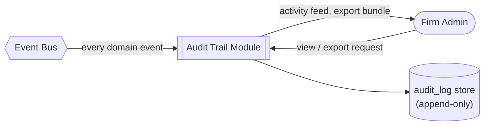
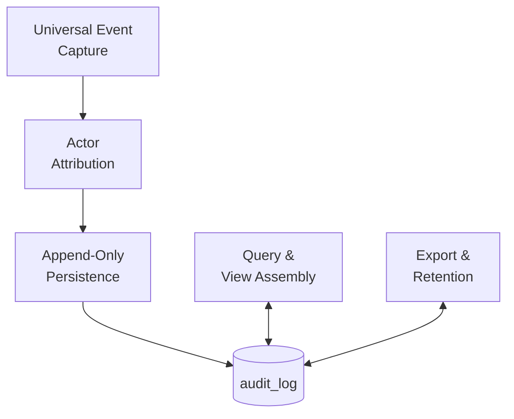
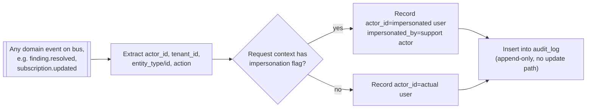
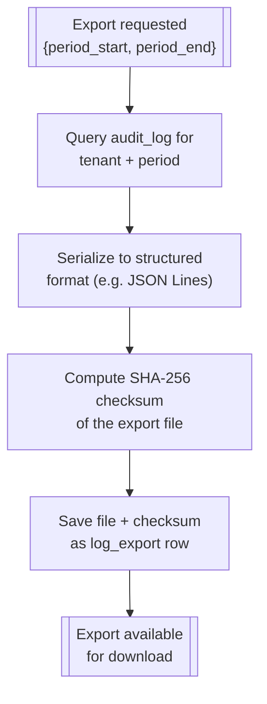
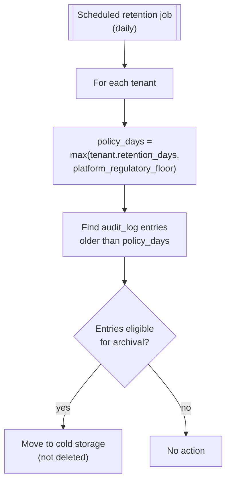

# Audit Trail & Compliance

:::caution Earlier module sketch — reconcile before implementation
This page documents an earlier India-first design. The [canonical solution architecture](../architecture/solution-architecture.md), [domain model](../architecture/domain-model-v2.md), [review contract](../architecture/signoff-contract.md), and [decision records](../architecture/decision-records.md) override contradictory details in this module. It is a **reference use case**, not executable functionality.
:::

## Purpose

Owns durable, attributable evidence of meaningful changes. A best-effort **event-bus subscriber alone is insufficient** to guarantee it: a business mutation, audit record and outbox entry must commit atomically, followed by idempotent delivery. Separate hash-verified exports from the security of underlying source history; see [Solution Architecture](../architecture/solution-architecture.md).

Owns the immutable, append-only record of who did what, when, across every module — the record
that makes the platform itself defensible under review, distinct from the audit *findings* the
platform produces for the client's books. Every event on the platform bus is captured here.

## Actors & permissions

| Actor | Interacts with this module as |
|---|---|
| Firm Admin | Views the firm's activity log, exports for compliance |
| Platform Operator | Investigates platform-wide security events |

## Functional features

| ID | Feature | Description | Acceptance criteria |
|---|---|---|---|
| FEAT-AUD-001 | Universal event capture | Every state-changing action across all modules logged | New modules are onboarded to the bus, not individually wired into this module |
| FEAT-AUD-002 | Append-only storage | Log entries are never updated or deleted by application code | Enforced at the database level (no UPDATE/DELETE grants on the log table) |
| FEAT-AUD-003 | Actor attribution | Every entry records who (or what impersonation context) performed the action | Impersonated actions record both the support actor and the impersonated user |
| FEAT-AUD-004 | Entity-scoped log view | View full history for one entity (e.g. one finding, one engagement) | Chronological, includes cross-module actions on that entity |
| FEAT-AUD-005 | Tenant activity log | Firm-wide chronological activity feed | Filterable by actor, action type, date range |
| FEAT-AUD-006 | Retention policy | Logs retained per tenant's configured/regulatory retention period | Retention cannot be set below the platform's regulatory floor |
| FEAT-AUD-007 | Regulator export | Structured export of the full log for a period | Includes a hash/checksum for tamper-evidence |
| FEAT-AUD-008 | Security event flagging | Certain actions (impersonation, permission escalation, mass export) flagged distinctly | Surfaced to Platform Operator view in near real time |

## Business rules & constraints

- **BR-AUD-01**: No application code path has UPDATE or DELETE privilege on the audit log table —
  it is append-only at the database grant level, not just by convention.
- **BR-AUD-02**: An entry, once written, is retained for at least the platform's regulatory floor
  even if a tenant's configured retention would otherwise be shorter.
- **BR-AUD-03**: Impersonation actions (see [Auth & Identity](./01-auth-identity)) always record
  both the impersonating support actor and the impersonated user, never one or the other alone.
- **BR-AUD-04**: The audit log itself is tenant-isolated, same as every other tenant-scoped table
  — a firm can never see another firm's activity log.
- **BR-AUD-05**: Not every actor is a `user`. A [client intake link](./15-client-intake) upload has
  no logged-in user behind it; `actor_type` records this so `FEAT-AUD-003` attribution still holds
  without inventing a synthetic user row.

## Data model

| Entity | Key fields | Scope |
|---|---|---|
| `audit_log` | `id`, `tenant_id`, `actor_type`, `actor_id`, `impersonated_by`, `action`, `entity_type`, `entity_id`, `metadata`, `occurred_at` | Tenant |
| `retention_policy` | `tenant_id`, `retention_days` | Tenant |
| `log_export` | `id`, `tenant_id`, `period_start`, `period_end`, `file_path`, `checksum` | Tenant |

## API surface

| Method | Path | Purpose | Auth scope |
|---|---|---|---|
| GET | `/audit-log` | Tenant activity feed | Admin role |
| GET | `/audit-log/entity/{type}/{id}` | Entity-scoped history | Assigned user |
| POST | `/audit-log/export` | Request regulator export | Admin role |
| GET | `/admin/security-events` | Platform-wide flagged events | Platform Operator |

## DFD Level 0

## DFD Level 1

## DFD Level 2 — Universal Capture

## DFD Level 2 — Regulator Export

## DFD Level 3 — Retention Enforcement

Even past the retention window, entries move to cold storage rather than being deleted — per
BR-AUD-02 the regulatory floor governs actual deletion eligibility, which is a separate,
longer-horizon process outside this job's scope.

## Edge cases & failure modes

| Condition | System behavior |
|---|---|
| Event bus delivers the same event twice (at-least-once delivery) | Log write is idempotent keyed on event ID — duplicate delivery produces one log entry, not two |
| Tenant sets retention_days below the regulatory floor | Config API rejects the value; floor is enforced at write time, not just documented |
| Export requested for a period with zero events | Export still generated, contains an empty but validly-checksummed file |

## Out of scope

- Real-time SIEM integration / external log shipping — v1 keeps the log in-platform; export covers
  the compliance handover case.
- User-facing log tampering detection UI — checksum exists for regulator verification, not as an
  in-product tamper-alert feature.
