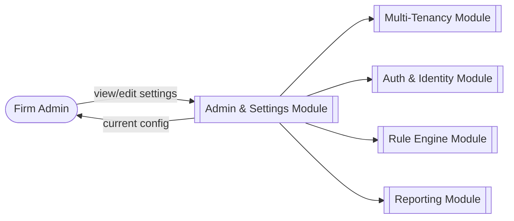
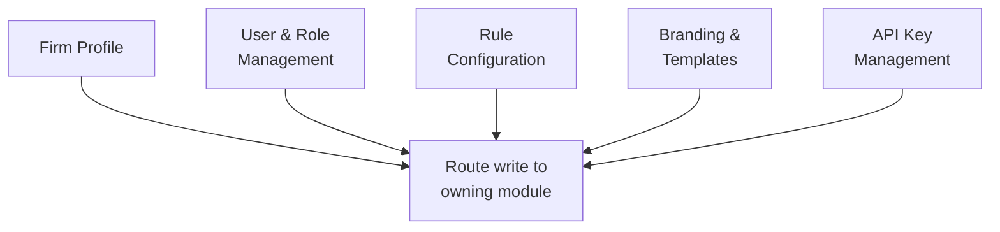
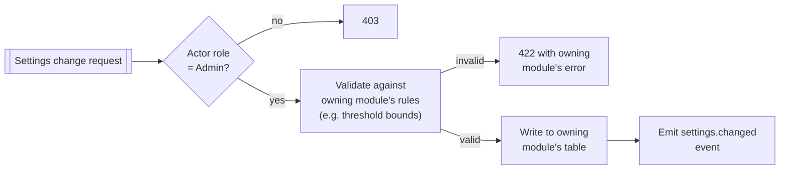
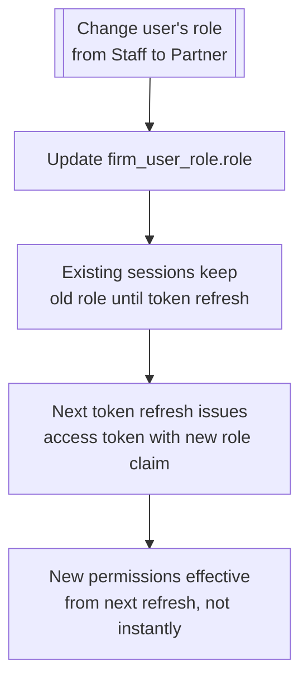
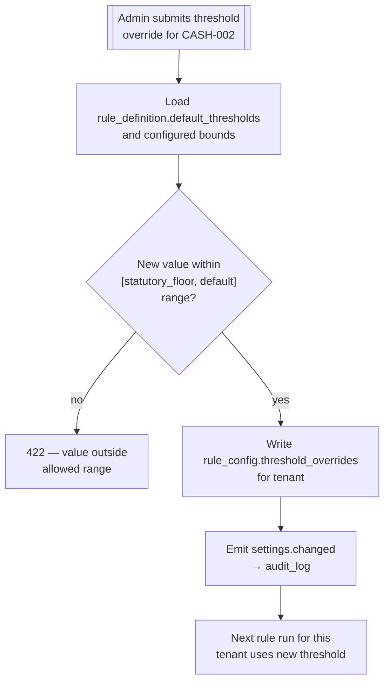

# Admin & Settings

## Purpose

Owns the configuration surface a Firm Admin uses to run the firm's account: firm profile, user and
role management, rule configuration, templates/branding, and API key issuance. This module is
mostly a UI/API front door onto configuration state that other modules actually enforce.

## Actors & permissions

| Actor | Interacts with this module as |
|---|---|
| Firm Admin | Full access to all settings |
| Engagement Partner | Read access to firm settings, no write |
| Audit Staff | No access |

## Functional features

| ID | Feature | Description | Acceptance criteria |
|---|---|---|---|
| FEAT-ADM-001 | Firm profile | Name, address, registration details | Used on generated letterhead and invoices |
| FEAT-ADM-002 | User management | List, invite, deactivate, change role for firm users | Delegates invitation to [Auth & Identity](./01-auth-identity) |
| FEAT-ADM-003 | Role assignment | Assign Admin / Partner / Staff roles per user | See [Reference → Roles & Permissions](../reference/roles-permissions) for the full matrix |
| FEAT-ADM-004 | Rule configuration | Enable/disable rules, set threshold overrides | Delegates enforcement to [Rule Engine](./07-rule-engine) |
| FEAT-ADM-005 | Branding/letterhead | Logo, letterhead layout for generated documents | Delegates rendering to [Reporting](./09-reporting-query-letters) |
| FEAT-ADM-006 | Notification defaults | Firm-wide default notification preferences | Delegates to [Notifications](./11-notifications) |
| FEAT-ADM-007 | API key management | Issue/revoke API keys for integrations | Delegates issuance to [Auth & Identity](./01-auth-identity) |
| FEAT-ADM-008 | Retention configuration | Set data/log retention within regulatory bounds | Delegates enforcement to [Audit Trail](./12-audit-trail-compliance) |
| FEAT-ADM-009 | Settings change audit | Every settings change recorded | Every write in this module emits an event captured by [Audit Trail](./12-audit-trail-compliance) |

## Business rules & constraints

- **BR-ADM-01**: This module never duplicates enforcement logic — it is a configuration surface
  whose values are read and enforced by the owning module (Rule Engine reads rule_config, Auth
  reads api_key, etc.). Settings changes here have no effect unless the owning module honors them.
- **BR-ADM-02**: Only the Admin role can change settings; Partner role is read-only here, distinct
  from Partner's write access within engagements.
- **BR-ADM-03**: Every settings change is itself an auditable event — this module has no
  "unlogged" configuration path.

## Data model

This module is primarily a UI/API aggregation layer over entities owned elsewhere:

| Entity | Owning module |
|---|---|
| `tenant_config`, `firm_branding` | [Multi-Tenancy](./02-multi-tenancy) / [Reporting](./09-reporting-query-letters) |
| `firm_user_role` | [Multi-Tenancy](./02-multi-tenancy) |
| `rule_config` | [Rule Engine](./07-rule-engine) |
| `api_key` | [Auth & Identity](./01-auth-identity) |
| `retention_policy` | [Audit Trail & Compliance](./12-audit-trail-compliance) |

## API surface

| Method | Path | Purpose | Auth scope |
|---|---|---|---|
| GET | `/settings/firm-profile` | Fetch firm profile | Admin / Partner (read) |
| PATCH | `/settings/firm-profile` | Update firm profile | Admin role |
| GET | `/settings/users` | List firm users + roles | Admin / Partner (read) |
| PATCH | `/settings/users/{id}/role` | Change a user's role | Admin role |
| GET | `/settings/rules` | View rule configuration | Admin / Partner (read) |
| PATCH | `/settings/rules/{rule_id}` | Update rule config | Admin role |

## DFD Level 0

## DFD Level 1

## DFD Level 2 — Settings Write with Delegated Enforcement

## DFD Level 2 — Role Change Cascade

## DFD Level 3 — Rule Threshold Override Validation

This mirrors the bound check already described in
[Rule Engine → BR-RULE-03](./07-rule-engine#business-rules--constraints) — Admin & Settings is the
UI surface for it, not a second implementation of the rule.

## Edge cases & failure modes

| Condition | System behavior |
|---|---|
| Last remaining Admin tries to demote themselves | Blocked — a tenant must always retain at least one Admin |
| Rule config change submitted while a rule run is in progress | Applied to the config table immediately; the in-progress run finishes with the thresholds it started with, next run uses the new value |
| Branding update with an invalid image format | 422 at upload, not accepted and silently broken at render time |

## Out of scope

- Granular custom roles / permission builder — three fixed roles (Admin, Partner, Staff) for v1,
  see [Reference → Roles & Permissions](../reference/roles-permissions).
- White-labeling the platform itself (custom domain, custom platform branding beyond
  document letterhead) — out of scope, see [Multi-Tenancy](./02-multi-tenancy#out-of-scope).
