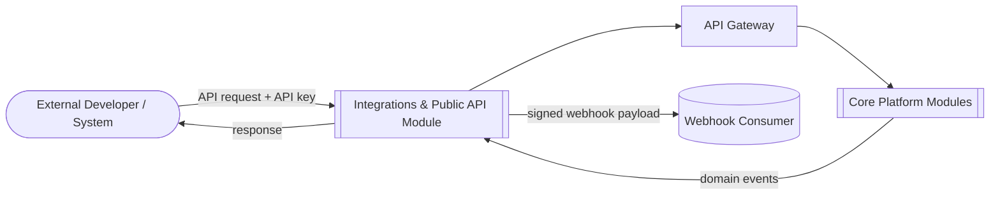
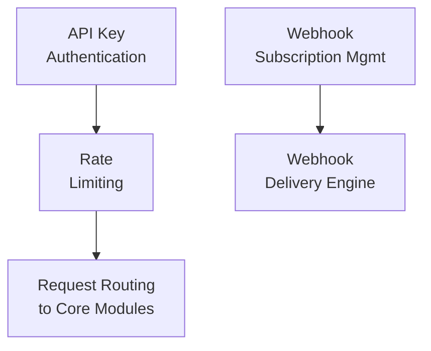
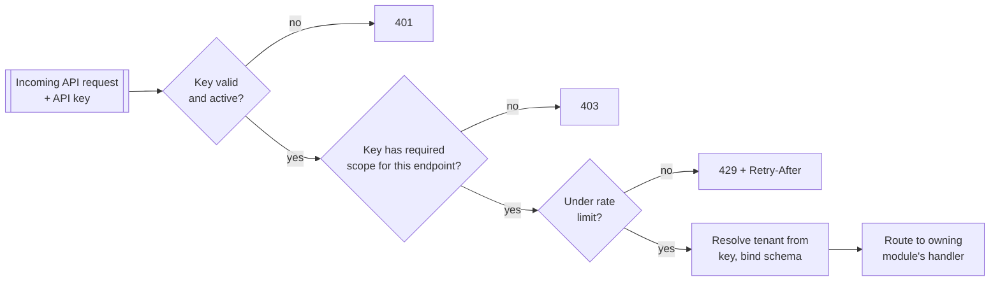
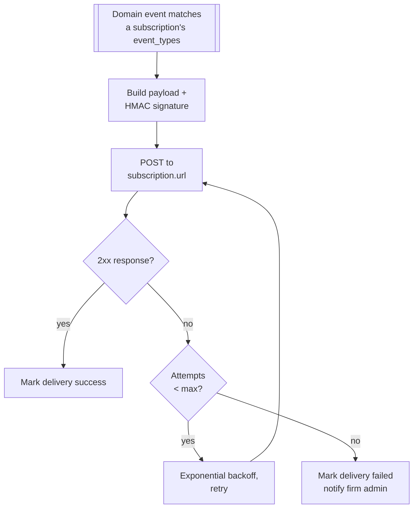
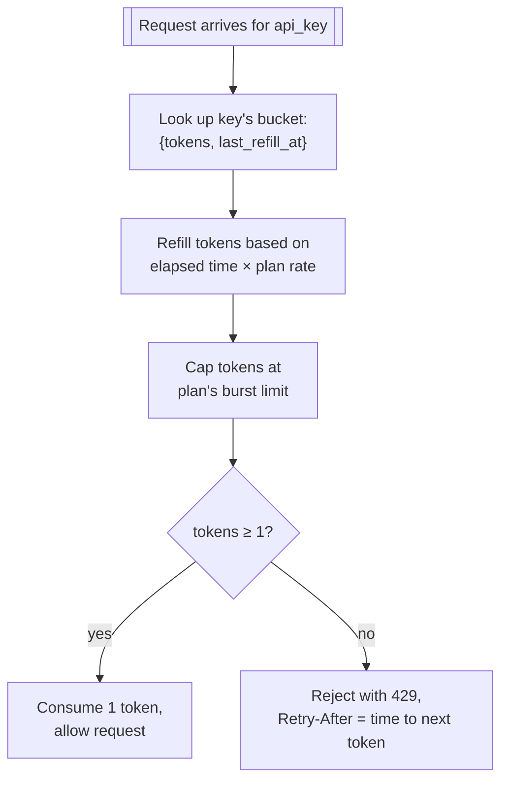

# Integrations & Public API

## Purpose

Exposes the platform to external systems: a documented REST API for programmatic access, outbound
webhooks for event notification, and connector-specific handling for the GST portal and Tally
data sources beyond simple file upload.

## Actors & permissions

| Actor | Interacts with this module as |
|---|---|
| External developer (firm's own tooling) | Calls the public API using an API key |
| Webhook consumer | Receives outbound event notifications |

## Functional features

| ID | Feature | Description | Acceptance criteria |
|---|---|---|---|
| FEAT-INT-001 | Public REST API | Documented, versioned API covering engagements, uploads, findings, reports | OpenAPI spec published; breaking changes only in a new version |
| FEAT-INT-002 | API key authentication | Service-account auth distinct from user login | Key scoped to specific permissions, see [Auth & Identity](./01-auth-identity) |
| FEAT-INT-003 | Rate limiting | Per-key request limits by plan tier | 429 returned with a `Retry-After` header when exceeded |
| FEAT-INT-004 | Outbound webhooks | Subscribe to platform events (e.g. `rules.completed`) | Delivered with signed payload; retried on non-2xx response |
| FEAT-INT-005 | Webhook management | Register/test/delete webhook endpoints | Test-send feature lets a developer verify their endpoint before relying on it |
| FEAT-INT-006 | GST portal connector | Structured handling of GSTR-2B beyond raw file upload | Validates the file is a genuine GST portal export before parsing |
| FEAT-INT-007 | Tally connector groundwork | Defined interface for a future direct Tally integration | Ingestion's event schema already names fields generically enough to support a non-file source later |
| FEAT-INT-009 | Client intake links | Non-API-key, non-file-only ingress for client-submitted uploads | See [Client Intake Portal](./15-client-intake) — a separate token type, not an `api_key` |
| FEAT-INT-008 | API usage analytics | Per-key request volume and error rate | Surfaced to the firm admin alongside billing usage |

## Business rules & constraints

- **BR-INT-01**: Every API request is subject to the same tenant isolation and role checks as the
  equivalent UI action — the public API is not a back door around access control.
- **BR-INT-02**: Webhook payloads are signed (HMAC) so a consumer can verify the request
  genuinely originated from the platform.
- **BR-INT-03**: A failed webhook delivery is retried with backoff for a bounded period, then
  marked failed and surfaced to the firm admin — it does not retry indefinitely.
- **BR-INT-04**: Rate limits are enforced per API key, not per tenant globally, so one integration
  hitting its limit doesn't starve another integration on the same tenant.

## Data model

| Entity | Key fields | Scope |
|---|---|---|
| `api_key` | `id`, `tenant_id`, `key_hash`, `scopes`, `rate_limit_tier` | Global (see [Auth & Identity](./01-auth-identity)) |
| `webhook_subscription` | `id`, `tenant_id`, `url`, `event_types`, `secret` | Tenant |
| `webhook_delivery` | `id`, `subscription_id`, `event_id`, `status`, `attempted_at`, `response_code` | Tenant |

## API surface

| Method | Path | Purpose | Auth scope |
|---|---|---|---|
| GET | `/api/v1/engagements` | List engagements | API key |
| POST | `/api/v1/engagements/{id}/uploads` | Upload a file | API key |
| GET | `/api/v1/findings` | List findings | API key |
| POST | `/webhooks` | Register a webhook | Admin role |
| POST | `/webhooks/{id}/test` | Send a test delivery | Admin role |
| DELETE | `/webhooks/{id}` | Remove a webhook | Admin role |
| GET | `/settings/api-usage` | Per-key usage analytics | Admin role |

## DFD Level 0

## DFD Level 1

## DFD Level 2 — API Request Path

## DFD Level 2 — Webhook Delivery

## DFD Level 3 — Rate Limit Token Bucket

## Edge cases & failure modes

| Condition | System behavior |
|---|---|
| API key revoked while a webhook subscription tied to it still exists | Webhook subscription is disabled, not silently orphaned — admin notified |
| Webhook endpoint returns 3xx redirect | Treated as non-2xx, triggers retry — redirects are not followed |
| GST portal file uploaded via public API is not a genuine GSTR-2B export | Rejected at the same validation point as UI upload, see [Ingestion](./05-document-ingestion) |

## Out of scope

- GraphQL API — REST only for v1.
- Direct, credential-based live pull from Tally software (rather than file export) — the connector
  groundwork (FEAT-INT-007) defines the interface; the live-pull integration itself is not built.
- Marketplace/app-store for third-party integrations — webhooks and API keys are the extension
  point; no integration marketplace exists.
