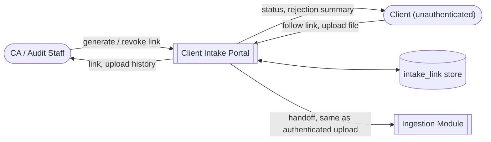
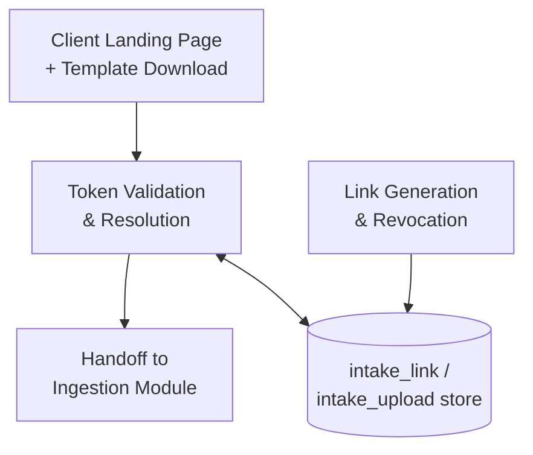
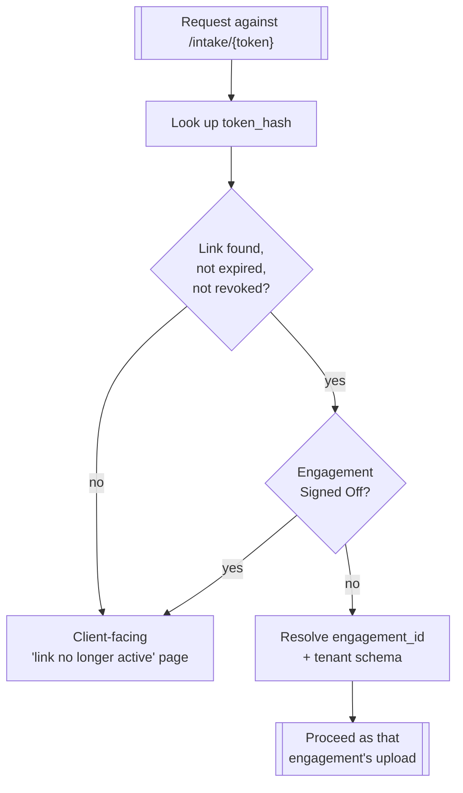
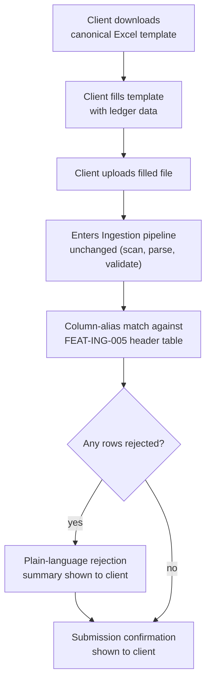

# Client Intake Portal

## Purpose

Shortens the collection loop between an audit firm and the client whose books it audits. A CA
generates a tokenized, engagement-scoped upload link and sends it to the client; the client
uploads their Tally XML / Excel / GSTR-2B files directly, with no platform account of their own.
This is a thin surface on [Document Ingestion](./05-document-ingestion) — it adds no parser, no
storage path, and no new role; it only adds a way for the raw files to arrive without passing
through the CA's own machine first. It also lets the firm hand the client a known-good Excel
template, so [FEAT-ING-005](./05-document-ingestion#functional-features)'s column-alias matching
lands cleanly instead of guessing at ad hoc headers.

## Actors & permissions

| Actor | Interacts with this module as |
|---|---|
| Firm Admin / Partner / assigned Staff | Generates, views, and revokes intake links for an engagement |
| Client (unauthenticated) | Follows a link, downloads the template, uploads files — holds no platform account |

## Functional features

| ID | Feature | Description | Acceptance criteria |
|---|---|---|---|
| FEAT-CIP-001 | Link generation | Create a single-use-scope, engagement-bound upload link | Link resolves to exactly one `engagement_id`; never lists or infers other engagements |
| FEAT-CIP-002 | Link expiry & revocation | Links expire automatically or can be revoked early | Expired/revoked token returns a client-facing "link no longer active" page, not a 401/500 |
| FEAT-CIP-003 | Canonical upload template | Downloadable Excel template with the columns Normalization expects | Column headers match the alias table in [FEAT-ING-005](./05-document-ingestion#functional-features) exactly |
| FEAT-CIP-004 | Token-based upload | Client uploads a file using only the link, no login | File enters the same pipeline as an authenticated upload — same scan, same parse, same rejection reporting |
| FEAT-CIP-005 | Upload history for the firm | CA sees what's been submitted against a link, in real time | Visible on the engagement dashboard alongside other uploads |
| FEAT-CIP-006 | Client-facing rejection summary | Client sees a plain-language summary of any rejected rows after upload | No internal error codes or stack traces exposed to an unauthenticated party |
| FEAT-CIP-007 | Submission confirmation | Client gets a simple "received" status after uploading | No further platform access implied or offered |

## Business rules & constraints

- **BR-CIP-01**: A token grants upload-only access to exactly one engagement. It can never read
  findings, transactions, other uploads, or any other engagement — enforced the same way as
  `architecture/cross-cutting.md` requires for authenticated tokens: resolved server-side from the
  token, never trusted from a client-supplied engagement ID.
- **BR-CIP-02**: A link is auto-revoked when its engagement reaches Signed Off
  ([FEAT-ENG-006](./04-engagements#functional-features) makes the engagement read-only) — a live
  link against a locked engagement would otherwise 409 confusingly for the client.
- **BR-CIP-03**: Token uploads pass through the identical virus scan
  ([FEAT-ING-002](./05-document-ingestion#functional-features)) and plan-tier size limits as
  authenticated uploads. Untrusted origin doesn't relax the pipeline, it's the reason the pipeline
  exists.
- **BR-CIP-04**: Token uploads are rate-limited per link, independent of the tenant's own API rate
  limits, so a single leaked or scripted link can't be used to hammer ingestion.

## Data model

| Entity | Key fields | Scope |
|---|---|---|
| `intake_link` | `id`, `engagement_id`, `token_hash`, `created_by`, `expires_at`, `revoked_at`, `status` | Tenant |
| `intake_upload` | `id`, `intake_link_id`, `uploaded_file_id`, `submitted_at`, `source_ip` | Tenant |

`token_hash` only — the token itself is never stored, mirroring `api_key.key_hash` in
[Integrations & Public API](./14-integrations-api#data-model).

## API surface

| Method | Path | Purpose | Auth scope |
|---|---|---|---|
| POST | `/engagements/{id}/intake-links` | Generate a new intake link | Admin / Partner / assigned Staff |
| GET | `/engagements/{id}/intake-links` | List links + their upload history | Assigned user |
| DELETE | `/intake-links/{id}` | Revoke a link | Admin / Partner |
| GET | `/intake/{token}` | Client-facing landing page (template download, upload form) | Token only, unauthenticated |
| POST | `/intake/{token}/uploads` | Client submits a file | Token only, unauthenticated |

## DFD Level 0

## DFD Level 1

## DFD Level 2 — Token Validation & Resolution

## DFD Level 3 — Template-Assisted Upload

## Edge cases & failure modes

| Condition | System behavior |
|---|---|
| Token used after engagement reaches Signed Off | Client sees "link no longer active", not a raw 409 |
| Token guessed/brute-forced | Token is a long random value, hashed at rest; rate limiting (BR-CIP-04) bounds guess attempts |
| Client uploads a file type the pipeline rejects at dispatch | Same client-facing rejection summary as any other dispatch failure ([FEAT-ING-003](./05-document-ingestion#functional-features)) |
| CA revokes a link while a client's upload is mid-flight | In-flight upload completes; the link cannot be used again afterward |
| Client uploads to the same link twice | Same re-upload/versioning behavior as an authenticated upload ([BR-ING-02](./05-document-ingestion#business-rules--constraints)) |

## Out of scope

- Client accounts, login, or multi-year upload history — v1 is a single-use link per engagement,
  generated fresh each time; a persistent client portal is a future iteration, the same way
  [Document Ingestion](./05-document-ingestion#out-of-scope) treats live Tally sync.
- Bookkeeping, invoicing, e-invoicing/IRN, e-way bills, POS — this module moves files, it does not
  become the client's system of record.
- OCR of scanned paper vouchers — inherited from [Document Ingestion](./05-document-ingestion#out-of-scope).
- Client visibility into findings, dashboards, or anything beyond their own upload status.
