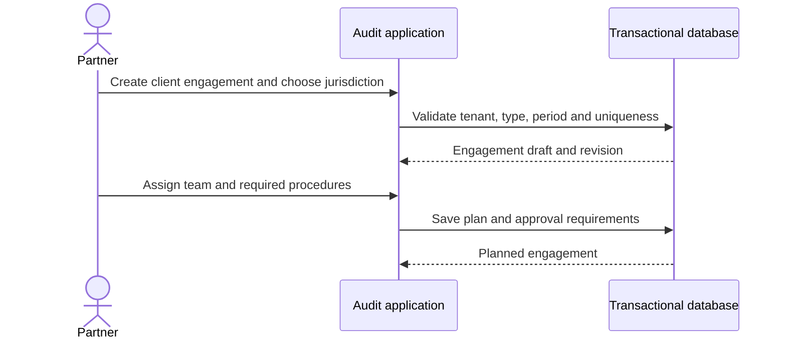

# Monday: The engagement begins

Northstar Audit's manager opens a new engagement for **Aster Components**. The illustrative client reports on an Indian April–March financial year. The manager assigns an engagement partner, two audit staff members, and a reviewer.

The team knows the client will send ledger data. But the first question is not *which rules can we run?* It is *what work must this engagement complete, and who is accountable?*

## The analyst's question

A client, a year and a folder are not enough to represent an audit assignment. Different engagement types, reporting standards and scopes may require different procedures, even for the same client and period.

**Actor goal:** Establish a reviewable engagement with a defined scope, audit plan, accountable personnel and applicable jurisdiction.

## What the analyst records

| Requirement | Reason |
| --- | --- |
| Client, engagement type, governing framework, reporting period and jurisdiction | Avoid duplicate or incorrectly scoped assignments |
| Assigned preparer, reviewer and engagement partner | Separation of duties and traceable responsibility |
| Identified risks, materiality assumptions, planned procedures and required sources | An audit workflow cannot be reduced to exception counts |
| Engagement revision and status history | Prevent stale approvals or invisible changes |
| Authorized access to specific engagements | Staff should not read another client's books merely because they belong to the firm |

The product supports an auditor **recording** professional decisions, not making them autonomously.

## Design choice

Start with a single **modular backend** responsible for identity, engagement planning, evidence, findings and approvals, with workers for slower parsing and rule execution. The modules have clear ownership, but need not be separate network services in v1.

## Failure case

An employee tries to access the engagement using a guessed ID. The server verifies **tenant membership and engagement assignment**, even if a valid JWT is present. A role or a tenant header alone cannot authorize another client's records.

## Acceptance scene

A partner can see **what was planned, who owns each procedure and which records are required** before any automated check begins. A staff member without assignment receives no engagement data.

**Next:** [Tuesday — the missing records](./02-the-missing-records.md) · [Engagement use case](../use-cases/02-create-engagement.md) · [Architecture](../architecture/solution-architecture.md)
