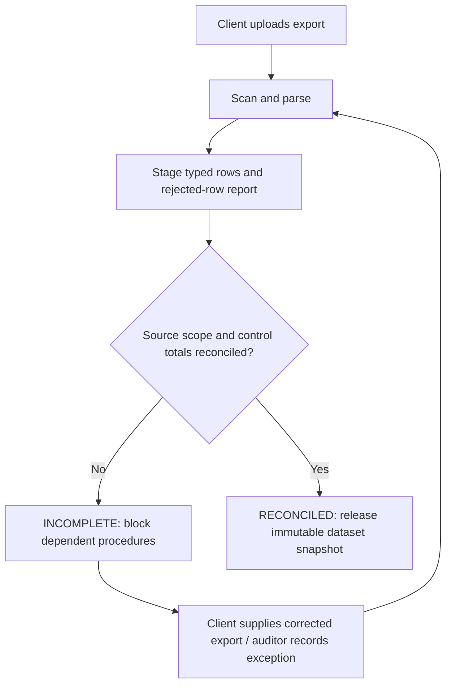

# Tuesday: The file imported successfully

Aster's finance team uploads a digital ledger export. The parser reports **98,600 structurally valid journal lines**, with no malformed rows. A naive interface shows a reassuring green badge.

But the accompanying source-system report says the selected export should contain **100,000 lines**. The numbers are fictional, but the problem is real: **a successful import does not prove a complete population.**

## The analyst's question

What evidence is necessary before an auditor may rely on an imported dataset?

| Concept | Meaning |
| --- | --- |
| **Parse validity** | The file is readable and its records match the expected format |
| **Population completeness** | The intended period, accounts, entities and records were actually included |
| **Accounting reconciliation** | Debit/credit totals, opening/closing balances and/or control totals agree to appropriate source records |
| **Audit suitability** | An authorized auditor judges whether the source and related limitations support the intended procedure |

An exported report can be internally balanced yet incomplete. A Tally voucher can be balanced even if other vouchers are missing.

## Design choice: two different gates

1. **Ingestion gate:** scan file, identify format, parse into typed staging records, report rejected rows and retain the original version/hash.
2. **Population gate:** collect source-system control totals or appropriate reconciliation evidence; reconcile count, amount, period and scope; record discrepancies and reviewer decisions.

The source snapshot receives an explicit state:

`UPLOADED → PARSED → RECONCILIATION_REQUIRED → RECONCILED`, or `REJECTED / INCOMPLETE`.

**Passing the first gate does not pass the second.**

## What the architecture must preserve

The file's cryptographic hash, received timestamp, uploader, source system, reporting period, parser version, original row references, accepted/rejected counts, control totals and reconciliation result are part of the evidence chain. Corrections produce a **new version** rather than destroying the first.

Raw ledger lines, invoices, tax statements and balance summaries are different record types. They should not all be forced into one ambiguous `transaction` row.

## Acceptance scene

The system reports **1,400 unaccounted-for lines** and marks the population incomplete. It does not allow a rule dependent on the full journal population to quietly return a clean result.

**Next:** [Wednesday — a finding is a question](./03-findings-not-verdicts.md) · [Source reconciliation use case](../use-cases/15-reconcile-source-population.md) · [Data model](../architecture/domain-model-v2.md)
