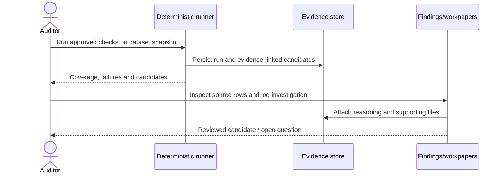

# Wednesday: A rule asks a question

The client supplies the missing data. The audit team reviews the reconciliation and approves a **versioned source snapshot**. A deterministic check now flags an unusual journal entry near the reporting period end.

A flag is not fraud. It is not proof of a tax violation. **It is a question for an auditor.**

## The analyst's question

Can another qualified reviewer reproduce the result, see what was and wasn't tested, and understand why the audit team decided to investigate?

## Design choice: a pinned, explainable run

Each run records its dataset snapshot, mapping version, exact approved jurisdiction pack/rule version, parameters, code version and initiating actor.

A check has a **coverage and execution status** independent of its number of findings:

| Status | Meaning |
| --- | --- |
| COMPLETED | All required inputs and validation prerequisites met; the check executed |
| INSUFFICIENT_DATA | Required inputs/population evidence missing; **not** a clean result |
| FAILED | Execution did not finish successfully |
| NOT_APPLICABLE | Reviewed applicability decision excludes the check |
| SKIPPED | Deliberately disabled, with an authorized, recorded reason |

The execution engine **owns and persists finding candidates**. The Findings module owns assignment, notes, disposition and review. The `rule_run.completed` event notifies consumers after committed results; it does not instruct a second module to recreate those same findings.

## Investigation, not automatic judgment

The auditor may request further documents or write a client query letter. A resolved item retains its original severity, reviewer notes and evidence. A later rerun never silently erases an unresolved issue.

## Example of a rule that needs scrutiny

An India-specific cash-payment check cannot decide that a supplier is a transport operator merely because its **name contains a keyword**. Legal applicability, exemptions and versioned law must be reviewed by professionals. That kind of inference can at most create a tentative classification for investigation.

## Acceptance scene

A second run against the same canonical dataset and rule configuration produces the **same canonical findings and coverage statuses**. The system preserves the audit decisions separately from the deterministic calculation.

**Next:** [Thursday — the review gate](./04-the-review-gate.md) · [Rule execution](../use-cases/06-run-audit-checks.md) · [Sign-off contract](../architecture/signoff-contract.md)
