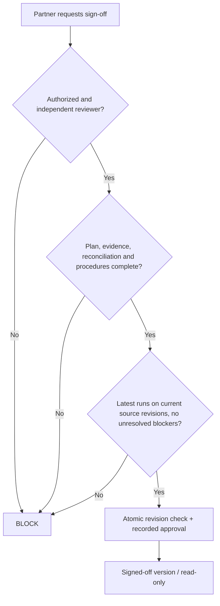

# Thursday: The partner clicks Sign off

The reviewer sees that the flagged journal entry has an explanation and supporting evidence. But one planned cash procedure has not been completed, and a dataset replacement arrived after the last rule run.

The dashboard shows fewer open issues. **That is not a reason to sign off.**

## The analyst's question

What exactly makes an engagement *review-ready*?

Not merely a completed rule run. Not merely zero Critical findings. The partner needs sufficient visibility into what was planned, what evidence was collected, what controls failed, what was excluded, and which procedures remain incomplete.

## Design choice: fail-closed sign-off contract

A sign-off attempt requires all of the following:

- An authorized partner/reviewer with appropriate separation from the work being approved.
- The planned required procedures either **completed with review** or explicitly documented as not applicable/deferred with approved rationale under the firm's methodology.
- Each procedure's underlying source population and reconciliation status acceptable for its purpose.
- Latest approved run(s) completed for the **current engagement revision**, not an older upload snapshot.
- No unresolved blockers: failed/incomplete mandatory checks, critical open issues or outstanding required review comments.
- Source, workpaper, finding and approval versions frozen atomically with the decision.

## Handling corrections

A changed upload or mapping invalidates dependent evaluations. New data produces a new immutable dataset snapshot and a new run. Prior evidence and sign-off history remain inspectable. The system must not treat a later clean run as permission to discard an earlier open explanation or significant judgment.

The partner's sign-off here is a **workflow approval** of the documented work. It is **not itself a statutory audit opinion**.

## Acceptance scene

The attempt is blocked, with a precise reason: *cash procedure incomplete; dataset revision newer than rule run*. A partner can correct the work without losing the history.

**Next:** [Friday — proving what happened](./05-trust-and-evidence.md) · [Review use case](../use-cases/09-partner-sign-off.md) · [Review contract](../architecture/signoff-contract.md)
