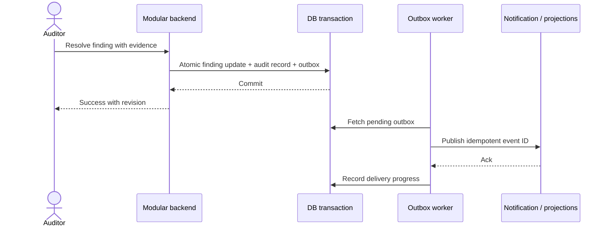

# Friday: Someone asks for the evidence

A reviewer asks: *Which version of the file did the auditor examine? Who changed the ledger classification? What happened when the ingestion worker crashed? Can operations staff see the client's books?*

An audit platform cannot answer these questions by saying *the database has an audit_log table*.

## The analyst's question

How do we make actions attributable, recoverable and inspectable while protecting confidential client material?

## Design choice: transactionally linked evidence

For a business operation such as resolving a finding:

1. Validate the actor, tenant, engagement, role and current revision.
2. Commit the status change **and an outbox event in the same database transaction**.
3. A worker publishes the outbox event with a stable event ID and retry policy.
4. Audit evidence is already anchored in the transaction; notification/indexing consumers are idempotent.
5. Preserve object versions/hashes and independently verify exports rather than relying only on an exported ZIP checksum.

A database grant that blocks ordinary UPDATE/DELETE of an event table is useful, but not by itself proof of tamper resistance against privileged operators. Controls must cover privileged access, retention, backup/restore, verifiable integrity and incident handling.

## Security boundaries

- **User identity:** globally authenticated, with active firm membership verified on every tenant-scoped operation.
- **Data isolation:** firm-bound queries and engagement authorization. If using schema-per-tenant PostgreSQL, set the schema **within a scoped transaction**, never leak connection settings across pooled requests.
- **Support operations:** v1 has no customer-content impersonation; operations work with service metadata and logged break-glass procedures.
- **Billing:** hosted/tokenized payment flows preferred; PCI DSS requirements depend on actual cardholder-data exposure and responsibility.
- **Assurance:** ISO 27001 and SOC 2 are organizational assurance paths, not checkboxes proving the product is certified.

## Acceptance scene

The firm exports a bounded evidence package with file versions, reconciliations, run coverage, reviewer decisions, sign-off revision and an integrity manifest. A support operator cannot use that operation to view another firm's private books.

**Next:** [How this became an architecture](./06-from-story-to-system.md) · [Security design](../architecture/assurance-design.md) · [Data ownership](../architecture/domain-model-v2.md)
