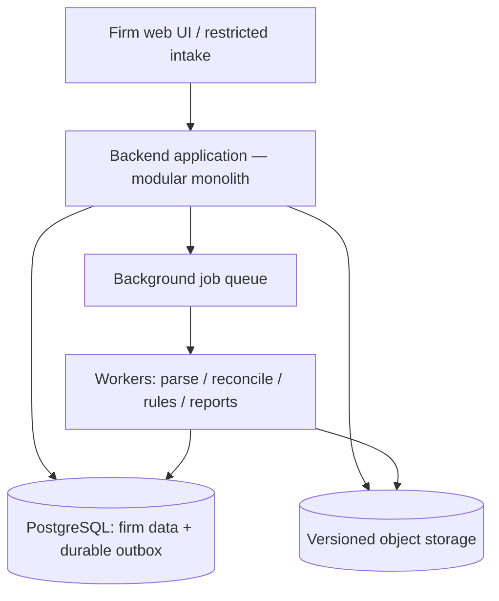

# The system behind the week

The fictional engagement exposed five distinct failures a product must prevent:

| Story event | Failure in a simplistic design | Chosen protection |
| --- | --- | --- |
| Monday: assignment created | File folder mistaken for audit plan | Engagement scope, risks, procedures, ownership |
| Tuesday: partial export | Valid rows mistaken for complete books | Source-population reconciliation and validation gate |
| Wednesday: check flags an entry | A rule treated as a verdict, or a missing input as no finding | Jurisdiction-reviewed rule version, coverage state, linked human review |
| Thursday: partner signs off | Old or incomplete run presented as finished work | Revision-bound, fail-closed sign-off contract |
| Friday: history questioned | Async notification treated as durable audit record | Transactional outbox, evidence/version ledger, restricted access |

## One backend; clear logical modules

A modular monolith is a **deployment choice**, not a ban on later microservices. Keep interfaces explicit so the ingestion and rule workers can scale independently and service boundaries can be extracted when real operational needs justify them.

## Canonical responsibility boundaries

| Logical owner | Creates and maintains |
| --- | --- |
| Identity and tenancy | Global user, firm membership, role policy, session |
| Engagement planning | Client, engagement, required procedures, responsibilities |
| Source ingestion | Immutable uploads, parsing outcomes, typed dataset revisions |
| Reconciliation | Population scope, control totals, discrepancies and reviewer decisions |
| Rule execution | Rule-run records, per-check coverage, evidence-linked finding candidates |
| Findings/workpapers | Assignments, investigation notes, dispositions, procedure results |
| Review | Readiness gate, approvals, frozen signed-off revision |
| Platform assurance | Durable audit evidence, integrity checks, operations/security evidence |

The physical database schema should reflect these boundaries even when tables share one deployable application.

## What is intentionally excluded

No autonomous financial-statement opinion, no universal legal rule engine, no real-world ISO/SOC 2 certification claim, no AI in core arithmetic, and no public integration marketplace in the initial pilot.

## Build order driven by risk

**First:** one engaged firm, one representative data source, population reconciliation and reproducible evidence. **Then:** deterministic checks and documented investigation. **Then:** approval gates and an evidence package. Billing, tenant onboarding automation, external APIs and extra jurisdiction packs follow validation.

Read the [solution architecture](../architecture/solution-architecture.md), [domain model](../architecture/domain-model-v2.md), [decision records](../architecture/decision-records.md), and [requirements traceability](../reference/requirements-traceability.md).

**The intended outcome is better evidence and decisions—not a claim that software has conducted an audit on behalf of a qualified professional.**
