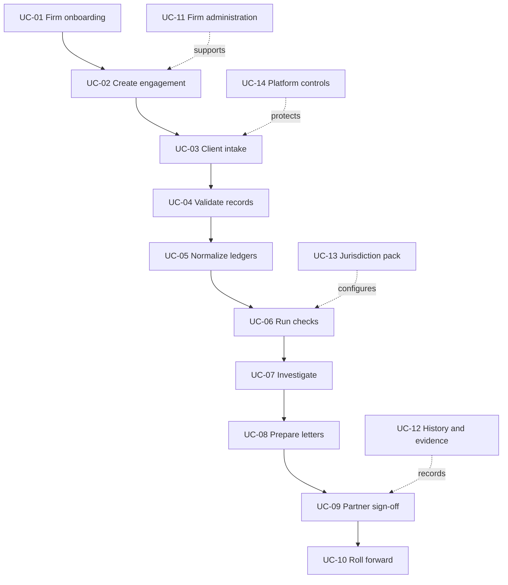

# Use-Case Catalogue

These use cases are a **supporting reference catalogue** for the continuous [engagement story](../intro.md), [solution architecture](../architecture/solution-architecture.md) and [canonical sign-off contract](../architecture/signoff-contract.md). The scenarios are proposed and some legacy module details remain India-specific.

A use case states **what an actor wants to achieve**, the initiating event, conditions, main steps, possible exceptions and verifiable result. These are **proposed** behaviours, not implementation/test reports.

## System boundary

**Inside:** firm workspace, identity and role checks, engagements, jurisdiction pack selection, digital intake, validation, mappings, rule execution, findings, query documents, sign-off, audit trail and security-control evidence.

**Outside:** client accounting systems, jurisdictional tax/reporting systems (India's GST portal is one example), payment/email providers, and independent assessors. Clients do not need full platform accounts in the proposed v1. The platform does not issue audit opinions or conclusively determine legal violations.

## End-to-end flow

## Actors and scenario catalogue

| ID | Main actor | User goal | Scenario |
| --- | --- | --- | --- |
| UC-01 | Firm Admin | Establish a secure firm workspace | [Firm onboarding](./01-firm-onboarding.md) |
| UC-02 | Engagement Partner | Start an audit for a client and FY | [Create engagement](./02-create-engagement.md) |
| UC-03 | Auditor + Client Representative | Submit digital records safely | [Client intake](./03-client-intake.md) |
| UC-04 | Audit Staff | Identify and handle invalid records | [Validate records](./04-validate-records.md) |
| UC-05 | Audit Staff | Categorize heterogeneous ledgers | [Normalize ledgers](./05-normalize-ledgers.md) |
| UC-06 | Audit Staff | Identify reproducible review candidates | [Run audit checks](./06-run-audit-checks.md) |
| UC-07 | Audit Staff | Investigate and document exceptions | [Investigate findings](./07-investigate-findings.md) |
| UC-08 | Audit Staff | Request client clarification in writing | [Prepare query letters](./08-prepare-query-letters.md) |
| UC-09 | Engagement Partner | Review and authorize sign-off | [Partner sign-off](./09-partner-sign-off.md) |
| UC-10 | Engagement Partner | Open next-year engagement | [Roll forward](./10-roll-forward.md) |
| UC-11 | Firm Admin | Control team, plans and settings | [Firm administration](./11-firm-administration.md) |
| UC-12 | Partner/Admin | Reconstruct evidence and decisions | [Evidence and history](./12-evidence-and-audit-history.md) |
| UC-13 | Partner | Select an approved and date-effective jurisdiction rule pack | [Jurisdiction configuration](./13-configure-jurisdiction.md) |
| UC-14 | Security Owner | Review controls, evidence, and payment scope | [Assurance evidence review](./14-control-evidence-review.md) |
| UC-15 | Audit Staff / Reviewer | Validate an imported accounting population | [Reconcile imported sources](./15-reconcile-source-population.md) |
| UC-16 | Auditor / Partner | Plan required audit procedures and review decisions | [Plan and review audit work](./16-plan-audit-procedures.md) |

## Shared success conditions

1. Authorization is scoped to the authenticated firm and assigned engagements.
2. Invalid inputs are rejected with explainable reasons; they are not silently discarded.
3. Findings are traceable to an input snapshot, rule/version and supporting transactions.
4. A flag is a **candidate for human review**, not proof of a statutory violation.
5. Resolution and final sign-off have accountable human actors and durable records.
6. Retention periods, statutory thresholds, and performance targets are **proposed assumptions** subject to review and testing.
7. India-only rules are never executed for unsupported jurisdictions; effective dates, approvals and legal references are pinned per run.
8. Controls protecting the platform are separate from statutory financial audit rules; ISO/SOC 2/PCI references are **not** compliance or certification claims.

For the design behind these scenarios, see the [proposed architecture](../architecture/system-context.md), [detailed specifications](../modules/04-engagements.md), and [illustrative rule catalogue](../reference/statutory-rules.md).
